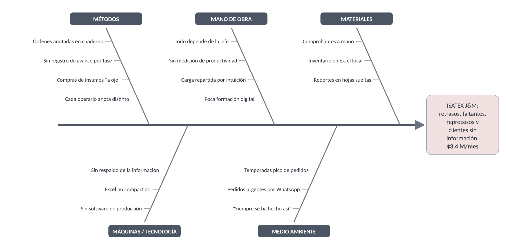
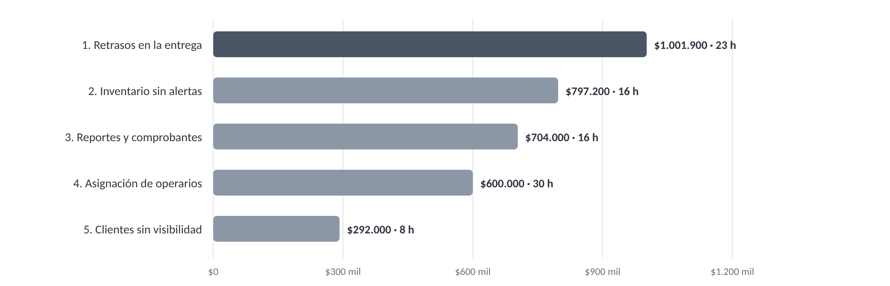

# 02.1 ANÁLISIS DEL PROBLEMA
## Texticode — ISATEX J&M S.A.S

> **Cómo leer este documento.** Este es el análisis del problema de **ISATEX J&M S.A.S**, la empresa de confecciones a la que va dirigida la propuesta comercial de Texticode. Como todavía no hay mediciones internas de la empresa, el tamaño de su operación se fijó con **supuestos preliminares** (sección 1.3), que se validarán con ISATEX en la fase de análisis y validación de requisitos. Cada cifra muestra su fórmula y los ejemplos son ilustrativos. La propuesta comercial usa estos mismos resultados, redondeados.

---

## 1. Contexto del negocio

### 1.1 La empresa

| Aspecto | Descripción |
|---------|-------------|
| **Razón social** | ISATEX J&M S.A.S · NIT 901.579.899-8 |
| **Persona de contacto** | Diana María Gómez Vaca, Jefe (dirige la operación y la administración) |
| **Ciudad** | Bogotá D.C. |
| **Actividad** | Confección de prendas por encargo para clientes empresariales y marcas *(tipo de prenda por validar)* |
| **Modelo de venta** | Por orden de producción (pedido), con fecha de entrega pactada y comprobante de entrega |
| **Personal** *(supuesto)* | La jefe, que también administra, y 6 operarios de planta (corte, confección y terminación) |
| **Clientes** *(supuesto)* | 15 clientes activos |
| **Volumen** *(supuesto)* | 20 órdenes al mes, de 80 prendas en promedio: unas **1.600 prendas al mes** |
| **Facturación estimada** | 1.600 prendas × $25.000 = **$40 millones COP al mes** |

### 1.2 Cómo trabaja hoy (situación AS-IS)

1. Los pedidos llegan por WhatsApp o en persona. La jefe los anota en un **cuaderno** y en una hoja de Excel en su computador.
2. Las fases (corte, confección y terminación) se reparten de palabra. Cada operario anota su avance a su manera, y nadie mide la productividad.
3. El inventario de telas, hilos y accesorios está en un **Excel local**, sin niveles mínimos. Lo que sale de bodega para un pedido no se descuenta.
4. Los **reportes y comprobantes de entrega se hacen a mano** en papel y hojas de cálculo, y les quitan horas a la jefe.
5. Para saber cómo va su pedido, el cliente **llama o escribe**, y la jefe tiene que preguntar en la planta.

### 1.3 Supuestos de cálculo

| # | Supuesto | Valor | Fuente o razón |
|---|----------|-------|----------------|
| S1 | Salario mínimo 2026 | $1.750.905 | Decreto 1469 de 2025 |
| S2 | Auxilio de transporte 2026 | $249.095 | Decreto 1470 de 2025 |
| S3 | Horas laborales al mes | 180 h | Jornada de 42 h semanales desde julio de 2026 (Ley 2101 de 2021) |
| S4 | Factor prestacional (prestaciones, seguridad social y parafiscales) | 1,5 | Estimación habitual para pequeñas empresas; ajustable |
| S5 | Costo por hora de un **operario** (1 SMMLV + auxilio) | **$16.700** | (S1 + S2) × S4 ÷ S3 |
| S6 | Costo por hora de la **jefe** (2,5 SMMLV) | **$36.500** | 2,5 × S1 × S4 ÷ S3 (por encima de 2 SMMLV no hay auxilio) |
| S7 | Valor promedio de una orden | $2.000.000 | 80 prendas × $25.000 |
| S8 | Valor del inventario de insumos | $8.000.000 | Estimación para una planta de 6 operarios |
| S9 | Tasa de cambio (TRM) | $3.163,76 por dólar | TRM del 21 de octubre de 2026 |

> **Por validar con ISATEX:** personal, número de clientes, volumen mensual, valor por prenda, valor del inventario y los porcentajes de cada problema. Si un dato real cambia, basta con reemplazarlo en la fórmula correspondiente.

---

## 2. Problemas críticos

Son los **cinco problemas** del diagnóstico de la propuesta comercial. Cada uno sigue el molde de la guía: **situación actual → problemas específicos → impacto cuantificado**, con un **ejemplo ilustrativo** antes del impacto.

### Problema 1 · Retrasos en la entrega de órdenes

**Situación actual.** Las órdenes están en un cuaderno, sin fecha límite visible ni seguimiento por fase. Nadie sabe con certeza qué orden va en qué etapa.

**Problemas específicos**

- No hay alertas de vencimiento: las órdenes atrasadas se descubren cuando el cliente reclama.
- La jefe dedica unas **11 horas al mes** a averiguar el estado de las órdenes en la planta.
- Las fases mal anotadas generan reprocesos: prendas cortadas de más o terminadas con la referencia equivocada.
- Se asume que **4 de cada 20 órdenes (20 %)** se entregan tarde.

**Ejemplo ilustrativo.** Un cliente encarga 100 camisas para el viernes. Corte y confección terminan a tiempo, pero nadie anota que falta la terminación, y la orden queda quieta. El retraso aparece cuando el cliente llama; la entrega sale 4 días tarde y el cliente pide un 5 % de descuento: 100 × $25.000 × 5 % = **$125.000** perdidos en una sola orden.

**Impacto cuantificado**

| Concepto | Fórmula | Pesos/mes | Horas/mes |
|----------|---------|-----------|-----------|
| Descuentos por entrega tardía | 4 órdenes × $2.000.000 × 5 % | $400.000 | — |
| Tiempo de la jefe rastreando órdenes | 11 h × $36.500 | $401.500 | 11 h |
| Reprocesos por fases mal registradas | 3 reprocesos × 4 h × $16.700 | $200.400 | 12 h |
| **Total problema 1** | | **$1.001.900** | **23 h** |

### Problema 2 · Inventario manual y sin alertas

**Situación actual.** El inventario está en un Excel local que no se conecta con las órdenes. Lo que se usa en un pedido no se descuenta y no hay niveles mínimos.

**Problemas específicos**

- Los materiales se agotan sin aviso y el faltante se descubre con la orden ya en corte.
- Toca comprar de urgencia, más caro, y la línea se detiene mientras llega el insumo.
- La merma (retazos, conos dañados) no se registra, así que nadie sabe cuánto se pierde.

**Ejemplo ilustrativo.** El Excel dice que hay 120 metros de tela, pero en bodega quedan 90: los 30 que salieron para otro pedido nunca se descontaron. El faltante aparece con la tela extendida en la mesa de corte. Se compra de urgencia a un precio un 15 % más alto y 2 operarios quedan 4 horas sin avanzar: 2 × 4 h × $16.700 = **$133.600** solo en tiempo detenido.

**Impacto cuantificado**

| Concepto | Fórmula | Pesos/mes | Horas/mes |
|----------|---------|-----------|-----------|
| Sobrecosto de compras de urgencia | 3 compras × $1.000.000 × 15 % | $450.000 | — |
| Línea detenida por falta de insumo | 2 paradas × 4 h × 2 operarios × $16.700 | $267.200 | 16 h |
| Merma no registrada | 1 % de un inventario de $8.000.000 | $80.000 | — |
| **Total problema 2** | | **$797.200** | **16 h** |

### Problema 3 · Reportes y comprobantes manuales

**Situación actual.** Los reportes de producción e inventario y los comprobantes de entrega se elaboran a mano, en papel y hojas de cálculo.

**Problemas específicos**

- La jefe dedica unas **16 horas al mes** a armar reportes y comprobantes, en lugar de dirigir la operación.
- Los errores de digitación en cantidades terminan en reclamos y reposiciones.
- Los datos de clientes y empleados quedan en papel y en archivos sin respaldo, sin los controles que exige la **Ley 1581 de 2012** (protección de datos personales).

**Ejemplo ilustrativo.** En un comprobante se escribe "75" en lugar de "80" camisas. El cliente firma lo que recibe, el error se descubre al cuadrar el pedido y el taller termina reponiendo 5 prendas sin poder demostrar cuántas entregó: 5 × $24.000 = **$120.000**, el valor por reposición que usa la tabla.

**Impacto cuantificado**

| Concepto | Fórmula | Pesos/mes | Horas/mes |
|----------|---------|-----------|-----------|
| Tiempo de la jefe en reportes y comprobantes | 16 h × $36.500 | $584.000 | 16 h |
| Reposiciones por errores de digitación | 1 reposición/mes × $120.000 | $120.000 | — |
| **Total problema 3** | | **$704.000** | **16 h** |
| Riesgo no mensual | Sanción por la Ley 1581 (hasta 2.000 SMMLV) y pérdida de la información sin respaldo | — | — |

### Problema 4 · Asignación desordenada de operarios

**Situación actual.** El trabajo se reparte por intuición y nadie mide cuánto produce cada operario.

**Problemas específicos**

- Unos operarios se sobrecargan mientras otros esperan trabajo.
- Sin datos de productividad, no hay cómo reconocer al más rápido ni apoyar al que se atrasa.
- La jefe gasta horas decidiendo asignaciones sin información.

**Ejemplo ilustrativo.** Un operario tiene 7 tareas activas y se queda después de la jornada, mientras dos compañeros pasan parte de la tarde sin una tarea asignada. Nadie lo nota a tiempo porque no hay un tablero que muestre la carga de cada uno.

**Impacto cuantificado**

Para no contar dos veces el mismo tiempo, el tiempo ocioso de este problema corresponde solo a operarios **sin tarea asignada**. Las horas detenidas por falta de insumo ya están en el problema 2.

| Concepto | Fórmula | Pesos/mes | Horas/mes |
|----------|---------|-----------|-----------|
| Tiempo ocioso por carga mal repartida | 25 h × $16.700 | $417.500 | 25 h |
| Asignaciones y cálculo manual de productividad | 5 h de la jefe × $36.500 | $182.500 | 5 h |
| **Total problema 4** | | **$600.000** | **30 h** |

### Problema 5 · Clientes sin visibilidad de su pedido

**Situación actual.** El cliente no puede consultar por su cuenta en qué va su pedido.

**Problemas específicos**

- Unas **40 consultas al mes** por teléfono o WhatsApp, de 12 minutos cada una, atendidas por la jefe.
- Cada llamada sin respuesta inmediata resta confianza; los clientes empresariales prefieren proveedores que muestren el avance.

**Ejemplo ilustrativo.** Un cliente llama tres veces en una semana para preguntar por el mismo pedido. Cada vez, la jefe deja lo que estaba haciendo, va a la planta, pregunta y devuelve la llamada.

**Impacto cuantificado**

| Concepto | Fórmula | Pesos/mes | Horas/mes |
|----------|---------|-----------|-----------|
| Atención de consultas de estado | 40 consultas × 12 min = 8 h × $36.500 | $292.000 | 8 h |
| Pérdida de confianza del cliente | No se cuantifica en este análisis | — | — |
| **Total problema 5** | | **$292.000** | **8 h** |

---

## 3. Causas raíz (diagrama de Ishikawa, 5M)

Un síntoma no es una causa. *"Se entregan pedidos tarde"* es un **síntoma**. *"Las órdenes están en un cuaderno, sin fecha límite visible ni registro del avance por fase"* es la **causa**.

| Categoría | Causas encontradas | Problemas que explica |
|-----------|--------------------|-----------------------|
| **Métodos** | Órdenes anotadas en cuaderno; sin registro del avance por fase; compras de insumos "a ojo"; cada operario anota distinto | 1, 2 |
| **Mano de obra** | Toda la información depende de la jefe; nadie mide la productividad; la carga se reparte por intuición; poca formación digital | 1, 4, 5 |
| **Materiales** | Comprobantes a mano; inventario en un Excel local; reportes en hojas sueltas | 2, 3 |
| **Máquinas / tecnología** | No hay software de producción; Excel no compartido; ningún respaldo de la información | 1, 2, 3 |
| **Medio ambiente** | Cultura de "siempre se ha hecho así"; pedidos urgentes por WhatsApp; temporadas pico de pedidos | 1, 5 |

**Causa raíz común.** ISATEX **no tiene un registro único y compartido** de sus órdenes, insumos, entregas y personal. Cada dato vive en un lugar distinto (cuaderno, Excel, papel, memoria de la jefe) y ninguno se actualiza solo.

---

## 4. Impacto total

| Problema | Pesos/mes (cálculo) | Horas/mes | Pesos/año | En la propuesta comercial (redondeado) |
|----------|---------------------|-----------|-----------|----------------------------------------|
| 1. Retrasos en la entrega de órdenes | $1.001.900 | 23 h | $12.022.800 | $1.000.000 |
| 2. Inventario manual y sin alertas | $797.200 | 16 h | $9.566.400 | $800.000 |
| 3. Reportes y comprobantes manuales | $704.000 | 16 h | $8.448.000 | $700.000 |
| 4. Asignación desordenada de operarios | $600.000 | 30 h | $7.200.000 | $600.000 |
| 5. Clientes sin visibilidad de su pedido | $292.000 | 8 h | $3.504.000 | $300.000 |
| **Total** | **$3.395.100** | **93 h** | **$40.741.200** | **$3.400.000** |

- Las pérdidas equivalen al **8,5 % de la facturación** estimada ($3,4 M ÷ $40 M).
- La jefe pierde **40 horas al mes** (11 + 16 + 5 + 8) en tareas que un sistema puede hacer o evitar: casi una semana laboral completa.
- El problema más costoso son los **retrasos en la entrega** (30 % de la pérdida).

---

## 5. Necesidad identificada

ISATEX necesita **un sistema web, con un registro único y compartido**, que le permita:

| # | Necesidad | Problema | Módulo de Texticode (propuesta comercial) |
|---|-----------|----------|-------------------------------------------|
| N1 | Registrar cada orden con cliente, cantidad, prioridad, fecha límite y fases, y marcar sola la orden que se vence | 1 | 3. Producción |
| N2 | Que cada operario vea sus tareas y reporte su avance por fase sin papel | 1, 4 | 4. Panel del operario |
| N3 | Llevar el inventario conectado a las órdenes, con stock mínimo, alertas de agotamiento e historial de movimientos | 2 | 2. Inventario |
| N4 | Generar reportes y comprobantes de entrega automáticos, sin digitación manual | 3 | 6. Clientes y comprobantes · 8. Reportes |
| N5 | Medir la productividad de cada operario y repartir la carga con datos | 4 | 5. Eficiencia y carga de trabajo |
| N6 | Que el cliente consulte el estado de su pedido y reciba avisos sin tener que llamar | 5 | 7. Panel del cliente · 9. Notificaciones · 10. Google Calendar |
| N7 | Controlar quién entra y qué puede ver cada rol, y proteger los datos personales (Ley 1581) | 3 | 1. Gestión de usuarios · 11. Seguridad y acceso |

Cada uno de los **11 módulos** de la propuesta comercial responde al menos a una necesidad, y cada necesidad a un problema.

---

## 6. Justificación

### 6.1 Comparación con las alternativas del mercado

| Alternativa | Qué resuelve | Qué no resuelve para ISATEX |
|-------------|--------------|-----------------------------|
| **Seguir con papel y Excel** | Sin costo de software | Ninguno de los cinco problemas; la pérdida sigue siendo ~$3,4 M/mes |
| **Software contable y de facturación** | Ventas, impuestos y contabilidad | No controla órdenes por fases, operarios ni consumo de insumos por pedido |
| **ERP de manufactura genérico** | Producción, inventario y compras | Licencia por usuario, implementación con consultores y procesos pensados para fábricas grandes; desproporcionado para una planta de 7 personas |
| **Texticode** | Producción por fases, inventario conectado, paneles de operario y cliente, comprobantes, eficiencia y reportes | No hace contabilidad, nómina ni facturación electrónica (fuera del alcance de la propuesta) |

### 6.2 Costo de no actuar

| Horizonte | Pérdida acumulada estimada |
|-----------|----------------------------|
| 3 meses | $10.185.300 |
| 6 meses | $20.370.600 |
| 12 meses | $40.741.200 |

A esto se suma lo que no tiene valor mensual: perder de un día para otro el historial de pedidos sin respaldo, y una sanción por manejar datos personales sin los controles de la Ley 1581 de 2012.

### 6.3 Inversión y retorno (según la propuesta comercial)

**Inversión única:** $6.783.000 con IVA (desarrollo e implementación $4.500.000, configuración y carga de datos $700.000, capacitación $500.000, IVA 19 % $1.083.000).

**Operación mensual:** $375.000 con IVA.

| Concepto | Plan | Valor mensual |
|----------|------|---------------|
| Hosting y base de datos | Vercel Pro (USD 20) y Supabase Pro (USD 25), a TRM $3.163,76, más IVA 19 % | $169.000 |
| Correo transaccional | SendGrid Essentials (USD 19,95), a TRM $3.163,76, más IVA 19 % | $76.000 |
| Soporte y mantenimiento | Soporte, parches de seguridad y respaldos | $130.000 |
| **Total** | | **$375.000** |

Se usan **planes de pago** porque los gratuitos no sirven para una empresa en operación: el plan Hobby de Vercel es solo para uso no comercial, el gratuito de Supabase se pausa tras una semana de inactividad y SendGrid retiró su plan gratuito en 2025.

**Retorno de la inversión.** La propuesta asume que el sistema reduce entre el 60 % y el 80 % de cada pérdida (70 % en promedio):

| Problema | Pérdida actual | Con Texticode | Ahorro mensual | Reducción |
|----------|----------------|---------------|----------------|-----------|
| 1. Retrasos en la entrega | $1.000.000 | $300.000 | $700.000 | 70 % |
| 2. Inventario sin alertas | $800.000 | $240.000 | $560.000 | 70 % |
| 3. Reportes y comprobantes | $700.000 | $140.000 | $560.000 | 80 % |
| 4. Asignación de operarios | $600.000 | $240.000 | $360.000 | 60 % |
| 5. Clientes sin visibilidad | $300.000 | $90.000 | $210.000 | 70 % |
| **Total** | **$3.400.000** | **$1.010.000** | **$2.390.000** | **70 %** |

| Indicador | Cálculo | Resultado |
|-----------|---------|-----------|
| Ahorro neto mensual | $2.390.000 − $375.000 | **$2.015.000** |
| Punto de equilibrio | $6.783.000 ÷ $2.015.000 | **≈ 3,4 meses** |
| Beneficio neto a 12 meses | $2.015.000 × 12 − $6.783.000 | **$17.397.000 (ROI 256,5 %)** |

---

## 7. Conclusiones

1. ISATEX J&M S.A.S pierde un estimado de **$3,4 millones y 93 horas al mes** porque no tiene un registro único y compartido de su operación.
2. El problema más costoso son los **retrasos en la entrega** (30 %). Inventario y retrasos juntos suman el 53 % de la pérdida.
3. La jefe es el **cuello de botella**: concentra 40 horas al mes de tareas que el sistema puede automatizar, y toda la información depende de ella.
4. Con Texticode, la inversión de $6.783.000 se recupera en unos **3,4 meses**, con un ahorro neto de **$2.015.000 al mes**.
5. El manejo de datos personales sin controles convierte la digitalización en una **obligación legal** (Ley 1581 de 2012), no solo en una mejora.

## 8. Recomendaciones y prioridad por fases

Los 11 módulos se entregan dentro de las **7 semanas** del cronograma de la propuesta. Este es el orden en que conviene ponerlos en marcha:

| Fase | Módulos | Problemas | Por qué en este orden |
|------|---------|-----------|-----------------------|
| **Fase 1** | Seguridad y acceso, gestión de usuarios, producción, panel del operario e inventario | 1, 2 | Concentran el **53 %** de la pérdida ($1,8 M/mes). Además, sin usuarios ni órdenes registradas no hay nada que reportar ni mostrar al cliente. El acceso por rol va primero porque los datos personales deben protegerse desde el primer registro |
| **Fase 2** | Clientes y comprobantes, reportes, panel del cliente y notificaciones por correo | 3, 5 | Usan las órdenes de la Fase 1 para eliminar la digitación manual y las llamadas de consulta (29 % de la pérdida) |
| **Fase 3** | Eficiencia y carga de trabajo, y Google Calendar | 4 | Necesitan varias semanas de historial para medir la productividad con sentido (18 % de la pérdida) |

> **Siguiente paso:** validar los supuestos de la sección 1.3 con Diana María Gómez Vaca en la reunión de validación de alcance (primer paso de la propuesta comercial) y ajustar las cifras con los datos reales de ISATEX.

---

## Anexo A · Fuentes de las cifras externas

| Dato | Valor usado | Fuente |
|------|-------------|--------|
| Salario mínimo 2026 | $1.750.905 | Decreto 1469 de 2025 [1] |
| Auxilio de transporte 2026 | $249.095 | Decreto 1470 de 2025 [1] |
| Jornada laboral | 42 h semanales desde el 15 de julio de 2026 | Ley 2101 de 2021 |
| Multa máxima por datos personales | Hasta 2.000 SMMLV | Ley 1581 de 2012, artículo 23 |
| TRM | $3.163,76 por dólar (21/10/2026) | Superintendencia Financiera, publicada por Portafolio [2] |
| Vercel Pro y restricción del plan Hobby | USD 20 por puesto de desarrollador al mes; Hobby solo para uso personal y no comercial | Documentación oficial de Vercel [3] |
| Supabase Pro | Desde USD 25 al mes; el plan gratuito se pausa tras 1 semana de inactividad | Página oficial de precios de Supabase [4] |
| SendGrid Essentials | USD 19,95 al mes por 50.000 correos; plan gratuito retirado en 2025 | Dreamlit, análisis de precios de SendGrid 2026 [5] |
| Inversión, operación y reducción por problema | Ver sección 6.3 | Propuesta comercial Texticode para ISATEX J&M S.A.S [8] |

Las demás cifras (personal, volumen, porcentajes de retraso, consultas, reprocesos y valores de inventario) son **supuestos preliminares** que se validarán con ISATEX.

### Referencias

1. Consultorsalud. *Aumento del salario mínimo en Colombia 2026: decretos 1469 y 1470 de 2025*. https://consultorsalud.com/aumento-del-salario-minimo-en-colombia-2026/
2. Portafolio. *Precio del dólar hoy en Colombia: la divisa inicia cerca de $3.160 este 21 de octubre*. https://www.portafolio.co/economia/finanzas/precio-del-dolar-hoy-en-colombia-la-divisa-inicia-cerca-de-3-160-este-21-de-octubre-504832
3. Vercel. *Hobby Plan* (documentación oficial, actualizada el 14/09/2026). https://vercel.com/docs/plans/hobby
4. Supabase. *Pricing*. https://supabase.com/pricing
5. Dreamlit. *SendGrid Alternatives (2026): The Free Tier Is Gone, Now What?* https://dreamlit.ai/blog/best-sendgrid-alternatives
6. Congreso de la República de Colombia. *Ley 1581 de 2012*, por la cual se dictan disposiciones generales para la protección de datos personales.
7. Congreso de la República de Colombia. *Ley 2101 de 2021*, por medio de la cual se reduce la jornada laboral semanal de manera gradual.
8. Equipo Texticode. *Propuesta comercial — Sistema de Gestión Textil, preparada para ISATEX J&M S.A.S* (25 de octubre de 2026).

Fecha de consulta de las fuentes en línea: 25 de octubre de 2026.

## Anexo B · Aprobación

| Rol | Nombre | Firma | Fecha |
|-----|--------|-------|-------|
| Analista | Andrés Lancheros | ________ | __/__/____ |
| Analista | Camilo Tibambre | ________ | __/__/____ |
| Analista | Kevin Castro | ________ | __/__/____ |
| Analista | Kevin Montenegro | ________ | __/__/____ |
| Cliente — ISATEX J&M S.A.S | Diana María Gómez Vaca, Jefe | ________ | __/__/____ |
| Docente | Ing. Edwin Marín | ________ | __/__/____ |
