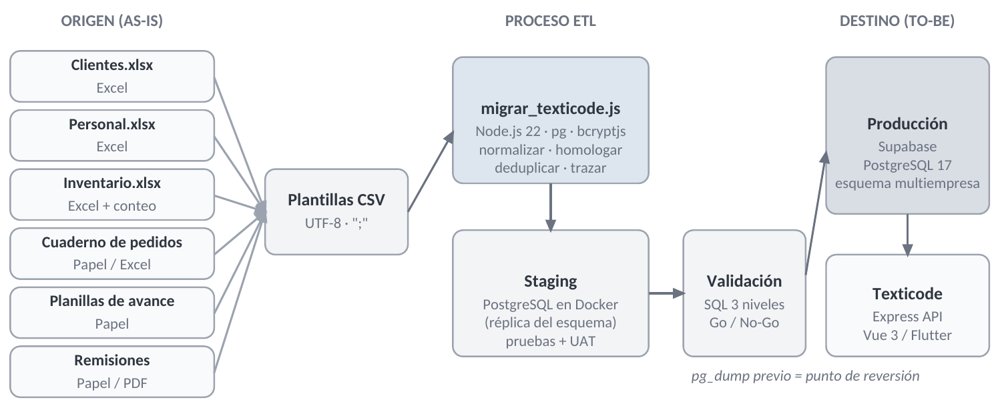
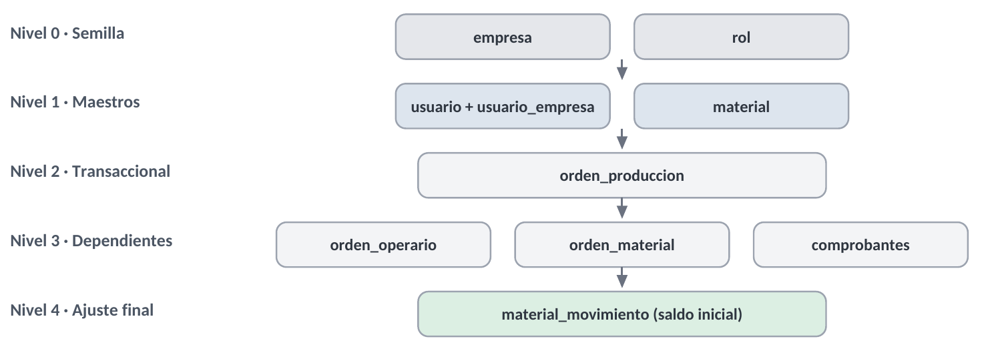
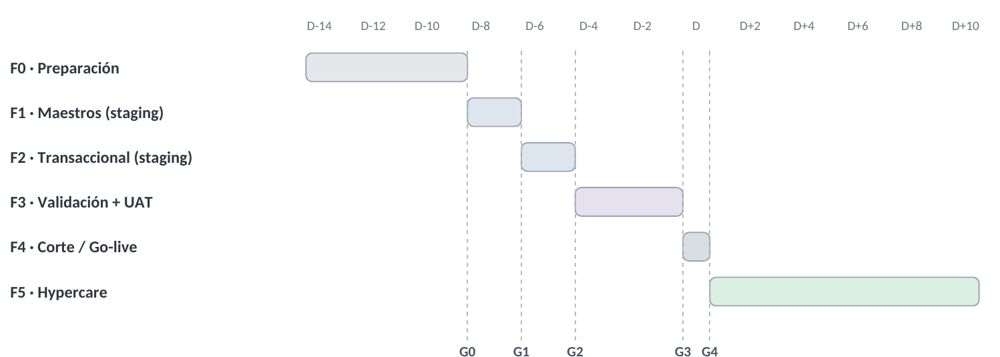
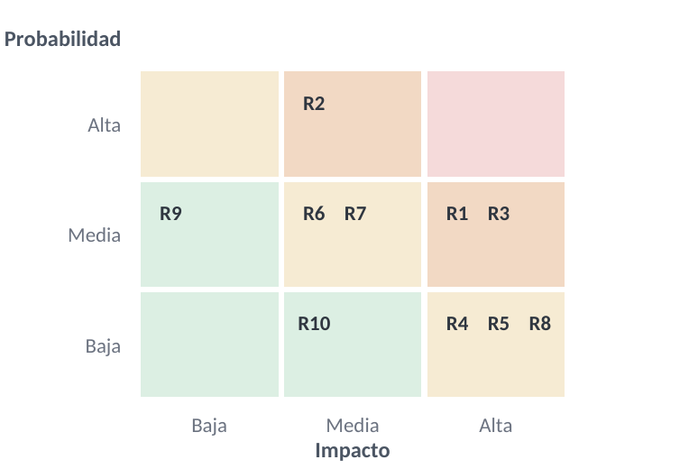

# Plan de Migración de Datos
## Texticode — Sistema de Gestión de Producción Textil

**SENA · Centro de Electricidad, Electrónica y Telecomunicaciones (CEET)** · Tecnólogo en Análisis y Desarrollo de Software (ADSO) · Ficha 3278639

**INFORME TÉCNICO · ENTREGABLE plan_migracion_datos**

Planificación de la migración de los registros operativos de una empresa de confección (hojas de cálculo y formatos en papel) hacia la plataforma SaaS Texticode, con inventario de datos, estrategia, mapeo y normalización, scripts de carga, validación en tres niveles, matriz de riesgos y plan de reversión.

|  |  |
| --- | --- |
| Aprendices | Kevin Montenegro<br>Andrés Felipe Lancheros<br>Camilo Andrés Tibambre<br>Kevin Andrés Castro |
| Instructor | Ing. Edwin Marín |
| Programa | Tecnólogo en Análisis y Desarrollo de Software (ADSO) |
| Ficha | 3278639 |
| Proyecto | Texticode — ADSO 2026 |
| Material de apoyo | Guía 02.5 · Migración de Datos (genérica) |
| Fecha | Bogotá D.C., 25 de octubre de 2026 |
| Versión | 1.1 — corregida contra el esquema real de la base de datos |

> **Evidencia verificable.** Los scripts de este plan (normalización, carga ETL y validación SQL) se ejecutaron en un entorno de staging PostgreSQL con el **esquema real de producción** (exportado con pg_dump) y un lote de datos de muestra representativo. Los resultados se presentan en la sección 10.

## Tabla de contenido

- 1\. Introducción
  - 1.1 Objetivo general
  - 1.2 Objetivos específicos
  - 1.3 Competencias que desarrolla este entregable
- 2\. Contexto del proyecto
  - 2.1 Situación actual (AS-IS)
  - 2.2 Sistema destino (TO-BE)
  - 2.2.1 Reglas del esquema real que condicionan la migración
  - 2.3 Arquitectura de la migración
- 3\. Alcance, supuestos y restricciones
  - 3.1 Dentro del alcance
  - 3.2 Fuera del alcance
  - 3.3 Supuestos y restricciones
- 4\. Inventario de datos y orden de carga
  - 4.1 Matriz de inventario de datos
  - 4.2 Datos semilla (no provienen del cliente)
  - 4.3 Orden de carga
- 5\. Estrategia de migración y entornos
  - 5.1 Comparativo de estrategias
  - 5.2 Entornos
- 6\. Mapeo, transformación y normalización
  - 6.1 Clientes y operarios → usuario
  - 6.2 Inventario → material
  - 6.3 Pedidos, avances, consumos y remisiones
  - 6.4 Reglas de deduplicación y rechazo
  - 6.5 Función normalizadora
- 7\. Plan de ejecución por fases
  - 7.1 Matriz de responsabilidades (RACI)
- 8\. Validación, pruebas y seguimiento (UAT)
  - 8.1 Criterios de aceptación
  - 8.2 Ejemplos de consultas de validación
  - 8.3 Pruebas de aceptación de usuario (UAT)
  - 8.4 Seguimiento de defectos
- 9\. Scripts de migración
- 10\. Resultados de la ejecución de prueba en staging
  - 10.1 Resultado de la carga por tabla
  - 10.2 Registros fusionados y rechazados (bitácora)
  - 10.3 Conciliación de totales (nivel 1)
  - 10.4 Integridad referencial y calidad (niveles 2 y 3)
  - 10.5 Muestra de usuarios migrados
- 11\. Matriz de riesgos
- 12\. Plan de reversión (rollback)
  - 12.1 Criterios de activación
  - 12.2 Procedimiento
  - 12.3 Prueba del rollback en staging
  - 12.4 Objetivos de recuperación
- 13\. Desarrollo de los ejercicios prácticos de la guía
  - 13.1 Ejercicio 1 · Matriz de inventario
  - 13.2 Ejercicio 2 · Limpieza de un CSV de clientes
  - 13.3 Ejercicio 3 · Cabecera vs. detalle en SQL
- 14\. Conclusiones
  - 14.1 Próximos pasos
- Anexo A · scripts/normalizadores.js
- Anexo B · scripts/migrar_texticode.js
- Anexo C · sql/10_validacion_post_carga.sql
- Anexo D · Glosario

## Control del documento

| Versión | Fecha | Descripción del cambio | Responsable |
|---|---|---|---|
| 0.1 | 17/10/2026 | Inventario preliminar de fuentes y borrador de estrategia | K. Montenegro |
| 0.5 | 20/10/2026 | Mapeo origen-destino, reglas de limpieza y scripts | Equipo Texticode |
| 1.0 | 21/10/2026 | Ejecución de prueba en staging, validación, riesgos y reversión | Equipo Texticode |
| 1.1 | 25/10/2026 | Corrección contra el esquema real exportado de producción: estados de orden, fase y comprobante según los ENUM/CHECK reales; stock y consumos en enteros; membresía en usuario_empresa; Id_Empresa en todas las tablas. Nuevo ensayo en staging | Equipo Texticode |

| Rol | Nombre | Responsabilidad sobre el documento |
|---|---|---|
| Elaboró | Equipo Texticode (4 aprendices) | Redacción técnica, scripts y pruebas |
| Revisó | Camilo Andrés Tibambre (Scrum Master) | Coherencia con el backlog y el cronograma |
| Aprueba | Ing. Edwin Marín (Instructor) | Aprobación académica del plan |

## 1. Introducción

Una migración de datos solo es exitosa si cada registro llega completo, se puede comprobar y se puede revertir. Este documento define, con ese criterio, cómo los datos operativos de una empresa de confección que hoy trabaja con hojas de cálculo de Excel y formatos en papel se trasladan a **Texticode**, la plataforma web y móvil de gestión de producción textil desarrollada por el equipo en el programa ADSO.

Texticode ya opera en producción sobre **Supabase PostgreSQL 17** con un esquema **multiempresa**: un superadministrador crea empresas y cada empresa tiene sus propios usuarios, inventario y órdenes. Por eso la migración de un cliente nuevo equivale a crear su empresa y poblarla con datos limpios, sin afectar a las demás empresas alojadas en la plataforma.

### 1.1 Objetivo general

Planificar, probar y documentar la migración de los registros maestros y transaccionales de la empresa cliente hacia Texticode, garantizando integridad referencial, trazabilidad fila por fila y capacidad de reversión total.

### 1.2 Objetivos específicos

- Elaborar el inventario estructurado de las fuentes de datos y definir sus dependencias y orden de carga.
- Seleccionar y justificar la estrategia de migración y los entornos de trabajo (staging y producción).
- Diseñar el mapeo origen-destino campo a campo y programar las reglas de limpieza y normalización.
- Construir los scripts de carga en Node.js y las consultas SQL de validación en tres niveles.
- Preparar la matriz de riesgos y el plan de contingencia (rollback) con criterios objetivos de activación.

### 1.3 Competencias que desarrolla este entregable

| Competencia de la guía | Dónde se evidencia en este plan |
|---|---|
| Inventario de datos y dependencias de carga | Sección 4 — matriz de inventario y diagrama de niveles de carga |
| Selección y justificación de estrategia | Sección 5 — comparativo Big Bang vs. Fases y entornos |
| Mapeo origen-destino y normalización | Sección 6 — mapeo por tabla, catálogos de homologación y funciones |
| Scripts Node.js y SQL de validación | Secciones 8 y 10, anexos A, B y C |
| Matriz de riesgos y rollback | Secciones 11 y 12 (rollback probado en staging) |

## 2. Contexto del proyecto

### 2.1 Situación actual (AS-IS)

La empresa cliente es un taller de confección que fabrica dotaciones, uniformes escolares y prendas por pedido. Su operación diaria se registra de forma manual y dispersa:

| Proceso | Cómo se registra hoy | Problemas detectados |
|---|---|---|
| Clientes | Libro Excel con varias hojas (una por vendedor) | Clientes repetidos con variaciones de escritura ("ANA PÉREZ" / "Ana Perez "), correos incompletos, teléfonos en 6 formatos distintos |
| Personal de planta | Excel de nómina con cargo y estado | Operarios retirados mezclados con activos; estados escritos de forma libre |
| Inventario de insumos | Excel + conteo físico mensual | Categorías y unidades sin estándar ("mts", "m", "metros"), materiales duplicados, conteos negativos por errores de digitación |
| Pedidos / órdenes | Cuaderno de pedidos transcrito a Excel | Fechas en dos formatos, estados libres ("terminado", "atrasado"), pedidos de clientes no registrados |
| Avance por fases | Planillas en papel por operario | Referencias a pedidos inexistentes; avances sin fecha |
| Remisiones de entrega | Talonario en papel / PDF | Sin vínculo verificable con el pedido |

### 2.2 Sistema destino (TO-BE)

| Capa | Tecnología en Texticode |
|---|---|
| Base de datos | Supabase PostgreSQL 17 (producción) · esquema relacional normalizado multiempresa |
| Backend | Node.js + Express, driver *pg* con Pool de conexiones, JWT y bcrypt |
| Clientes | Web Vue 3 + Vite (roles administrador, operario y cliente) · App móvil Flutter |
| Entorno de pruebas | PostgreSQL en contenedor Docker con el esquema real de producción (pg_dump --schema-only) como staging |
| Integraciones | Google Calendar (OAuth2) y SendGrid (correo transaccional) |

Las tablas destino se tomaron del **esquema real** exportado con *pg_dump --schema-only* del contenedor *texticode-db* (22/10/2026): **empresa, rol, usuario, usuario_empresa, material, material_movimiento, orden_produccion, orden_operario, orden_material y comprobantes**. Ese mismo archivo se usa como esquema de staging (*sql/00_esquema_destino.sql*).

#### 2.2.1 Reglas del esquema real que condicionan la migración

| Elemento del esquema | Definición real | Consecuencia para la carga |
|---|---|---|
| orden_produccion.Estado | ENUM estado_orden: 'En Proceso', 'Completada', 'Retrasada' | No existen Pendiente, Entregada ni Cancelada: se homologan (sección 6.3) |
| orden_operario.Estado_Fase | CHECK: 'Pendiente', 'En Proceso', 'Completada' | Una fase "retrasada" se carga En Proceso; el retraso es de la orden |
| comprobantes.Estado | ENUM estado_comprobante: 'Entregado', 'Pendiente' | La entrega de un pedido se registra aquí, no en la orden |
| material.Stock_Actual / Minimo / Maximo | INTEGER | Sin decimales: se usa la unidad menor (Metros → Centímetros) |
| orden_material.Cantidad_Usada | INTEGER | Mismo factor de unidad que su material |
| usuario / usuario_empresa | usuario no tiene Id_Empresa; la empresa y el rol están en usuario_empresa | Cada usuario se crea con su membresía principal (Es_Principal = true) |
| FK compuestas (Id, Id_Empresa) | Órdenes, fases, consumos, comprobantes y kárdex exigen la misma empresa | Todo INSERT lleva Id_Empresa; un cruce entre empresas falla en la base |
| orden_produccion.Fecha_Limite | DATE NOT NULL | Pedido sin fecha de entrega → RECHAZADO |

### 2.3 Arquitectura de la migración



*Figura 1. Flujo de la migración: fuentes manuales → plantillas CSV → ETL en Node.js → staging → validación → producción.*

## 3. Alcance, supuestos y restricciones

> **Regla del alcance:** lo que no está explícitamente listado en este plan, no se migra. Cualquier fuente nueva que aparezca después de aprobado el plan entra como solicitud de cambio en el backlog.

### 3.1 Dentro del alcance

- Clientes activos e históricos con al menos un pedido o correo válido.
- Personal de planta (operarios), incluidos los retirados, que se migran **inactivos** para conservar el historial de producción.
- Catálogo de insumos con su **conteo físico validado** como saldo inicial.
- Órdenes de producción del año en curso (histórico desde el 1 de enero de 2026) y las órdenes abiertas.
- Avance por fases de cada orden, consumo de materiales por orden y remisiones de entrega.

### 3.2 Fuera del alcance

- Tokens de Google Calendar, tokens de recuperación de contraseña y observaciones de operario: los genera el sistema en uso.
- Información contable, nómina y facturación electrónica (no las gestiona Texticode).
- Pedidos anteriores a 2026: se conservan en el archivo físico/Excel como respaldo de consulta.
- Imágenes, firmas escaneadas y adjuntos de las remisiones en papel.

### 3.3 Supuestos y restricciones

| # | Supuesto / restricción | Consecuencia para el plan |
|---|---|---|
| S1 | La empresa entrega los archivos fuente completos en la Fase 0 y designa un responsable de datos. | Sin fuente congelada no se inicia la Fase 1 (puerta G0). |
| S2 | El superadministrador de Texticode crea la empresa destino antes de la carga. | Todos los registros llevan el Id_Empresa de esa empresa. |
| S3 | El volumen inicial es menor a 500.000 registros. | Permite Big Bang controlado en una ventana corta. |
| R1 | Nunca se ejecutan scripts de desarrollo contra producción. | Todo se ensaya primero en staging (Docker). |
| R2 | Los usuarios migrados no tienen contraseña previa. | Se generan contraseñas temporales con bcrypt y cambio obligatorio en el primer ingreso. |
| R3 | Supabase sin restauración a un punto exacto (PITR es un complemento de pago aparte; los respaldos diarios no coinciden con el minuto del corte). | El respaldo pg_dump previo al corte es obligatorio y se verifica su restauración. |

## 4. Inventario de datos y orden de carga

El inventario es el primer entregable del plan. Para cada fuente se registra su formato, responsable, volumen estimado, tabla destino y dependencia. Los volúmenes son estimaciones de levantamiento y se confirman al cierre de la Fase 0.

### 4.1 Matriz de inventario de datos

| ID | Fuente origen | Formato | Vol. estim. | Tabla destino | Tipo | Depende de |
|---|---|---|---|---|---|---|
| F-01 | Clientes.xlsx (hojas por vendedor) | Excel | ≈ 350 | usuario (rol cliente) | Maestro | empresa, rol |
| F-02 | Personal.xlsx | Excel | ≈ 25 | usuario (rol operario) | Maestro | empresa, rol |
| F-03 | Inventario.xlsx + acta de conteo físico | Excel / papel | ≈ 180 | material | Maestro | empresa, usuario (dueño) |
| F-04 | Cuaderno de pedidos 2026 | Papel → Excel | ≈ 1.200 | orden_produccion | Transaccional | usuario, material |
| F-05 | Planillas de avance por fase | Papel → Excel | ≈ 3.000 | orden_operario | Dependiente | orden_produccion, usuario |
| F-06 | Consumo de insumos por pedido | Excel | ≈ 2.500 | orden_material | Dependiente | orden_produccion, material |
| F-07 | Talonario de remisiones | Papel / PDF | ≈ 900 | comprobantes | Dependiente | orden_produccion, usuario |
| F-08 | Saldo inicial (derivado de F-03) | Cálculo | ≈ 180 | material_movimiento | Ajuste final | material |

> Volumen total estimado: **≈ 8.300 registros**, muy por debajo del umbral de 500.000 que la guía usa para recomendar una estrategia Big Bang controlada.

### 4.2 Datos semilla (no provienen del cliente)

| Tabla | Contenido | Origen |
|---|---|---|
| empresa | Registro de la empresa cliente (nombre, Slug único, Estado = 'activa') | Creado por el superadministrador |
| rol | Administrador (Id 1), Operario (Id 2), Cliente (Id 3): los Id que reconoce el backend | Catálogo existente de Texticode |
| usuario (administrador) | Cuenta del administrador de la empresa | Creada por el superadministrador |

### 4.3 Orden de carga

El orden respeta las claves foráneas del motor: ninguna tabla se carga antes que las tablas a las que referencia. Si un nivel falla, los niveles siguientes no se ejecutan.



*Figura 2. Niveles de carga. Cada nivel depende únicamente de los niveles superiores.*

| Nivel | Tablas | Justificación |
|---|---|---|
| 0 · Semilla | empresa, rol | Toda fila de negocio referencia a una empresa y todo usuario a un rol. |
| 1 · Maestros | usuario + usuario_empresa → material | Entidades independientes del negocio. Cada usuario se crea junto con su membresía en la empresa. Material va después porque tiene un cliente dueño opcional (Id_Cliente → usuario_empresa). |
| 2 · Transaccional | orden_produccion | Requiere cliente, material y operario ya existentes. Se carga en orden cronológico de fecha de pedido. |
| 3 · Dependientes | orden_operario, orden_material, comprobantes | Dependen estrictamente de que la orden exista. |
| 4 · Ajuste final | material_movimiento | Saldo inicial del kárdex igual al conteo físico validado, para que stock = suma de movimientos. |

## 5. Estrategia de migración y entornos

### 5.1 Comparativo de estrategias

| Criterio | Big Bang controlado | Por fases (incremental) |
|---|---|---|
| Volumen (≈ 8.300 registros) | Adecuado: la carga completa toma minutos | Innecesario para este volumen |
| Convivencia de sistemas | Un solo corte; no hay doble digitación | Excel y Texticode en paralelo durante semanas |
| Riesgo de inconsistencias | Bajo si se ensaya en staging | Alto: los datos cambian entre fases |
| Esfuerzo del equipo | Concentrado en la ventana de corte | Distribuido, pero exige sincronización |
| Reversión | Simple: restaurar un único respaldo | Compleja: varios puntos de restauración |

> **Decisión:** se adopta un **Big Bang controlado**. Toda la carga se ensaya completa en staging tantas veces como sea necesario y el paso a producción se hace en una sola ventana de mantenimiento, fuera del horario de la planta (sábado de 6:00 p. m. a 10:00 p. m.), con congelamiento de las fuentes desde el viernes a las 6:00 p. m.

### 5.2 Entornos

| Entorno | Infraestructura | Uso en la migración | Datos |
|---|---|---|---|
| Desarrollo | PC de cada aprendiz | Escritura de scripts y pruebas unitarias de normalizadores | Muestras anonimizadas |
| Staging | PostgreSQL en Docker (docker-compose de Texticode), mismo esquema que producción | Ensayos completos, validación SQL y UAT | Copia completa de las fuentes |
| Producción | Supabase PostgreSQL 17 (multiempresa) | Solo la carga definitiva en la ventana de corte | Datos reales |

> **Regla de oro:** nunca se interactúa directamente con la base de datos de producción durante el desarrollo y las pruebas de los scripts. La cadena de conexión de producción solo se carga en la Fase 4 y la custodia el líder de migración.

## 6. Mapeo, transformación y normalización

El documento de mapeo define la transformación exacta de cada campo. Su propósito es evitar errores silenciosos: clientes duplicados por diferencias de escritura, unidades que no suman o estados que la aplicación no reconoce.

### 6.1 Clientes y operarios → usuario

| Campo origen | Campo destino | Regla de transformación |
|---|---|---|
| nombre | Nombre_Completo | Espacios colapsados, formato título, se conservan tildes. Siglas (S.A.S., LTDA) en mayúscula. |
| correo | Correo | trim + minúsculas + validación por expresión regular. Inválido o vacío → **RECHAZADO**. |
| correo (parte local) | Nombre_Usuario | Derivado del correo; si existe se agrega sufijo numérico (ana.perez2). |
| telefono | Telefono | Solo dígitos → E.164 **+57**XXXXXXXXXX. Fijo de 7 dígitos → indicativo 601. |
| documento | (clave de deduplicación) | Solo dígitos, sin dígito de verificación del NIT. No se almacena. |
| estado (operarios) | Estado | Activo → activo; Retirado/Retirada → inactivo. |
| — (hoja de origen) | Id_Rol (usuario y usuario_empresa) | Clientes.xlsx → Cliente (3); Personal.xlsx → Operario (2). |
| — | Contrasena | Contraseña temporal aleatoria, hash bcrypt (10 rondas); cambio obligatorio en el primer ingreso. |
| — | usuario_empresa | Membresía en la empresa destino: Id_Empresa, Id_Rol, Estado y Es_Principal = true. La tabla usuario no tiene Id_Empresa. |

### 6.2 Inventario → material

| Campo origen | Campo destino | Regla de transformación |
|---|---|---|
| material | Nombre_Material | Espacios colapsados. Clave normalizada (sin tildes, minúsculas) para detectar duplicados → **FUSIONADO**. |
| categoria | Categoria | Catálogo: tela/telas → Telas · hilo/hilos → Hilos · accesorio(s) → Accesorios. |
| unidad | Unidad | Catálogo: m/mts/metros → Metros · cm → Centímetros · und/unidad/conos → Unidades · rollo → Rollos · kg → Kilos · g → Gramos. |
| conteo_fisico | Stock_Actual (INTEGER) | Coma decimal → punto. Si el material tiene decimales en el conteo, el mínimo, el máximo o algún consumo, se carga en la **unidad menor**: Metros → Centímetros (×100), Kilos → Gramos (×1000). Decimales en Unidades o Rollos, negativo o no numérico → **RECHAZADO** (se recuenta). |
| minimo / maximo | Stock_Minimo / Stock_Maximo (INTEGER) | Mismo factor de unidad que el stock; se valida mínimo ≤ máximo. |
| cliente_dueno | Id_Cliente | Búsqueda por nombre normalizado en los clientes ya cargados; vacío → NULL. |

### 6.3 Pedidos, avances, consumos y remisiones

| Origen | Destino | Regla de transformación |
|---|---|---|
| pedidos.cliente | orden_produccion.Id_Cliente | Se resuelve por correo o por nombre normalizado. Cliente inexistente → RECHAZADO. |
| pedidos.fecha_pedido / fecha_entrega | Fecha_Creacion / Fecha_Limite | dd/mm/aaaa o aaaa-mm-dd → ISO 8601. Se carga en orden cronológico. |
| pedidos.estado | Estado (ENUM estado_orden) | pendiente → **En Proceso** con 0 unidades realizadas · en proceso → En Proceso · atrasado → Retrasada · terminado → Completada · entregado → **Completada** (la entrega queda en comprobantes) · cancelado → **RECHAZADO** (queda en el archivo histórico). |
| pedidos.prioridad | Prioridad | alta/urgente → Alta · media/normal → Media · baja → Baja. |
| pedidos.cantidad | Cantidad y Unidades | Entero mayor que cero; de lo contrario RECHAZADO. |
| pedidos.fecha_entrega | Fecha_Limite (NOT NULL) | Vacía o inválida → RECHAZADO. |
| avances (última fase) | Unidades_Realizadas | Completada = Cantidad; si no, lo reportado en la última fase (tope = Cantidad). |
| avances.estado | Estado_Fase (CHECK) | pendiente → Pendiente · en proceso → En Proceso · retrasada → **En Proceso** · completada → Completada. Pedido inexistente → RECHAZADO (huérfano). |
| consumos.cantidad | orden_material.Cantidad_Usada (INTEGER) | En la misma unidad que el material (×100 si se pasó a Centímetros). **No** genera movimiento de salida: el stock ya es el conteo físico. |
| remisiones.estado | comprobantes.Estado (ENUM) | entregado → Entregado · pendiente → Pendiente. Id_Usuario = cliente de la orden. |
| — | Id_Empresa | Se escribe en **todas** las tablas transaccionales; las FK compuestas (Id, Id_Empresa) rechazan cualquier cruce entre empresas. |

> **Por qué no existen los estados Pendiente, Entregada ni Cancelada.** En Texticode una orden nace *En Proceso* (valor por defecto del ENUM) y la función *actualizar_ordenes_retrasadas()* la pasa a *Retrasada* cuando vence. La entrega no es un estado de la orden sino del comprobante (*Entregado*). Una orden cancelada no tiene representación, por eso no se migra y se conserva en el archivo histórico. Si el script usara los valores antiguos, PostgreSQL rechazaría la fila (se comprobó en la prueba de atomicidad de la sección 12.3).

> **Decisión clave de inventario.** El consumo histórico no descuenta stock. Si se descontara, el inventario quedaría por debajo de la realidad, porque el conteo físico ya refleja esos consumos. El kárdex arranca con un único movimiento *Creacion* por material igual al conteo físico validado.

### 6.4 Reglas de deduplicación y rechazo

| Situación | Regla | Resultado en bitácora |
|---|---|---|
| Mismo correo normalizado o mismo documento | Se conserva el primer registro; los demás se vinculan a él | FUSIONADO |
| Material repetido por nombre normalizado | Se conserva el primero; la diferencia de conteo se reporta para verificación | FUSIONADO |
| Campo obligatorio vacío o inválido | No se carga; se devuelve al dueño de datos para corrección | RECHAZADO |
| Cantidad con decimales en una unidad sin submúltiplo (Unidades, Rollos) | No se redondea; se pide recontar en unidades enteras | RECHAZADO |
| Orden cancelada en el cuaderno | No tiene estado en Texticode; queda en el archivo histórico | RECHAZADO |
| Referencia a un registro inexistente (huérfano) | No se carga; se reporta con el número de pedido | RECHAZADO |
| Registro correcto | Se inserta y se guarda el Id destino | CARGADO |

Cada fila leída queda registrada en la tabla **migracion_trazabilidad** (lote, archivo, fila de origen, tabla destino, Id destino, resultado y motivo). Así cualquier registro de Texticode se puede rastrear hasta la fila exacta del Excel.

### 6.5 Función normalizadora

**scripts/normalizadores.js (extracto — versión completa en el Anexo A)**

```javascript
export const normalizarClave = (txt) =>
  String(txt ?? '')
    .normalize('NFD')
    .replace(/[\u0300-\u036f]/g, '') // elimina diacríticos (tildes)
    .toLowerCase()
    .replace(/\s+/g, ' ')            // colapsa espacios múltiples
    .trim();                          // limpia bordes

// "ANA PÉREZ" y "Ana Perez " producen la misma clave: "ana perez"

export const normalizarTelefono = (tel) => {
  let d = String(tel ?? '').replace(/\D/g, '');
  if (d.startsWith('57') && d.length === 12) d = d.slice(2);
  if (d.length === 7) d = '601' + d;            // fijo antiguo de Bogotá
  if (d.length === 10 && (d.startsWith('3') || d.startsWith('60'))) return '+57' + d;
  return null;
};

// Stock y consumos son INTEGER: 250,5 Metros → aEntero('250,5', 100) = 25050 Centímetros.
// Devuelve null si no queda entero (p. ej. 2,5 Rollos) y la fila se rechaza.
export const aEntero = (valor, factor = 1) => {
  const n = typeof valor === 'number' ? valor : aNumero(valor);
  if (Number.isNaN(n)) return null;
  const r = Math.round(n * factor);
  return Math.abs(n * factor - r) < 1e-9 ? r : null;
};
```

## 7. Plan de ejecución por fases

El plan se ejecuta en seis fases secuenciales. Al final de cada fase hay una **puerta de calidad (Go/No-Go)**: si el criterio no se cumple, la fase se repite y la siguiente no inicia. "D" es el día del corte a producción.



*Figura 3. Cronograma relativo al día de corte (D) y puertas de calidad G0–G4.*

| Fase | Actividades principales | Entregable | Puerta de calidad (Go/No-Go) |
|---|---|---|---|
| F0 · Preparación<br>D-14 a D-9 | Recolección de fuentes; transcripción del papel a plantillas CSV; limpieza manual con el dueño de datos; montaje de staging Docker con el esquema de producción | Fuentes congeladas v1, staging operativo, inventario confirmado | **G0:** 100 % de fuentes del inventario recibidas y staging con esquema idéntico al de producción |
| F1 · Maestros<br>D-8 a D-7 | Carga en staging de empresa, clientes, operarios y materiales | Bitácora de carga de maestros | **G1:** rechazo ≤ 2 % por archivo tras corrección; 0 duplicados lógicos |
| F2 · Transaccional<br>D-6 a D-5 | Carga cronológica de órdenes, fases, consumos y remisiones; saldo inicial | Bitácora completa del lote | **G2:** 0 huérfanos; conciliación de totales 100 % |
| F3 · Validación<br>D-4 a D-1 | Ejecución de las consultas de 3 niveles; UAT con usuarios del negocio por rol; corrección de defectos en el tablero Scrum | Acta UAT firmada; backlog sin defectos críticos | **G3:** todos los controles PASA y 0 defectos críticos/altos abiertos |
| F4 · Corte<br>D (sáb 6–10 p. m.) | Congelamiento; respaldo pg_dump verificado; carga definitiva en producción; validación SQL; pruebas de humo | Respaldo + bitácora de producción + checklist de humo | **G4:** validación PASA en producción y pruebas de humo OK antes de las 10 p. m.; si no → rollback |
| F5 · Estabilización<br>D+1 a D+10 | Hypercare: monitoreo de logs, soporte a usuarios, cambio de contraseñas temporales, cierre | Informe de cierre de la migración | Sin incidentes críticos por 10 días; 100 % de usuarios activos con contraseña propia |

### 7.1 Matriz de responsabilidades (RACI)

> R = Responsable · A = Aprueba · C = Consultado · I = Informado. Asignación propuesta para el equipo.

| Actividad | K. Montenegro<br>(PO / líder) | C. Tibambre<br>(Scrum Master) | A. Lancheros<br>(BD / SQL) | K. Castro<br>(QA) | Dueño de datos<br>(empresa) |
|---|---|---|---|---|---|
| Inventario y fuentes | A | C | R | I | R |
| Scripts ETL y normalización | R/A | I | C | C | I |
| Staging y esquema | A | I | R | C | — |
| Validación SQL 3 niveles | A | I | R | R | I |
| UAT y backlog de defectos | C | R | C | R | A |
| Respaldo y corte a producción | R/A | C | R | C | I |
| Decisión de rollback | A | R | C | C | C |
| Comunicación a interesados | C | R | I | I | I |

## 8. Validación, pruebas y seguimiento (UAT)

Una migración se da por buena cuando supera métricas medibles, no cuando "parece estar bien". La validación se ejecuta con el script *sql/10_validacion_post_carga.sql* (Anexo C) en staging y, de nuevo, en producción durante el corte.

### 8.1 Criterios de aceptación

| Nivel | Métrica | Umbral de aceptación |
|---|---|---|
| 1 · Conciliación | Filas del Excel = cargadas + fusionadas + rechazadas (por archivo) | 100 % |
| 1 · Conciliación | Cargadas según bitácora = filas en la tabla destino | 100 % |
| 1 · Conciliación | SUM(Cantidad) de órdenes y SUM(Stock_Actual) vs. totales calculados en el Excel | Diferencia = 0 |
| 2 · Integridad | Registros huérfanos en cualquier relación | 0 |
| 2 · Integridad | Registros de una empresa vinculados a otra empresa | 0 |
| 3 · Calidad | Obligatorios nulos, negativos, duplicados lógicos, formatos inválidos | 0 |
| 3 · Calidad | Stock del material (cabecera) vs. suma del kárdex (detalle) | 0 diferencias |
| General | Tasa de rechazo por archivo después de la corrección de la Fase 0 | ≤ 2 % |

### 8.2 Ejemplos de consultas de validación

**Integridad referencial y calidad de datos**

```sql
-- Nivel 2 · Órdenes cuyo cliente no es miembro con rol Cliente (Id 3) de la misma empresa
SELECT COUNT(*) AS hallazgos
FROM orden_produccion op
LEFT JOIN usuario_empresa ue
       ON ue."Id_Usuario" = op."Id_Cliente" AND ue."Id_Empresa" = op."Id_Empresa"
WHERE ue."Id_Rol" IS DISTINCT FROM 3;

-- Nivel 3 · Correos duplicados ignorando mayúsculas y espacios
SELECT LOWER(TRIM("Correo")) AS correo, COUNT(*)
FROM usuario GROUP BY 1 HAVING COUNT(*) > 1;
```

### 8.3 Pruebas de aceptación de usuario (UAT)

| ID | Rol | Caso de prueba | Resultado esperado |
|---|---|---|---|
| UAT-01 | Administrador | Buscar un cliente que estaba duplicado en el Excel | Aparece una sola vez, con teléfono +57 y correo en minúsculas |
| UAT-02 | Administrador | Abrir Gestión de Inventario y comparar 10 materiales al azar con el acta de conteo físico | Stock, unidad y categoría coinciden |
| UAT-03 | Administrador | Abrir 10 órdenes al azar y compararlas con el cuaderno de pedidos | Cliente, cantidades, fechas y estado coinciden |
| UAT-04 | Administrador | Generar el reporte PDF/CSV de producción | Totales iguales a la conciliación de nivel 1 |
| UAT-05 | Operario | Iniciar sesión con la contraseña temporal | El sistema obliga a cambiar la contraseña |
| UAT-06 | Operario | Consultar tareas asignadas y su avance por fase | Fases y cantidades iguales a la planilla en papel |
| UAT-07 | Operario (retirado) | Intentar iniciar sesión | Acceso denegado: usuario inactivo |
| UAT-08 | Cliente | Consultar pedidos y entregas | Solo ve sus propios pedidos y comprobantes |
| UAT-09 | Superadmin | Consultar otra empresa de la plataforma | No aparece ningún dato de la empresa migrada |

### 8.4 Seguimiento de defectos

Los hallazgos de la UAT se registran en el tablero Scrum del proyecto (Trello) en la lista **Product Backlog** con la etiqueta *MIGRACIÓN*, y avanzan por *Sprint Backlog → En progreso → En revisión → Hecho*. Cada tarjeta indica: archivo y fila de origen (tomados de la bitácora), severidad, responsable y evidencia (captura o consulta SQL).

| Severidad | Definición | Tratamiento |
|---|---|---|
| Crítica | Pérdida de datos o flujo principal bloqueado | Bloquea la puerta G3; corrección inmediata |
| Alta | Dato incorrecto que afecta cantidades, stock o estados | Bloquea la puerta G3 |
| Media | Dato incorrecto sin impacto en cálculos (formato, mayúsculas) | Se corrige antes del corte si hay tiempo; si no, en hypercare |
| Baja | Mejora o detalle visual | Backlog normal |

## 9. Scripts de migración

La carga se automatiza con un script en Node.js 22 que reutiliza las mismas librerías del backend de Texticode (*pg* y *bcryptjs*). Sus principios de diseño son:

- **Una transacción por fase:** si cualquier fila provoca un error de base de datos, toda la fase se revierte (ROLLBACK) y no queda información a medias.
- **Resolución de claves en memoria:** los Id generados en el nivel 1 se guardan en índices (correo → Id, nombre → Id) para resolver las claves foráneas de los niveles 2 y 3.
- **Trazabilidad total:** cada fila leída genera un registro en *migracion_trazabilidad* con su resultado y motivo.
- **Idempotencia operativa:** el script se ejecuta sobre una base limpia; para repetir un ensayo se restaura el respaldo de staging.
- **Seguridad:** las contraseñas temporales nunca se guardan en texto plano en la base; el archivo de entrega se destruye tras notificar a los usuarios.

| Archivo | Propósito |
|---|---|
| sql/00_esquema_destino.sql | Esquema real de producción (pg_dump --schema-only) para crear staging idéntico |
| sql/01_control_migracion.sql | Roles base (Id 1, 2, 3) y tabla migracion_trazabilidad |
| scripts/normalizadores.js | Funciones de limpieza y catálogos de homologación (Anexo A) |
| scripts/migrar_texticode.js | ETL completo por fases con transacciones y bitácora (Anexo B) |
| scripts/limpiar_clientes_csv.js | Ejercicio 2 de la guía: teléfonos +57 y descarte de correos inválidos |
| sql/10_validacion_post_carga.sql | Validación en 3 niveles con resultado PASA/FALLA (Anexo C) |

**Secuencia de ejecución**

```bash
# 1. Crear staging con el esquema REAL y los objetos de control
psql "$STAGING_URL" -v ON_ERROR_STOP=1 -f sql/00_esquema_destino.sql
psql "$STAGING_URL" -v ON_ERROR_STOP=1 -f sql/01_control_migracion.sql

# 2. Ejecutar la migración (EMPRESA_DESTINO = empresa creada por el superadmin)
DATABASE_URL="$STAGING_URL" EMPRESA_DESTINO="Confecciones Cliente Piloto" \
  node scripts/migrar_texticode.js ./origen

# 3. Validar: todos los controles deben mostrar PASA
psql "$STAGING_URL" -f sql/10_validacion_post_carga.sql
```

## 10. Resultados de la ejecución de prueba en staging

> Ensayo ejecutado el 25/10/2026 sobre PostgreSQL 16 con el **esquema real de producción** (sección 9), usando un **lote de muestra** de 62 filas construido a partir de los problemas reales identificados en el AS-IS (duplicados, correos inválidos, unidades sin estándar, conteos negativos y referencias huérfanas). El objetivo es demostrar que las reglas detectan y tratan cada caso.

### 10.1 Resultado de la carga por tabla

| Tabla destino | Cargados | Fusionados | Rechazados | Transacción |
|---|---|---|---|---|
| usuario | 13 | 2 | 2 | COMMIT |
| material | 11 | 1 | 1 | COMMIT |
| orden_produccion | 8 | 0 | 2 | COMMIT |
| orden_operario | 10 | 0 | 1 | COMMIT |
| orden_material | 9 | 0 | 0 | COMMIT |
| comprobantes | 2 | 0 | 0 | COMMIT |
| material_movimiento | 11 | 0 | 0 | COMMIT |

### 10.2 Registros fusionados y rechazados (bitácora)

| Archivo | Fila | Resultado | Motivo |
|---|---|---|---|
| clientes.csv | 3 | FUSIONADO | "Ana Perez " = "ANA PÉREZ" (mismo correo y documento) |
| clientes.csv | 5 | RECHAZADO | Correo inválido: luisf.gomez@hotmail (sin dominio) |
| clientes.csv | 8 | RECHAZADO | Correo vacío (Carlos Rojas) |
| clientes.csv | 13 | FUSIONADO | "DOTACIONES JR" = "Dotaciones JR" (mismo correo y NIT) |
| inventario.csv | 8 | RECHAZADO | Conteo físico negativo (-3) → recontar |
| inventario.csv | 14 | FUSIONADO | Material duplicado "Dril azul industrial "; conteo 250 vs 250,5 → verificar |
| pedidos.csv | 8 | RECHAZADO | Cliente no existe en maestros: "Cliente Desconocido SAS" |
| pedidos.csv | 9 | RECHAZADO | Cantidad igual a cero |
| avances.csv | 12 | RECHAZADO | Orden huérfana: P-0199 |

Además, la bitácora registra las **conversiones** que exige el esquema real, sin pérdida de información:

| Origen | Valor en el Excel | Valor cargado | Regla |
|---|---|---|---|
| inventario.csv fila 2 · Dril azul industrial | 250,5 mts (mín. 50, máx. 500) | 25.050 Centímetros (mín. 5.000, máx. 50.000) | Stock INTEGER → unidad menor ×100 |
| inventario.csv fila 4 · Jean índigo 12 oz | 180 m | 18.000 Centímetros | Su consumo en P-0103 es 37,5 m |
| consumos.csv fila 7 · P-0103 | 37,5 m de Jean índigo | 3.750 (Centímetros) | Misma unidad que el material |
| pedidos.csv · P-0101 | ENTREGADO | Completada + comprobante Entregado | ENUM estado_orden |
| pedidos.csv · P-0106 y P-0109 | pendiente / Pendiente | En Proceso, 0 realizadas | ENUM estado_orden |
| avances.csv fila 9 · P-0104 fase 1 | retrasada | En Proceso (la orden queda Retrasada) | CHECK Estado_Fase |

### 10.3 Conciliación de totales (nivel 1)

| Archivo | Filas origen | Cargadas | Fusionadas | Rechazadas | % rechazo |
|---|---|---|---|---|---|
| clientes.csv | 12 | 8 | 2 | 2 | 16,7 % |
| operarios.csv | 5 | 5 | 0 | 0 | 0,0 % |
| inventario.csv | 13 | 11 | 1 | 1 | 7,7 % |
| pedidos.csv | 10 | 8 | 0 | 2 | 20,0 % |
| avances.csv | 11 | 10 | 0 | 1 | 9,1 % |
| consumos.csv | 9 | 9 | 0 | 0 | 0,0 % |
| remisiones.csv | 2 | 2 | 0 | 0 | 0,0 % |
| **Total** | **62** | **53** | **3** | **6** | **9,7 %** |

| Control | Excel (filas válidas) | Texticode | Resultado |
|---|---|---|---|
| Unidades pedidas (SUM Cantidad) | 888 | 888 | PASA |
| Stock total migrado (SUM Stock_Actual, en la unidad cargada) | 45.375 | 45.375 | PASA |
| Saldo inicial en kárdex (SUM movimientos) | 45.375 | 45.375 | PASA |
| Órdenes por estado | 5 En Proceso · 2 Completada · 1 Retrasada | Igual | PASA |
| Bitácora vs. filas en las 6 tablas destino | 53 cargadas | 53 filas | PASA |

> Las tasas de rechazo superan el umbral de 2 % porque el lote de muestra se construyó **a propósito** con errores para probar las reglas. En la ejecución real, esos registros se devuelven al dueño de datos en la Fase 0 y la carga se repite hasta cumplir la puerta G1.

### 10.4 Integridad referencial y calidad (niveles 2 y 3)

| Control | Hallazgos | Resultado |
|---|---|---|
| 2.1 Órdenes sin cliente válido (rol cliente) | 0 | PASA |
| 2.2 Órdenes con operario sin rol operario | 0 | PASA |
| 2.3 Fases sin orden | 0 | PASA |
| 2.4 Consumos sin material | 0 | PASA |
| 2.5 Comprobantes cuyo usuario no es el cliente de la orden | 0 | PASA |
| 2.6 Datos mezclados entre empresas (5 relaciones) | 0 | PASA |
| 2.7 Usuarios sin membresía principal (usuario_empresa) | 0 | PASA |
| 3.1 Usuarios con obligatorios vacíos | 0 | PASA |
| 3.2 Correos duplicados | 0 | PASA |
| 3.3 Teléfonos fuera de formato +57 | 0 | PASA |
| 3.4 Materiales duplicados | 0 | PASA |
| 3.5 Stock negativo o mínimo > máximo | 0 | PASA |
| 3.6 Cantidad ≤ 0 o realizadas > cantidad | 0 | PASA |
| 3.7 Fecha límite anterior a la creación | 0 | PASA |
| 3.8 Completadas con unidades pendientes | 0 | PASA |
| 3.9 Stock (cabecera) ≠ suma del kárdex (detalle) | 0 | PASA |
| 3.10 Fases con más unidades que la orden | 0 | PASA |
| 3.11 Unidad fuera del catálogo de la aplicación | 0 | PASA |

> **Resultado:** 18 de 18 controles de integridad y calidad en PASA, conciliación de totales exacta y las tres transacciones confirmadas. El lote de prueba cumple las condiciones técnicas de las puertas G2 y G3.

### 10.5 Muestra de usuarios migrados

| Id | Nombre_Completo | Nombre_Usuario | Telefono | Estado | Rol (usuario_empresa) |
|---|---|---|---|---|---|
| 91 | Ana Pérez | ana.perez | +573001234567 | activo | Cliente |
| 92 | Confecciones El Telar S.A.S. | compras | +576017452233 | activo | Cliente |
| 94 | Uniformes Andinos LTDA | gerencia | +576017451122 | activo | Cliente |
| 95 | Dotaciones JR | dotacionesjr | +573214456677 | activo | Cliente |
| 99 | Jorge Enrique Pinzón | jorge.pinzon | +573156677889 | activo | Operario |
| 102 | Patricia Valencia | patricia.valencia | +573112233445 | inactivo | Operario |

*Tabla. Nombres en formato título con tildes, teléfonos en E.164, la operaria retirada migrada como inactiva y la membresía en la empresa destino (Id 5). Los Id continúan las secuencias del esquema de producción.*

## 11. Matriz de riesgos

Probabilidad e impacto se califican de 1 (bajo) a 3 (alto). Nivel = probabilidad × impacto: 1–2 Bajo, 3–4 Medio, 6–9 Alto.



**Lectura del mapa de calor.** Los riesgos R1 y R3 (nivel 6) son los prioritarios porque combinan probabilidad media con impacto alto: ambos atacan la exactitud de los datos maestros. R2 tiene la mayor probabilidad, ya que buena parte de los pedidos y avances nace en papel. Los riesgos de impacto alto y probabilidad baja (R4, R5, R8) se controlan con reglas operativas y se cubren con el plan de reversión.

*Figura 4. Mapa de calor de riesgos (probabilidad × impacto).*

| ID | Riesgo | P | I | Nivel | Mitigación (preventiva) | Contingencia |
|---|---|---|---|---|---|---|
| R1 | Duplicación de clientes por variaciones de escritura | 2 | 3 | Alta | Clave normalizada + deduplicación por correo y documento; control 3.2 | Fusión manual guiada por la bitácora |
| R2 | Fuentes en papel incompletas o ilegibles | 3 | 2 | Alta | Transcripción doble y revisión del dueño de datos en F0 | Cargar solo lo verificado; el resto queda en archivo físico |
| R3 | Inventario inicial distinto al real | 2 | 3 | Alta | Conteo físico como única fuente de stock; control 3.9 | Ajuste de inventario desde la app en hypercare |
| R4 | Ejecutar un script de prueba contra producción | 1 | 3 | Media | Regla de oro; URL de producción solo en F4, custodiada por el líder | Rollback inmediato desde el respaldo |
| R5 | Mezcla de datos con otra empresa de la plataforma | 1 | 3 | Media | Id_Empresa obligatorio en cada INSERT; control 2.6; UAT-09 | Rollback y revisión del aislamiento por empresa |
| R6 | Ventana de corte insuficiente | 2 | 2 | Media | Ensayo cronometrado en staging; carga de minutos para ≈ 8.300 filas | Extender 1 h o aplicar rollback según G4 |
| R7 | Usuarios no logran ingresar con la contraseña temporal | 2 | 2 | Media | Entrega por canal seguro; flujo de recuperación vía SendGrid | Soporte en hypercare; reenvío de credenciales |
| R8 | Respaldo previo corrupto o incompleto | 1 | 3 | Media | Restauración de prueba del pg_dump antes de cargar; checksum SHA-256 | Segundo respaldo desde el panel de Supabase |
| R9 | Resistencia al cambio del personal de planta | 2 | 1 | Baja | Capacitación por rol y acompañamiento en la primera semana | Refuerzo con guías rápidas |
| R10 | Exposición de datos personales de clientes | 1 | 2 | Baja | Archivos fuente fuera del repositorio Git; CSV cifrados; borrado tras el cierre | Reporte del incidente y rotación de credenciales |

## 12. Plan de reversión (rollback)

El plan B se aprueba antes del día del corte. Su punto de partida es el **respaldo validado** de la base de producción tomado justo antes de iniciar la carga.

### 12.1 Criterios de activación

| Criterio | Umbral que activa el rollback |
|---|---|
| Pérdida de datos | Cualquier diferencia en la conciliación de totales (nivel 1) que no se explique por rechazos documentados |
| Integridad | Uno o más hallazgos en los controles de nivel 2 (huérfanos o datos mezclados entre empresas) |
| Flujos principales | Falla bloqueante en inicio de sesión, gestión de órdenes, inventario o reportes durante las pruebas de humo |
| Otras empresas | Cualquier alteración en datos de empresas distintas a la migrada |
| Tiempo | A las 10:00 p. m. la puerta G4 no está aprobada |

### 12.2 Procedimiento

| Paso | Acción | Responsable |
|---|---|---|
| 1 | **Detener el acceso** al sistema para la empresa migrada (estado inactivo de la empresa / mantenimiento) para evitar "datos basura". | K. Montenegro |
| 2 | Registrar la evidencia del fallo (salida de la validación, logs del backend) para el diagnóstico. | K. Castro |
| 3 | **Restaurar** la base desde el respaldo pre-corte: *pg_restore --clean --if-exists*. | A. Lancheros |
| 4 | Verificar la restauración con conteos y sumas de control frente al respaldo. | A. Lancheros |
| 5 | **Notificar** a los interesados (empresa, instructor, equipo) con la causa preliminar y la nueva fecha. | C. Tibambre |
| 6 | Retomar temporalmente la operación en Excel/papel; corregir el script en staging y reprogramar el corte. | Equipo |

**Comandos de respaldo y restauración**

```bash
# Antes de cargar (Fase 4): respaldo + verificación
pg_dump -Fc -f respaldo_pre_corte.dump "$PROD_URL"
sha256sum respaldo_pre_corte.dump > respaldo_pre_corte.sha256
pg_restore -l respaldo_pre_corte.dump > /dev/null   # el archivo es legible

# Si se activa el rollback
pg_restore --clean --if-exists -d "$PROD_URL" respaldo_pre_corte.dump
```

### 12.3 Prueba del rollback en staging

| Prueba | Evidencia | Resultado |
|---|---|---|
| Respaldo previo | pg_dump formato custom (76 KB) con checksum SHA-256 registrado | PASA |
| Falla simulada | Se borraron las 10 fases y se duplicó el stock (45.375 → 90.750) | Inyectada |
| Restauración | pg_restore en 0,22 s → 10 fases y stock 45.375 recuperados | PASA |
| Atomicidad | Transacción con una orden válida y otra con Estado = 'Pendiente': PostgreSQL rechaza el valor (no existe en el ENUM estado_orden) y la orden válida del mismo bloque tampoco queda guardada (8 órdenes antes y después) | PASA |

### 12.4 Objetivos de recuperación

| Indicador | Objetivo | Justificación |
|---|---|---|
| RPO (pérdida máxima) | 0 registros | Las fuentes están congeladas desde el viernes y el respaldo se toma justo antes de la carga |
| RTO (tiempo de recuperación) | ≤ 30 minutos | Restauración medida en segundos para el volumen previsto, más verificación y comunicación |

## 13. Desarrollo de los ejercicios prácticos de la guía

### 13.1 Ejercicio 1 · Matriz de inventario

Resuelto en la sección 4 sobre el modelo de negocio de un taller de confección: 8 fuentes y 10 tablas destino (empresa, rol, usuario, usuario_empresa, material, orden_produccion, orden_operario, orden_material, comprobantes y material_movimiento) con sus dependencias de carga en cinco niveles.

### 13.2 Ejercicio 2 · Limpieza de un CSV de clientes

**scripts/limpiar_clientes_csv.js**

```javascript
import fs from 'node:fs';
import { parse } from 'csv-parse/sync';
import { normalizarCorreo, normalizarTelefono, nombrePropio } from './normalizadores.js';

const [entrada, salida] = process.argv.slice(2);
const filas = parse(fs.readFileSync(entrada, 'utf8'), { columns: true, delimiter: ';' });
const validos = [], descartados = [];
filas.forEach((r, i) => {
  const correo = normalizarCorreo(r.correo);
  if (!correo) return descartados.push({ fila: i + 2, nombre: r.nombre.trim() });
  validos.push([nombrePropio(r.nombre), correo, normalizarTelefono(r.telefono) ?? ''].join(';'));
});
fs.writeFileSync(salida, 'nombre;correo;telefono\n' + validos.join('\n'));
console.log(`Leídos: ${filas.length} · Válidos: ${validos.length} · Descartados: ${descartados.length}`);
```

**Salida de la ejecución**

```bash
$ node scripts/limpiar_clientes_csv.js origen/clientes.csv salida/clientes_limpios.csv
Leídos: 12 · Válidos: 10 · Descartados: 2
  fila 5  Luis Fernando Gómez   correo inválido o vacío
  fila 8  Carlos Rojas          correo inválido o vacío

nombre;correo;telefono
Ana Pérez;ana.perez@gmail.com;+573001234567
Confecciones El Telar S.A.S.;compras@eltelar.co;+576017452233
María José Ruiz;mjruiz@outlook.com;+573105550101      (entrada: "+57 310 555 0101")
Dotaciones JR;dotacionesjr@gmail.com;+573214456677    (entrada: "57 321 445 6677")
```

### 13.3 Ejercicio 3 · Cabecera vs. detalle en SQL

En Texticode no existen facturas; el equivalente directo de "cabecera vs. detalle" es el **stock del material** (cabecera) frente a la **suma de sus movimientos de kárdex** (detalle). La misma lógica se aplica a las unidades realizadas de una orden frente a sus fases.

**Consulta de verificación**

```sql
-- Materiales cuyo stock registrado no coincide con la suma matemática de su kárdex
SELECT m."Id_Material", m."Nombre_Material",
       m."Stock_Actual"                    AS stock_cabecera,
       COALESCE(SUM(mm."Cantidad"), 0)     AS suma_detalle,
       m."Stock_Actual" - COALESCE(SUM(mm."Cantidad"), 0) AS diferencia
FROM material m
LEFT JOIN material_movimiento mm ON mm."Id_Material" = m."Id_Material"
GROUP BY m."Id_Material", m."Nombre_Material", m."Stock_Actual"
HAVING m."Stock_Actual" <> COALESCE(SUM(mm."Cantidad"), 0);

-- Equivalente con facturas (modelo genérico de la guía)
SELECT f.id_factura, f.total AS total_cabecera,
       SUM(d.cantidad * d.precio_unitario) AS total_detalle
FROM factura f JOIN factura_detalle d ON d.id_factura = f.id_factura
GROUP BY f.id_factura, f.total
HAVING f.total <> SUM(d.cantidad * d.precio_unitario);
```

## 14. Conclusiones

- La estrategia **Big Bang controlado** es la adecuada para Texticode: el volumen estimado (≈ 8.300 registros) se carga en minutos y evita la doble digitación entre Excel y la plataforma.
- El orden de carga en cinco niveles, derivado de las claves foráneas reales del esquema, impidió cualquier registro huérfano en el ensayo.
- La normalización centralizada en un solo módulo (*normalizadores.js*) resolvió los problemas del AS-IS: duplicados por escritura, teléfonos en seis formatos, unidades y estados sin estándar.
- Ensayar contra el **esquema real exportado** y no contra uno reconstruido evitó dos fallas de producción: estados de orden que el ENUM no acepta y cantidades decimales en columnas enteras.
- Tomar el **conteo físico como única fuente del stock** y no descontar el consumo histórico evita un inventario subestimado y deja stock = kárdex desde el primer día.
- La bitácora *migracion_trazabilidad* hace cada registro auditable hasta su fila de origen, lo que agiliza la UAT y la corrección de rechazos.
- El rollback no es teórico: se probó en staging con una falla simulada y la base se recuperó por completo con el respaldo previo.

### 14.1 Próximos pasos

| # | Acción | Responsable |
|---|---|---|
| 1 | Aprobación del plan por el instructor | Ing. Edwin Marín |
| 2 | Fijar la fecha del corte (D) con la empresa y crear la épica MIGRACIÓN en el tablero Scrum | K. Montenegro / C. Tibambre |
| 3 | Recibir y congelar las fuentes reales (Fase 0) | A. Lancheros + dueño de datos |
| 4 | Agregar a la app el cambio obligatorio de contraseña en el primer ingreso para usuarios migrados | Equipo de desarrollo |

## Anexo A · scripts/normalizadores.js

**scripts/normalizadores.js**

```javascript
// =====================================================================
// TEXTICODE · Migración de datos — Funciones de normalización y limpieza
// Reglas definidas en el documento de mapeo (sección 6 del plan).
// =====================================================================

/** Clave de comparación: sin tildes, minúsculas, espacios simples. */
export const normalizarClave = (txt) =>
  String(txt ?? '')
    .normalize('NFD')
    .replace(/[̀-ͯ]/g, '') // elimina diacríticos (tildes)
    .toLowerCase()
    .replace(/\s+/g, ' ')            // colapsa espacios múltiples
    .trim();

/** Nombre para mostrar: espacios limpios y Formato Título (conserva tildes). */
export const nombrePropio = (txt) => {
  const siglas = new Set(['s.a.s.', 'sas', 'ltda', 'jr', 's.a.', 'ltda.']);
  return String(txt ?? '')
    .replace(/\s+/g, ' ')
    .trim()
    .toLowerCase()
    .split(' ')
    .map((p) => (siglas.has(p) ? p.toUpperCase() : p.charAt(0).toUpperCase() + p.slice(1)))
    .join(' ');
};

const RE_CORREO = /^[a-z0-9._%+-]+@[a-z0-9.-]+\.[a-z]{2,}$/;

/** Correo en minúsculas y sin espacios; null si no es válido. */
export const normalizarCorreo = (correo) => {
  const c = String(correo ?? '').trim().toLowerCase();
  return RE_CORREO.test(c) ? c : null;
};

/**
 * Teléfono colombiano a formato internacional E.164 (+57XXXXXXXXXX).
 * - Celular: 10 dígitos que inician en 3.
 * - Fijo nacional: 10 dígitos que inician en 60 (p. ej. 601 Bogotá).
 * - Fijo antiguo de 7 dígitos: se asume indicativo 601 (Bogotá).
 * Devuelve null si no se puede normalizar.
 */
export const normalizarTelefono = (tel) => {
  let d = String(tel ?? '').replace(/\D/g, '');
  if (d.startsWith('57') && d.length === 12) d = d.slice(2);
  if (d.length === 7) d = '601' + d;
  if (d.length === 10 && (d.startsWith('3') || d.startsWith('60'))) return '+57' + d;
  return null;
};

/** Solo dígitos del documento (NIT sin dígito de verificación). */
export const normalizarDocumento = (doc) => String(doc ?? '').split('-')[0].replace(/\D/g, '') || null;

/** Número con coma o punto decimal → Number; NaN si no es numérico. */
export const aNumero = (v) => {
  const s = String(v ?? '').trim().replace(/\./g, (m, i, str) => (str.includes(',') ? '' : m)).replace(',', '.');
  return s === '' ? NaN : Number(s);
};

/** Fecha dd/mm/aaaa o aaaa-mm-dd → 'aaaa-mm-dd'; null si es inválida o vacía. */
export const normalizarFecha = (f) => {
  const s = String(f ?? '').trim();
  let a, m, d;
  if (/^\d{4}-\d{2}-\d{2}$/.test(s)) [a, m, d] = s.split('-').map(Number);
  else if (/^\d{1,2}\/\d{1,2}\/\d{4}$/.test(s)) [d, m, a] = s.split('/').map(Number);
  else return null;
  const fecha = new Date(Date.UTC(a, m - 1, d));
  if (fecha.getUTCMonth() !== m - 1 || fecha.getUTCDate() !== d) return null;
  return fecha.toISOString().slice(0, 10);
};

/**
 * Convierte una cantidad a ENTERO en la unidad destino. En Texticode el stock
 * (Stock_Actual/Minimo/Maximo) y Cantidad_Usada son INTEGER, así que una
 * cantidad con decimales no se puede redondear sin perder información.
 * Devuelve el entero, o null si (cantidad × factor) no es un número entero.
 */
export const aEntero = (valor, factor = 1) => {
  const n = typeof valor === 'number' ? valor : aNumero(valor);
  if (Number.isNaN(n)) return null;
  const r = Math.round(n * factor);
  return Math.abs(n * factor - r) < 1e-9 ? r : null;
};

/** ¿La cantidad tiene parte decimal? (12,5 → true; 12 → false) */
export const tieneDecimales = (valor) => {
  const n = aNumero(valor);
  return !Number.isNaN(n) && !Number.isInteger(n);
};

/** Identificador corto y único de la empresa (columna empresa.Slug). */
export const slug = (txt) => normalizarClave(txt).replace(/[^a-z0-9]+/g, '-').replace(/^-|-$/g, '');

// ---------- Catálogos de homologación (valor origen → dominio destino) ----------
// Los valores destino son los que acepta el esquema real de Texticode.
export const CATEGORIAS = { tela: 'Telas', telas: 'Telas', hilo: 'Hilos', hilos: 'Hilos', accesorio: 'Accesorios', accesorios: 'Accesorios' };
export const UNIDADES = {
  m: 'Metros', mt: 'Metros', mts: 'Metros', metro: 'Metros', metros: 'Metros',
  cm: 'Centímetros', und: 'Unidades', unidad: 'Unidades', unidades: 'Unidades', conos: 'Unidades', cono: 'Unidades',
  rollo: 'Rollos', rollos: 'Rollos', kg: 'Kilos', kilos: 'Kilos', g: 'Gramos', gramos: 'Gramos',
};
/**
 * Unidad menor para guardar en ENTEROS una cantidad con decimales sin perder
 * precisión: 250,5 Metros → 25.050 Centímetros · 2,5 Kilos → 2.500 Gramos.
 * Las unidades sin submúltiplo (Unidades, Rollos) no admiten decimales.
 */
export const SUBUNIDADES = { Metros: { unidad: 'Centímetros', factor: 100 }, Kilos: { unidad: 'Gramos', factor: 1000 } };
export const PRIORIDADES = { alta: 'Alta', urgente: 'Alta', media: 'Media', normal: 'Media', baja: 'Baja' };
/**
 * ENUM estado_orden = 'En Proceso' | 'Completada' | 'Retrasada'.
 * - "pendiente" (no iniciada) → En Proceso con 0 unidades realizadas (estado inicial de Texticode).
 * - "entregado" → Completada; la entrega queda registrada en comprobantes (Estado = 'Entregado').
 * - "cancelado" no tiene equivalente: la orden NO se migra (queda en el archivo histórico).
 */
export const ESTADOS_ORDEN = {
  pendiente: 'En Proceso', 'en proceso': 'En Proceso', proceso: 'En Proceso',
  atrasado: 'Retrasada', atrasada: 'Retrasada', retrasado: 'Retrasada', retrasada: 'Retrasada',
  terminado: 'Completada', terminada: 'Completada', completada: 'Completada',
  entregado: 'Completada', entregada: 'Completada',
};
export const ESTADOS_ORDEN_NO_MIGRABLES = new Set(['cancelado', 'cancelada', 'anulado', 'anulada']);
/**
 * CHECK de orden_operario.Estado_Fase = 'Pendiente' | 'En Proceso' | 'Completada'.
 * Una fase "retrasada" sigue en proceso: el retraso se marca en la ORDEN
 * (función actualizar_ordenes_retrasadas), no en la fase.
 */
export const ESTADOS_FASE = {
  pendiente: 'Pendiente', 'en proceso': 'En Proceso', proceso: 'En Proceso', retrasada: 'En Proceso',
  completada: 'Completada', terminada: 'Completada',
};
/** ENUM estado_comprobante = 'Entregado' | 'Pendiente'. */
export const ESTADOS_COMPROBANTE = { entregado: 'Entregado', entregada: 'Entregado', pendiente: 'Pendiente' };
/** ENUM estado_usuario = 'activo' | 'inactivo'. */
export const ESTADOS_USUARIO = { activo: 'activo', retirado: 'inactivo', retirada: 'inactivo', inactivo: 'inactivo' };

/** Busca en un catálogo usando la clave normalizada; null si no existe. */
export const homologar = (catalogo, valor) => catalogo[normalizarClave(valor)] ?? null;
```

## Anexo B · scripts/migrar_texticode.js

**scripts/migrar_texticode.js**

```javascript
// =====================================================================
// TEXTICODE · Script de migración de datos (Excel/papel → PostgreSQL)
// Uso:  DATABASE_URL=postgres://... node migrar_texticode.js ./origen
// Destino: esquema REAL de Texticode (sql/00_esquema_destino.sql).
// Regla de oro: este script SOLO se ejecuta contra STAGING hasta aprobar
// la puerta de calidad de la Fase 3 (UAT).
// =====================================================================
import fs from 'node:fs';
import path from 'node:path';
import crypto from 'node:crypto';
import pg from 'pg';
import bcrypt from 'bcryptjs';
import { parse } from 'csv-parse/sync';
import {
  normalizarClave, nombrePropio, normalizarCorreo, normalizarTelefono, normalizarDocumento,
  aNumero, aEntero, tieneDecimales, normalizarFecha, homologar, slug,
  CATEGORIAS, UNIDADES, SUBUNIDADES, PRIORIDADES, ESTADOS_ORDEN, ESTADOS_ORDEN_NO_MIGRABLES,
  ESTADOS_FASE, ESTADOS_COMPROBANTE, ESTADOS_USUARIO,
} from './normalizadores.js';

const DIR = process.argv[2] ?? './origen';
const EMPRESA = process.env.EMPRESA_DESTINO ?? 'Confecciones Cliente Piloto';
const LOTE = `MIG-${new Date().toLocaleDateString('sv-SE', { timeZone: 'America/Bogota' })}`;
const { Pool } = pg;
const pool = new Pool({ connectionString: process.env.DATABASE_URL });

const leer = (archivo) =>
  parse(fs.readFileSync(path.join(DIR, archivo), 'utf8'), { columns: true, delimiter: ';', trim: false, skip_empty_lines: true });

const resumen = {};
const credenciales = [];
const contar = (tabla, resultado) => {
  resumen[tabla] ??= { CARGADO: 0, FUSIONADO: 0, RECHAZADO: 0 };
  resumen[tabla][resultado]++;
};

async function trazar(cx, archivo, fila, tabla, id, resultado, motivo = null) {
  contar(tabla, resultado);
  await cx.query(
    `INSERT INTO migracion_trazabilidad ("Lote","Archivo","Fila_Origen","Tabla_Destino","Id_Destino","Resultado","Motivo")
     VALUES ($1,$2,$3,$4,$5,$6,$7)`,
    [LOTE, archivo, fila, tabla, id, resultado, motivo],
  );
}

/** Ejecuta una fase completa dentro de UNA transacción: todo o nada. */
async function fase(nombre, fn) {
  const cx = await pool.connect();
  try {
    await cx.query('BEGIN');
    await fn(cx);
    await cx.query('COMMIT');
    console.log(`✔ ${nombre}: confirmada (COMMIT)`);
  } catch (err) {
    await cx.query('ROLLBACK');
    console.error(`✖ ${nombre}: revertida (ROLLBACK) → ${err.message}`);
    throw err;
  } finally {
    cx.release();
  }
}

const passTemporal = () => crypto.randomBytes(9).toString('base64url');
const usuarioDesdeCorreo = (correo, usados) => {
  const base = correo.split('@')[0].replace(/[^a-z0-9._]/g, '');
  let u = base, i = 2;
  while (usados.has(u)) u = `${base}${i++}`;
  usados.add(u);
  return u;
};

// Índices en memoria para resolver claves foráneas (clave natural → Id destino)
const idx = { clientePorCorreo: new Map(), clientePorNombre: new Map(), clientePorDoc: new Map(),
  operarioPorNombre: new Map(), materialPorNombre: new Map(), ordenPorNumero: new Map(), clienteDeOrden: new Map() };

/**
 * Inserta el usuario y su membresía en la empresa. En Texticode la pertenencia
 * a una empresa vive en usuario_empresa (no en usuario), y las órdenes,
 * materiales y comprobantes la exigen con FK compuestas (Id_Usuario, Id_Empresa).
 */
async function crearUsuario(cx, idEmpresa, idRol, nombre, correo, telefono, estado, usados) {
  const temp = passTemporal();
  const { rows } = await cx.query(
    `INSERT INTO usuario ("Id_Rol","Nombre_Completo","Nombre_Usuario","Correo","Telefono","Contrasena","Estado")
     VALUES ($1,$2,$3,$4,$5,$6,$7) RETURNING "Id_Usuario"`,
    [idRol, nombre, usuarioDesdeCorreo(correo, usados), correo, telefono, await bcrypt.hash(temp, 10), estado]);
  const id = rows[0].Id_Usuario;
  await cx.query(
    `INSERT INTO usuario_empresa ("Id_Usuario","Id_Empresa","Id_Rol","Estado","Es_Principal") VALUES ($1,$2,$3,$4,true)`,
    [id, idEmpresa, idRol, estado]);
  if (estado === 'activo') credenciales.push({ correo, temporal: temp });
  return id;
}

/**
 * Decide la unidad de cada material ANTES de cargarlo. El stock es INTEGER:
 * si el conteo, el mínimo, el máximo o algún consumo del material tiene
 * decimales, se guarda en la unidad menor (Metros → Centímetros ×100,
 * Kilos → Gramos ×1000). Así no se redondea ni se pierde ninguna cantidad.
 */
function planearUnidades(inventario, consumos) {
  const plan = new Map();
  for (const r of inventario) {
    const clave = normalizarClave(r.material);
    if (plan.has(clave)) continue; // el duplicado se fusiona después
    const unidad = homologar(UNIDADES, r.unidad);
    const decimales = [r.conteo_fisico, r.minimo, r.maximo].some(tieneDecimales)
      || consumos.some((c) => normalizarClave(c.material) === clave && tieneDecimales(c.cantidad));
    const sub = decimales && unidad ? SUBUNIDADES[unidad] : null;
    plan.set(clave, sub ? { unidad: sub.unidad, factor: sub.factor, convertida: true } : { unidad, factor: 1, convertida: false });
  }
  return plan;
}

async function main() {
  let idEmpresa;
  const usados = new Set();

  // ---------------- FASE 1 · DATOS MAESTROS ----------------
  await fase('Fase 1 · Maestros (empresa, usuarios, materiales)', async (cx) => {
    const e = await cx.query(
      `INSERT INTO empresa ("Nombre_Empresa","Slug","Estado") VALUES ($1,$2,'activa')
       ON CONFLICT ("Slug") DO UPDATE SET "Nombre_Empresa"=EXCLUDED."Nombre_Empresa" RETURNING "Id_Empresa"`,
      [EMPRESA, slug(EMPRESA)]);
    idEmpresa = e.rows[0].Id_Empresa;
    // Roles por nombre (sin distinguir mayúsculas) con respaldo en los Id fijos del backend (1, 2, 3)
    const filasRol = (await cx.query('SELECT "Id_Rol", LOWER("Nombre_Rol") AS n FROM rol')).rows;
    const rol = (nombres, idFijo) => filasRol.find((r) => nombres.includes(r.n))?.Id_Rol ?? idFijo;
    const roles = { operario: rol(['operario', 'operador'], 2), cliente: rol(['cliente'], 3) };

    // 1.1 Clientes ------------------------------------------------------
    for (const [i, r] of leer('clientes.csv').entries()) {
      const fila = i + 2; // fila 1 = encabezado
      const correo = normalizarCorreo(r.correo);
      const doc = normalizarDocumento(r.documento);
      const clave = normalizarClave(r.nombre);
      if (!correo) { await trazar(cx, 'clientes.csv', fila, 'usuario', null, 'RECHAZADO', 'Correo vacío o inválido'); continue; }
      const existente = idx.clientePorCorreo.get(correo) ?? (doc && idx.clientePorDoc.get(doc));
      if (existente) { await trazar(cx, 'clientes.csv', fila, 'usuario', existente, 'FUSIONADO', 'Duplicado lógico (correo/documento)'); continue; }
      const id = await crearUsuario(cx, idEmpresa, roles.cliente, nombrePropio(r.nombre), correo,
        normalizarTelefono(r.telefono), 'activo', usados);
      idx.clientePorCorreo.set(correo, id); idx.clientePorNombre.set(clave, id); if (doc) idx.clientePorDoc.set(doc, id);
      await trazar(cx, 'clientes.csv', fila, 'usuario', id, 'CARGADO');
    }

    // 1.2 Operarios -----------------------------------------------------
    for (const [i, r] of leer('operarios.csv').entries()) {
      const fila = i + 2;
      const correo = normalizarCorreo(r.correo);
      const estado = homologar(ESTADOS_USUARIO, r.estado);
      if (!correo || !estado) { await trazar(cx, 'operarios.csv', fila, 'usuario', null, 'RECHAZADO', 'Correo o estado inválido'); continue; }
      const id = await crearUsuario(cx, idEmpresa, roles.operario, nombrePropio(r.nombre), correo,
        normalizarTelefono(r.telefono), estado, usados);
      idx.operarioPorNombre.set(normalizarClave(r.nombre), id);
      await trazar(cx, 'operarios.csv', fila, 'usuario', id, 'CARGADO', estado === 'inactivo' ? 'Migrado inactivo (retirado)' : null);
    }

    // 1.3 Materiales (stock = conteo físico validado, en ENTEROS) ---------
    const inventario = leer('inventario.csv');
    const plan = planearUnidades(inventario, leer('consumos.csv'));
    for (const [i, r] of inventario.entries()) {
      const fila = i + 2;
      const clave = normalizarClave(r.material);
      const categoria = homologar(CATEGORIAS, r.categoria);
      const { unidad, factor, convertida } = plan.get(clave);
      if (idx.materialPorNombre.has(clave)) {
        const previo = idx.materialPorNombre.get(clave);
        await trazar(cx, 'inventario.csv', fila, 'material', previo.id, 'FUSIONADO',
          `Duplicado por nombre; conteo ${r.conteo_fisico} vs ${previo.conteo} → verificar en conteo físico`);
        continue;
      }
      const conteo = aNumero(r.conteo_fisico);
      const [stock, minimo, maximo] = [r.conteo_fisico, r.minimo, r.maximo].map((v) => aEntero(v, factor));
      const motivo = !categoria ? `Categoría no homologable: "${r.categoria}"`
        : !unidad ? `Unidad no homologable: "${r.unidad}"`
        : Number.isNaN(conteo) || conteo < 0 ? `Conteo físico inválido o negativo (${r.conteo_fisico}) → recontar`
        : stock === null || minimo === null || maximo === null
          ? `Cantidad con decimales en ${unidad}, que no tiene unidad menor; el stock es entero → recontar en unidades enteras`
        : minimo > maximo ? 'Stock mínimo mayor que el máximo' : null;
      if (motivo) { await trazar(cx, 'inventario.csv', fila, 'material', null, 'RECHAZADO', motivo); continue; }
      const idCliente = r.cliente_dueno ? idx.clientePorNombre.get(normalizarClave(r.cliente_dueno)) ?? null : null;
      const { rows } = await cx.query(
        `INSERT INTO material ("Id_Empresa","Nombre_Material","Categoria","Stock_Actual","Unidad","Stock_Minimo","Stock_Maximo","Id_Cliente")
         VALUES ($1,$2,$3,$4,$5,$6,$7,$8) RETURNING "Id_Material"`,
        [idEmpresa, r.material.replace(/\s+/g, ' ').trim(), categoria, stock, unidad, minimo, maximo, idCliente]);
      idx.materialPorNombre.set(clave, { id: rows[0].Id_Material, conteo: r.conteo_fisico, factor });
      await trazar(cx, 'inventario.csv', fila, 'material', rows[0].Id_Material, 'CARGADO',
        convertida ? `Convertido a ${unidad} (×${factor}) para guardar decimales como entero: ${r.conteo_fisico} → ${stock}` : null);
    }
  });

  // ---------------- FASE 2 · DATOS TRANSACCIONALES Y DEPENDIENTES ----------------
  await fase('Fase 2 · Transaccional (órdenes, fases, consumos, comprobantes)', async (cx) => {
    const avances = leer('avances.csv');

    // 2.1 Órdenes de producción, en orden cronológico ----------------------
    const pedidos = leer('pedidos.csv').map((r, i) => ({ ...r, fila: i + 2, fecha: normalizarFecha(r.fecha_pedido) }))
      .sort((a, b) => String(a.fecha).localeCompare(String(b.fecha)));
    for (const r of pedidos) {
      const correo = normalizarCorreo(r.cliente);
      const idCliente = correo ? idx.clientePorCorreo.get(correo) : idx.clientePorNombre.get(normalizarClave(r.cliente));
      const mat = idx.materialPorNombre.get(normalizarClave(r.material));
      const cantidad = aEntero(r.cantidad);
      const estado = homologar(ESTADOS_ORDEN, r.estado);
      const prioridad = homologar(PRIORIDADES, r.prioridad);
      const limite = normalizarFecha(r.fecha_entrega);
      const idOperario = r.operario ? idx.operarioPorNombre.get(normalizarClave(r.operario)) ?? null : null;
      const motivo = ESTADOS_ORDEN_NO_MIGRABLES.has(normalizarClave(r.estado))
          ? 'Orden cancelada: Texticode no tiene ese estado; queda en el archivo histórico'
        : !idCliente ? `Cliente no existe en maestros: "${r.cliente}"`
        : !mat ? `Material no existe en maestros: "${r.material}"`
        : !(cantidad > 0) ? 'Cantidad debe ser un entero mayor que cero'
        : !estado || !prioridad ? 'Estado o prioridad no homologable'
        : !r.fecha ? 'Fecha de pedido inválida'
        : !limite ? 'Fecha de entrega vacía o inválida (Fecha_Limite es obligatoria)'
        : r.descripcion.trim().length > 150 ? 'Descripción de más de 150 caracteres' : null;
      if (motivo) { await trazar(cx, 'pedidos.csv', r.fila, 'orden_produccion', null, 'RECHAZADO', motivo); continue; }
      // Unidades realizadas: total si está completada; si no, lo reportado en la última fase registrada
      const fasesOrden = avances.filter((a) => a.num_pedido === r.num_pedido).sort((a, b) => b.fase - a.fase);
      const realizadas = estado === 'Completada' ? cantidad
        : Math.min(cantidad, fasesOrden.length ? aEntero(fasesOrden[0].cantidad_realizada) ?? 0 : 0);
      const { rows } = await cx.query(
        `INSERT INTO orden_produccion ("Id_Empresa","Id_Cliente","Id_Material","Id_Operario","Producto","Descripcion","Cantidad",
           "Prioridad","Fecha_Creacion","Fecha_Limite","Estado","Unidades","Unidades_Realizadas")
         VALUES ($1,$2,$3,$4,$5,$6,$7,$8::prioridad_orden,$9,$10,$11::estado_orden,$7,$12) RETURNING "Id_Orden"`,
        [idEmpresa, idCliente, mat.id, idOperario, r.producto.trim(), r.descripcion.trim(), cantidad, prioridad,
          r.fecha, limite, estado, realizadas]);
      idx.ordenPorNumero.set(r.num_pedido.trim(), rows[0].Id_Orden);
      idx.clienteDeOrden.set(rows[0].Id_Orden, idCliente);
      await trazar(cx, 'pedidos.csv', r.fila, 'orden_produccion', rows[0].Id_Orden, 'CARGADO',
        `Pedido ${r.num_pedido} · "${r.estado.trim()}" → ${estado}`);
    }

    // 2.2 Avance por fases (orden_operario) -------------------------------
    for (const [i, r] of avances.entries()) {
      const idOrden = idx.ordenPorNumero.get(r.num_pedido.trim());
      const idOp = idx.operarioPorNombre.get(normalizarClave(r.operario));
      const estado = homologar(ESTADOS_FASE, r.estado);
      const realizada = aEntero(r.cantidad_realizada);
      if (!idOrden || !idOp || !estado || realizada === null || realizada < 0) {
        await trazar(cx, 'avances.csv', i + 2, 'orden_operario', null, 'RECHAZADO',
          !idOrden ? `Orden huérfana: ${r.num_pedido}` : 'Operario, estado o cantidad inválidos');
        continue;
      }
      const { rows } = await cx.query(
        `INSERT INTO orden_operario ("Id_Empresa","Id_Orden","Id_Operario","Numero_Fase","Descripcion_Fase","Cantidad_Realizada","Estado_Fase","Fecha_Completada")
         VALUES ($1,$2,$3,$4,$5,$6,$7,$8) RETURNING "Id_Orden_Operario"`,
        [idEmpresa, idOrden, idOp, Number(r.fase), r.descripcion_fase, realizada, estado,
          estado === 'Completada' ? normalizarFecha(r.fecha) : null]);
      await trazar(cx, 'avances.csv', i + 2, 'orden_operario', rows[0].Id_Orden_Operario, 'CARGADO',
        normalizarClave(r.estado) === 'retrasada' ? 'Fase "retrasada" → En Proceso (el retraso se marca en la orden)' : null);
    }

    // 2.3 Consumo histórico de material (sin movimiento: el stock ya es el conteo físico)
    for (const [i, r] of leer('consumos.csv').entries()) {
      const idOrden = idx.ordenPorNumero.get(r.num_pedido.trim());
      const mat = idx.materialPorNombre.get(normalizarClave(r.material));
      const usada = mat ? aEntero(r.cantidad, mat.factor) : null; // misma unidad que el material
      if (!idOrden || !mat || !(usada > 0)) {
        await trazar(cx, 'consumos.csv', i + 2, 'orden_material', null, 'RECHAZADO',
          !idOrden || !mat ? 'Orden o material inexistente' : `Cantidad inválida (${r.cantidad})`);
        continue;
      }
      await cx.query(`INSERT INTO orden_material ("Id_Empresa","Id_Orden","Id_Producto","Cantidad_Usada") VALUES ($1,$2,$3,$4)`,
        [idEmpresa, idOrden, mat.id, usada]);
      await trazar(cx, 'consumos.csv', i + 2, 'orden_material', idOrden, 'CARGADO',
        mat.factor > 1 ? `Convertido ×${mat.factor}: ${r.cantidad} → ${usada}` : null);
    }

    // 2.4 Remisiones → comprobantes -----------------------------------------
    for (const [i, r] of leer('remisiones.csv').entries()) {
      const idOrden = idx.ordenPorNumero.get(r.num_pedido.trim());
      const estado = homologar(ESTADOS_COMPROBANTE, r.estado);
      if (!idOrden || !estado) {
        await trazar(cx, 'remisiones.csv', i + 2, 'comprobantes', null, 'RECHAZADO', !idOrden ? 'Orden inexistente' : `Estado no homologable: "${r.estado}"`);
        continue;
      }
      const { rows } = await cx.query(
        `INSERT INTO comprobantes ("Id_Empresa","Id_Usuario","Id_Orden","Estado","Fecha_Limite")
         VALUES ($1,$2,$3,$4::estado_comprobante,$5) RETURNING "Id_Comprobante"`,
        [idEmpresa, idx.clienteDeOrden.get(idOrden), idOrden, estado, normalizarFecha(r.fecha_limite)]);
      await trazar(cx, 'remisiones.csv', i + 2, 'comprobantes', rows[0].Id_Comprobante, 'CARGADO');
    }
  });

  // ---------------- AJUSTE FINAL · SALDO INICIAL DE INVENTARIO ----------------
  await fase('Ajuste final · Movimiento de saldo inicial por material', async (cx) => {
    const { rowCount } = await cx.query(
      `INSERT INTO material_movimiento ("Id_Empresa","Id_Material","Tipo","Cantidad","Nota")
       SELECT m."Id_Empresa", m."Id_Material", 'Creacion', m."Stock_Actual", 'Saldo inicial migrado (conteo físico ${LOTE})'
       FROM material m WHERE m."Id_Empresa" = $1
         AND NOT EXISTS (SELECT 1 FROM material_movimiento mm WHERE mm."Id_Material" = m."Id_Material")`, [idEmpresa]);
    resumen.material_movimiento = { CARGADO: rowCount, FUSIONADO: 0, RECHAZADO: 0 };
  });

  console.log(`\nLote ${LOTE} · Empresa destino: ${EMPRESA} (Id ${idEmpresa})`);
  console.table(resumen);
  // Las contraseñas temporales se entregan por canal seguro y se destruye el archivo tras la entrega.
  fs.writeFileSync(path.join(DIR, '..', 'evidencias', 'credenciales_temporales.csv'),
    'correo;contrasena_temporal\n' + credenciales.map((c) => `${c.correo};${c.temporal}`).join('\n'));
  await pool.end();
}

main().catch(async (e) => { console.error(e); await pool.end(); process.exit(1); });
```

## Anexo C · sql/10_validacion_post_carga.sql

**sql/10_validacion_post_carga.sql**

```sql
-- =====================================================================
-- TEXTICODE · Validación post-carga (3 niveles) — ejecutar en STAGING y
-- luego en PRODUCCIÓN durante el corte. Cada control debe dar 0 hallazgos.
-- Esquema real: la empresa y el rol de cada usuario están en usuario_empresa
-- (Id_Rol 1 = administrador, 2 = operario, 3 = cliente).
-- =====================================================================

-- ---------------------------------------------------------------------
-- NIVEL 1 · CONCILIACIÓN DE TOTALES (origen vs destino)
-- ---------------------------------------------------------------------
-- 1.1 Filas leídas por archivo y su destino final (debe cuadrar con el conteo del Excel)
SELECT "Archivo",
       COUNT(*)                                         AS filas_origen,
       COUNT(*) FILTER (WHERE "Resultado"='CARGADO')    AS cargadas,
       COUNT(*) FILTER (WHERE "Resultado"='FUSIONADO')  AS fusionadas,
       COUNT(*) FILTER (WHERE "Resultado"='RECHAZADO')  AS rechazadas,
       ROUND(100.0*COUNT(*) FILTER (WHERE "Resultado"='RECHAZADO')/COUNT(*),1) AS pct_rechazo
FROM migracion_trazabilidad
GROUP BY "Archivo" ORDER BY "Archivo";

-- 1.2 Registros cargados según bitácora = registros reales en cada tabla destino
SELECT t.tabla, t.segun_bitacora, t.en_destino,
       CASE WHEN t.segun_bitacora = t.en_destino THEN 'PASA' ELSE 'FALLA' END AS resultado
FROM (
  SELECT 'usuario + usuario_empresa' AS tabla,
         (SELECT COUNT(*) FROM migracion_trazabilidad WHERE "Tabla_Destino"='usuario' AND "Resultado"='CARGADO') AS segun_bitacora,
         (SELECT COUNT(*) FROM usuario u JOIN usuario_empresa ue USING ("Id_Usuario") WHERE ue."Id_Rol" IN (2,3)) AS en_destino
  UNION ALL SELECT 'material',
         (SELECT COUNT(*) FROM migracion_trazabilidad WHERE "Tabla_Destino"='material' AND "Resultado"='CARGADO'),
         (SELECT COUNT(*) FROM material)
  UNION ALL SELECT 'orden_produccion',
         (SELECT COUNT(*) FROM migracion_trazabilidad WHERE "Tabla_Destino"='orden_produccion' AND "Resultado"='CARGADO'),
         (SELECT COUNT(*) FROM orden_produccion)
  UNION ALL SELECT 'orden_operario',
         (SELECT COUNT(*) FROM migracion_trazabilidad WHERE "Tabla_Destino"='orden_operario' AND "Resultado"='CARGADO'),
         (SELECT COUNT(*) FROM orden_operario)
  UNION ALL SELECT 'orden_material',
         (SELECT COUNT(*) FROM migracion_trazabilidad WHERE "Tabla_Destino"='orden_material' AND "Resultado"='CARGADO'),
         (SELECT COUNT(*) FROM orden_material)
  UNION ALL SELECT 'comprobantes',
         (SELECT COUNT(*) FROM migracion_trazabilidad WHERE "Tabla_Destino"='comprobantes' AND "Resultado"='CARGADO'),
         (SELECT COUNT(*) FROM comprobantes)
) t;

-- 1.3 Totales de control (se comparan contra la suma calculada en el Excel origen,
--     expresada en la misma unidad con la que se cargó cada material)
SELECT 'Unidades pedidas (orden_produccion.Cantidad)' AS control, SUM("Cantidad")::bigint AS total FROM orden_produccion
UNION ALL SELECT 'Stock total migrado (material.Stock_Actual)', SUM("Stock_Actual") FROM material
UNION ALL SELECT 'Saldo inicial en kárdex (material_movimiento)', SUM("Cantidad")::bigint FROM material_movimiento WHERE "Tipo"='Creacion'
UNION ALL SELECT 'Consumo histórico (orden_material.Cantidad_Usada)', SUM("Cantidad_Usada") FROM orden_material;

-- 1.4 Órdenes por estado (solo existen los valores del ENUM estado_orden)
SELECT "Estado"::text AS estado, COUNT(*) AS ordenes FROM orden_produccion GROUP BY 1 ORDER BY 1;

-- ---------------------------------------------------------------------
-- NIVEL 2 · INTEGRIDAD REFERENCIAL (registros huérfanos o de otra empresa)
-- ---------------------------------------------------------------------
WITH controles AS (
  SELECT '2.1 Órdenes cuyo cliente no tiene rol cliente en la empresa' AS control, COUNT(*) AS hallazgos
    FROM orden_produccion op LEFT JOIN usuario_empresa ue
      ON ue."Id_Usuario"=op."Id_Cliente" AND ue."Id_Empresa"=op."Id_Empresa"
    WHERE ue."Id_Rol" IS DISTINCT FROM 3
  UNION ALL SELECT '2.2 Órdenes con operario que no tiene rol operario', COUNT(*)
    FROM orden_produccion op JOIN usuario_empresa ue
      ON ue."Id_Usuario"=op."Id_Operario" AND ue."Id_Empresa"=op."Id_Empresa"
    WHERE ue."Id_Rol" <> 2
  UNION ALL SELECT '2.3 Fases (orden_operario) sin orden', COUNT(*)
    FROM orden_operario oo LEFT JOIN orden_produccion op USING ("Id_Orden") WHERE op."Id_Orden" IS NULL
  UNION ALL SELECT '2.4 Consumos sin material', COUNT(*)
    FROM orden_material om LEFT JOIN material m ON m."Id_Material"=om."Id_Producto" WHERE m."Id_Material" IS NULL
  UNION ALL SELECT '2.5 Comprobantes cuyo usuario no es el cliente de la orden', COUNT(*)
    FROM comprobantes c JOIN orden_produccion op USING ("Id_Orden") WHERE c."Id_Usuario" <> op."Id_Cliente"
  UNION ALL SELECT '2.6 Registros de otra empresa mezclados (Id_Empresa distinto entre tablas)', COUNT(*) FROM (
    SELECT 1 FROM orden_produccion op JOIN material m ON m."Id_Material"=op."Id_Material" WHERE m."Id_Empresa"<>op."Id_Empresa"
    UNION ALL SELECT 1 FROM orden_operario oo JOIN orden_produccion op USING ("Id_Orden") WHERE oo."Id_Empresa"<>op."Id_Empresa"
    UNION ALL SELECT 1 FROM orden_material om JOIN orden_produccion op USING ("Id_Orden") WHERE om."Id_Empresa"<>op."Id_Empresa"
    UNION ALL SELECT 1 FROM comprobantes c JOIN orden_produccion op USING ("Id_Orden") WHERE c."Id_Empresa"<>op."Id_Empresa"
    UNION ALL SELECT 1 FROM material_movimiento mm JOIN material m USING ("Id_Material") WHERE mm."Id_Empresa"<>m."Id_Empresa") x
  UNION ALL SELECT '2.7 Usuarios migrados sin membresía principal en una empresa', COUNT(*)
    FROM usuario u LEFT JOIN usuario_empresa ue ON ue."Id_Usuario"=u."Id_Usuario" AND ue."Es_Principal"
    WHERE ue."Id_Usuario" IS NULL
)
SELECT control, hallazgos, CASE WHEN hallazgos=0 THEN 'PASA' ELSE 'FALLA' END AS resultado FROM controles;

-- ---------------------------------------------------------------------
-- NIVEL 3 · CALIDAD DE DATOS
-- ---------------------------------------------------------------------
WITH controles AS (
  SELECT '3.1 Usuarios con campos obligatorios vacíos' AS control, COUNT(*) AS hallazgos
    FROM usuario WHERE COALESCE(TRIM("Nombre_Completo"),'')='' OR COALESCE(TRIM("Correo"),'')=''
  UNION ALL SELECT '3.2 Correos duplicados (ignorando mayúsculas/espacios)', COUNT(*) FROM (
    SELECT LOWER(TRIM("Correo")) FROM usuario GROUP BY 1 HAVING COUNT(*)>1) d
  UNION ALL SELECT '3.3 Teléfonos fuera de formato +57XXXXXXXXXX', COUNT(*)
    FROM usuario WHERE "Telefono" IS NOT NULL AND "Telefono" !~ '^\+57[0-9]{10}$'
  UNION ALL SELECT '3.4 Materiales duplicados por nombre normalizado', COUNT(*) FROM (
    SELECT "Id_Empresa", LOWER(REGEXP_REPLACE(TRIM("Nombre_Material"),'\s+',' ','g')) FROM material GROUP BY 1,2 HAVING COUNT(*)>1) d
  UNION ALL SELECT '3.5 Stock negativo o mínimo > máximo', COUNT(*)
    FROM material WHERE "Stock_Actual"<0 OR "Stock_Minimo">"Stock_Maximo"
  UNION ALL SELECT '3.6 Órdenes con cantidad <= 0 o realizadas > cantidad', COUNT(*)
    FROM orden_produccion WHERE "Cantidad"<=0 OR "Unidades_Realizadas">"Cantidad"
  UNION ALL SELECT '3.7 Fecha límite anterior a la fecha de creación', COUNT(*)
    FROM orden_produccion WHERE "Fecha_Limite" < "Fecha_Creacion"::date
  UNION ALL SELECT '3.8 Órdenes completadas con unidades pendientes', COUNT(*)
    FROM orden_produccion WHERE "Estado"='Completada' AND "Unidades_Realizadas"<>"Cantidad"
  -- Cabecera vs detalle: el stock del material debe ser igual a la suma de su kárdex
  UNION ALL SELECT '3.9 Stock (cabecera) distinto a la suma de movimientos (detalle)', COUNT(*) FROM (
    SELECT m."Id_Material" FROM material m LEFT JOIN material_movimiento mm USING ("Id_Material")
    GROUP BY m."Id_Material", m."Stock_Actual"
    HAVING m."Stock_Actual" <> COALESCE(SUM(mm."Cantidad"),0)) x
  UNION ALL SELECT '3.10 Fases reportadas con más unidades que la orden', COUNT(*)
    FROM orden_operario oo JOIN orden_produccion op USING ("Id_Orden") WHERE oo."Cantidad_Realizada" > op."Cantidad"
  UNION ALL SELECT '3.11 Unidad del material fuera del catálogo de la aplicación', COUNT(*)
    FROM material WHERE "Unidad" NOT IN ('Metros','Centímetros','Unidades','Rollos','Kilos','Gramos','Piezas')
)
SELECT control, hallazgos, CASE WHEN hallazgos=0 THEN 'PASA' ELSE 'FALLA' END AS resultado FROM controles;
```

## Anexo D · Glosario

| Término | Definición |
|---|---|
| ETL | Extract, Transform, Load: extraer de la fuente, transformar/limpiar y cargar en el destino. |
| Staging | Entorno de pruebas con la misma estructura que producción, donde se ensaya la migración. |
| Big Bang | Estrategia en la que todos los datos se migran en un único corte. |
| Go/No-Go | Puerta de calidad: decisión formal de avanzar o repetir una fase según criterios medibles. |
| UAT | User Acceptance Testing: pruebas de aceptación ejecutadas por los usuarios del negocio. |
| Hypercare | Periodo de soporte reforzado inmediatamente después de la salida a producción. |
| Huérfano | Registro que referencia a otro que no existe (viola la integridad referencial). |
| Kárdex | Registro cronológico de entradas y salidas de un material (material_movimiento). |
| E.164 | Formato internacional de números telefónicos: +código de país + número (p. ej. +573001234567). |
| RPO / RTO | Pérdida máxima de datos tolerable / tiempo máximo para recuperar el servicio. |
| Multiempresa | Modelo en el que una misma instalación de Texticode aloja varias empresas con datos aislados. |
