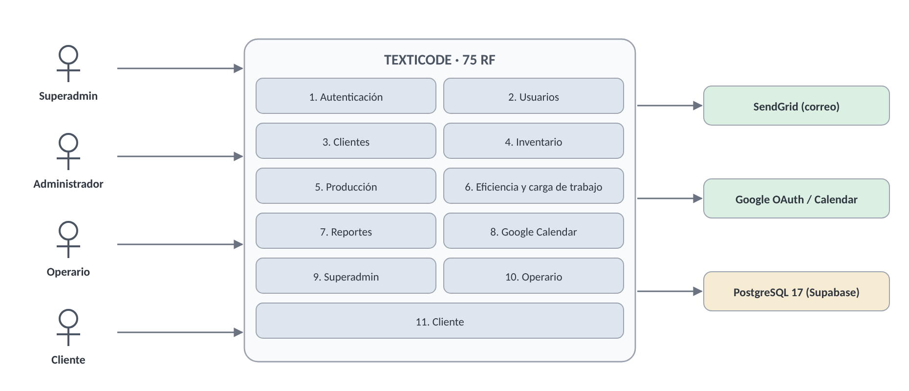
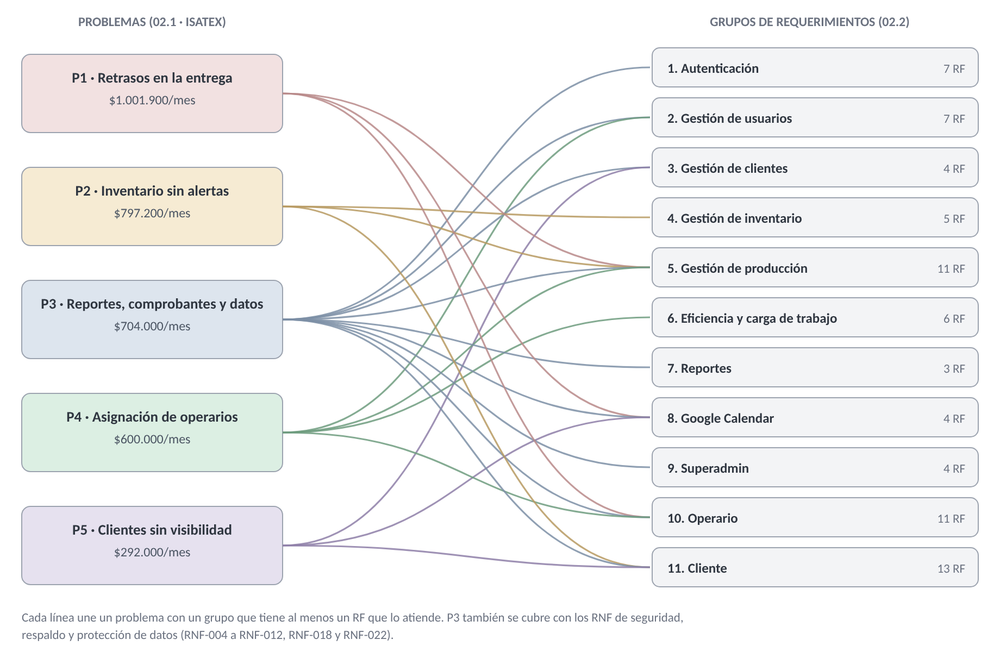

# 02.2 ESPECIFICACIÓN DE REQUERIMIENTOS
## Texticode — ISATEX J&M S.A.S

> **Cómo leer este documento.** Sigue la estructura de la norma **IEEE 830** y traduce las necesidades N1–N7 del **02.1 Análisis del problema de ISATEX J&M S.A.S** en **75 requerimientos funcionales** (RF-001 a RF-075), agrupados en **11 grupos**, y **24 requerimientos no funcionales**. Cada RF dice a qué problema del 02.1 responde y cómo se verifica. Los RF se revisaron contra el código del repositorio (rama *kvnwagner_rama*, 26/10/2026); lo que no coincide quedó en la sección 7.

---

## 1. Introducción

### 1.1 Propósito

Este documento define **qué debe hacer** Texticode para resolver los cinco problemas del análisis 02.1 y **con qué calidad** debe hacerlo, en términos que se puedan comprobar. Es el acuerdo entre ISATEX J&M S.A.S y el equipo de desarrollo, y la base de las pruebas de aceptación. Lo leen la jefe de ISATEX (Diana María Gómez Vaca), el equipo de desarrollo y el instructor evaluador.

### 1.2 Alcance

Texticode es una plataforma web para empresas de confección que gestiona usuarios, clientes, inventario de insumos, órdenes de producción por fases, comprobantes de entrega, eficiencia de operarios, reportes y fechas en Google Calendar. Funciona en modalidad **multiempresa**: una sola instalación atiende a varias empresas, cada una con sus datos aislados. ISATEX J&M S.A.S es la primera empresa cliente de este documento.

**Dentro del alcance:** los 11 módulos de la propuesta comercial del 25/10/2026, que se detallan en los 75 RF de la sección 3, más las funciones de la plataforma que usa el superadmin para crear y administrar empresas.

**Fuera del alcance** (igual que en la propuesta comercial):

- Facturación electrónica ante la DIAN y contabilidad.
- Pasarela de pagos y conciliación bancaria.
- Nómina y liquidación de salarios.
- Compras automáticas a proveedores.
- Cualquier módulo no pactado en la propuesta comercial.

### 1.3 Definiciones y abreviaturas

| Término | Definición |
|---------|------------|
| **Empresa** | Cliente de la plataforma (por ejemplo, ISATEX J&M S.A.S); sus datos están separados de los de otras empresas |
| **Superadmin** | Usuario del equipo Texticode que crea y administra empresas y roles; no opera dentro de ninguna empresa |
| **Administrador** | Persona que dirige la empresa (en ISATEX, la jefe); gestiona usuarios, inventario, producción y reportes |
| **Operario** | Trabajador de planta que ejecuta y reporta las fases que le asignan |
| **Cliente** | Persona o empresa que encarga órdenes y consulta su avance |
| **Orden de producción** | Pedido de un cliente: producto, cantidad, materiales, prioridad, dificultad, fecha límite y estado |
| **Fase** | Etapa de una orden (corte, confección, terminación...) asignada a un operario con una cuota de prendas |
| **Kárdex** | Registro cronológico de entradas y salidas de cada material |
| **Comprobante** | Constancia de entrega de una orden, en estado Pendiente o Entregado |
| **RF / RNF** | Requerimiento funcional / no funcional |
| **P1–P5 / N1–N7** | Problemas y necesidades identificados en el 02.1 Análisis del problema |

### 1.4 Referencias

- IEEE Std 830-1998, *Recommended Practice for Software Requirements Specifications*.
- 02.1 Análisis del problema — Texticode, ISATEX J&M S.A.S, versión 2.0 (25/10/2026).
- Propuesta comercial — Texticode para ISATEX J&M S.A.S (25/10/2026).
- Arquitectura técnica — Texticode, versión 1.1 (25/10/2026).
- Requisitos funcionales de Texticode, RF-001 a RF-075 (documento del equipo, octubre de 2026).
- Ley 1581 de 2012 (protección de datos personales, Colombia).
- Guía de estudio "Análisis del problema y Requerimientos funcionales", Ing. Edwin Marín (19/10/2026).

---

## 2. Descripción general

### 2.1 Perspectiva del producto

Texticode es un sistema independiente: una aplicación web (Vue 3) que consume una API REST (Node.js y Express) y guarda los datos en PostgreSQL 17. Se integra con dos servicios externos: SendGrid para el correo y Google para el inicio de sesión y el calendario. En producción, la web y la API se publican en Vercel Pro y la base de datos en Supabase Pro (ver Arquitectura técnica, sección 2.6).

### 2.2 Funciones principales

Los 75 RF están en 11 grupos. Cada grupo corresponde a uno o más módulos de la propuesta comercial y responde a una necesidad del 02.1:

| Grupo de RF | RF | Módulo de la propuesta comercial | Necesidad (02.1) |
|-------------|----|----------------------------------|------------------|
| 1. Autenticación | RF-001 a RF-007 | 9. Notificaciones por correo · 11. Seguridad y acceso | N7 |
| 2. Administrador · Gestión de usuarios | RF-008 a RF-014 | 1. Gestión de usuarios | N2, N7 |
| 3. Administrador · Gestión de clientes | RF-015 a RF-018 | 6. Clientes y comprobantes | N4 |
| 4. Administrador · Gestión de inventario | RF-019 a RF-023 | 2. Inventario | N3 |
| 5. Administrador · Gestión de producción | RF-024 a RF-034 | 2. Inventario · 3. Producción · 4. Panel del operario · 6. Clientes y comprobantes · 9. Notificaciones por correo | N1, N2, N3, N4 |
| 6. Administrador · Eficiencia y carga de trabajo | RF-035 a RF-040 | 5. Eficiencia y carga de trabajo | N5 |
| 7. Administrador · Reportes | RF-041 a RF-043 | 8. Reportes | N4 |
| 8. Google Calendar | RF-044 a RF-047 | 10. Google Calendar | N6, N7 |
| 9. Superadmin | RF-048 a RF-051 | Plataforma (superadmin) | N4, N7 |
| 10. Operario | RF-052 a RF-062 | 4. Panel del operario | N2, N7 |
| 11. Cliente | RF-063 a RF-075 | 6. Clientes y comprobantes · 7. Panel del cliente · 9. Notificaciones por correo | N4, N6, N7 |

### 2.3 Usuarios

| Usuario | En ISATEX | Conocimiento técnico | Uso principal | Dispositivo |
|---------|-----------|----------------------|---------------|-------------|
| Superadmin | Equipo Texticode (proveedor) | Alto | Crear la empresa, su administrador y los roles | Computador |
| Administrador | La jefe (Diana María Gómez Vaca) | Básico-medio | Planear producción, controlar inventario, revisar eficiencia y reportes | Computador y celular |
| Operario | 6 operarios de planta (supuesto del 02.1) | Básico | Ver sus tareas y reportar avance | Celular |
| Cliente | Unos 15 clientes activos (supuesto del 02.1) | Básico | Consultar pedidos y descargar comprobantes | Celular y computador |

### 2.4 Restricciones

- **R1.** Proyecto del programa ADSO (SENA), desarrollado por 4 aprendices con Scrum; implementación en **7 semanas** según el cronograma de la propuesta.
- **R2.** El tratamiento de datos personales de clientes y empleados debe cumplir la **Ley 1581 de 2012**.
- **R3.** La operación en producción usa planes de pago (Vercel Pro, Supabase Pro y SendGrid Essentials) dentro del costo mensual de **$375.000** de la propuesta.
- **R4.** Interfaz en español (Colombia), moneda COP y zona horaria America/Bogota.
- **R5.** Un usuario pertenece a **una sola empresa** (decisión de diseño de octubre de 2026).

### 2.5 Supuestos y dependencias

- **D1.** ISATEX tiene internet en la oficina y los operarios tienen datos móviles en la planta.
- **D2.** Cada usuario tiene un correo propio para recibir avisos y recuperar su contraseña.
- **D3.** Si SendGrid o Google fallan, el sistema sigue funcionando sin correos ni calendario.
- **D4.** Los datos iniciales de ISATEX se cargan con el Plan de migración de datos (versión 1.1).
- **D5.** El tamaño de la operación (operarios, clientes, órdenes) son los supuestos del 02.1, por validar con ISATEX.

---

## 3. Requerimientos funcionales

**Prioridad.** Sigue las fases del 02.1: **Alta** = Fase 1 (seguridad y acceso, usuarios, producción, panel del operario e inventario: los problemas P1 y P2, el 53 % de la pérdida) · **Media** = Fase 2 (clientes y comprobantes, reportes, panel del cliente y notificaciones: P3 y P5) · **Baja** = Fase 3 (eficiencia, carga de trabajo y Google Calendar: P4). Dentro de cada grupo, las funciones de consulta o comodidad bajan un nivel.

**Formato.** Cada RF tiene identificador, nombre, prioridad, actor, problema del 02.1, descripción y criterios de aceptación. Los RF centrales de cada grupo incluyen además **entradas** y **salidas**, como pide la guía.

### 3.1 Autenticación

*RF-001 a RF-007 · Actor principal: Todos los roles*

| RF-001 | Iniciar sesión |
|---|---|
| **Prioridad** | Alta |
| **Actor** | Todos |
| **Problema (02.1)** | P3 · N7 |
| **Descripción** | El usuario ingresa con su nombre de usuario o correo y su contraseña; puede mostrar u ocultar la contraseña. |
| **Entradas** | Nombre de usuario o correo; contraseña |
| **Salidas** | Sesión activa y redirección al panel del rol (RF-004), o mensaje de error (RF-003) |
| **Criterios de aceptación** | 1. El mismo campo acepta el nombre de usuario o el correo (el servidor busca por ambos). 2. El botón del ojo alterna entre mostrar y ocultar la contraseña. 3. Con credenciales válidas se crea una sesión que vence a las 8 horas (RNF-006). 4. Un usuario, empresa o rol inactivo no puede ingresar. |

| RF-002 | Iniciar sesión con Google |
|---|---|
| **Prioridad** | Media |
| **Actor** | Todos |
| **Problema (02.1)** | P3 · N7 |
| **Descripción** | El usuario puede autenticarse con su cuenta de Google (OAuth2) y el sistema valida que el inicio se haya originado en el mismo navegador. |
| **Criterios de aceptación** | 1. Solo ingresa si ya existe un usuario de Texticode con ese correo. 2. Si el parámetro de estado (state) de OAuth no coincide con el del navegador que inició el flujo, el ingreso se rechaza. 3. Aplica las mismas reglas de usuario, empresa y rol inactivo de RF-001. |

| RF-003 | Validar credenciales |
|---|---|
| **Prioridad** | Alta |
| **Actor** | Todos |
| **Problema (02.1)** | P3 · N7 |
| **Descripción** | El sistema verifica los datos, exige completar ambos campos y muestra un mensaje de error si las credenciales son incorrectas. |
| **Criterios de aceptación** | 1. No envía el formulario si falta el usuario o la contraseña, e indica el campo vacío. 2. Con datos incorrectos muestra un mensaje genérico, sin revelar si falló el usuario o la contraseña. 3. Tras 10 intentos fallidos en 15 minutos para la misma cuenta, o 50 desde la misma IP, rechaza nuevos intentos (RNF-007). |

| RF-004 | Redirigir según rol |
|---|---|
| **Prioridad** | Alta |
| **Actor** | Todos |
| **Problema (02.1)** | P3 · N7 |
| **Descripción** | Al ingresar, el sistema lleva al panel del rol: superadmin, administrador, operario o cliente. |
| **Criterios de aceptación** | 1. Superadmin → panel de empresas; administrador → panel de administración; operario → su cuenta; cliente → su cuenta. 2. La redirección usa el rol que viene en la sesión firmada, no un valor guardado en el navegador. |

| RF-005 | Controlar acceso por rol |
|---|---|
| **Prioridad** | Alta |
| **Actor** | Sistema |
| **Problema (02.1)** | P3 · N7 |
| **Descripción** | El sistema impide abrir pantallas de otro rol y devuelve al login a quien no tenga sesión. |
| **Criterios de aceptación** | 1. Abrir la URL de una pantalla de otro rol redirige al inicio de sesión o al panel propio. 2. Una petición al API sin permiso responde 403 y no modifica datos, aunque se haga sin la interfaz (RNF-009). 3. Operario y cliente solo ven sus propios registros. |

| RF-006 | Recuperar contraseña |
|---|---|
| **Prioridad** | Alta |
| **Actor** | Todos |
| **Problema (02.1)** | P3 · N7 |
| **Descripción** | El usuario solicita por correo un enlace con token para definir una nueva contraseña (mínimo 8 caracteres, mayúscula, número y carácter especial). El enlace se valida antes de mostrar el formulario. |
| **Entradas** | Correo registrado; después, nueva contraseña y su confirmación |
| **Salidas** | Correo con el enlace; contraseña actualizada y redirección al inicio de sesión |
| **Criterios de aceptación** | 1. Muestra el mismo mensaje exista o no el correo, para no revelar qué cuentas existen. 2. El enlace vence en 1 hora y sirve una sola vez; pedir uno nuevo invalida el anterior. 3. Antes de mostrar el formulario se valida el token; si venció o ya se usó, se informa y no se muestra. 4. La nueva contraseña cumple: mínimo 8 caracteres, una mayúscula, un número y un carácter especial, validados también en el servidor (RNF-005). |

| RF-007 | Cerrar sesión |
|---|---|
| **Prioridad** | Alta |
| **Actor** | Todos |
| **Problema (02.1)** | P3 · N7 |
| **Descripción** | El usuario puede cerrar sesión desde el menú lateral de cualquier pantalla, con confirmación. |
| **Criterios de aceptación** | 1. La opción está en el menú lateral de todas las pantallas autenticadas. 2. Pide confirmación; al aceptar, borra la sesión del dispositivo y lleva al inicio de sesión. 3. Con "atrás" en el navegador no se ve información protegida. |

### 3.2 Administrador · Gestión de usuarios

*RF-008 a RF-014 · Actor principal: Administrador*

| RF-008 | Crear usuario |
|---|---|
| **Prioridad** | Alta |
| **Actor** | Administrador |
| **Problema (02.1)** | P4, P3 · N2, N7 |
| **Descripción** | El administrador registra un usuario con nombre completo, nombre de usuario, correo, teléfono (10 dígitos), rol y contraseña segura. |
| **Entradas** | Nombre completo, usuario, correo, teléfono, rol y contraseña |
| **Salidas** | Usuario activo en la lista, con mensaje de confirmación |
| **Criterios de aceptación** | 1. Todos los campos son obligatorios; el teléfono debe tener exactamente 10 dígitos. 2. El correo y el nombre de usuario no se pueden repetir; si ya existen, se indica cuál. 3. La contraseña cumple la política de RF-006 y se guarda cifrada con bcrypt (RNF-004). 4. El usuario queda creado en la empresa del administrador, nunca en otra (RNF-008). |

| RF-009 | Editar usuario |
|---|---|
| **Prioridad** | Alta |
| **Actor** | Administrador |
| **Problema (02.1)** | P4, P3 · N7 |
| **Descripción** | El administrador modifica nombre, usuario, correo, teléfono y rol de un usuario existente. |
| **Criterios de aceptación** | 1. El formulario carga los datos actuales del usuario. 2. Aplica las mismas validaciones de RF-008 (unicidad de correo y usuario, teléfono de 10 dígitos). 3. Solo edita usuarios de su propia empresa. |

| RF-010 | Asignar rol |
|---|---|
| **Prioridad** | Alta |
| **Actor** | Administrador |
| **Problema (02.1)** | P4, P3 · N7 |
| **Descripción** | Al crear o editar, el administrador selecciona el rol entre los roles disponibles (incluido administrador). |
| **Criterios de aceptación** | 1. La lista muestra solo los roles activos: administrador, operario y cliente. 2. El rol superadmin nunca aparece en la lista de una empresa. 3. El cambio de rol se aplica desde el siguiente ingreso del usuario. |

| RF-011 | Desactivar usuario |
|---|---|
| **Prioridad** | Alta |
| **Actor** | Administrador |
| **Problema (02.1)** | P3 · N7 |
| **Descripción** | El administrador desactiva un usuario, con confirmación, para que no pueda ingresar al sistema. |
| **Criterios de aceptación** | 1. Pide confirmación antes de desactivar. 2. El usuario desactivado no puede iniciar sesión y su sesión abierta deja de funcionar en la siguiente petición (RNF-006). 3. Sus registros históricos (órdenes, fases, comprobantes) se conservan. |

| RF-012 | Buscar, filtrar y ordenar usuarios |
|---|---|
| **Prioridad** | Media |
| **Actor** | Administrador |
| **Problema (02.1)** | P4 · N7 |
| **Descripción** | Búsqueda por nombre o correo, filtro por rol (administrador, operario, cliente) y ordenamiento por usuario, rol o fecha de registro. |
| **Criterios de aceptación** | 1. La búsqueda filtra mientras se escribe, sin distinguir mayúsculas. 2. El filtro por rol y la búsqueda se pueden combinar. 3. El orden se puede invertir con un segundo clic en la columna. |

| RF-013 | Ver estadísticas de usuarios |
|---|---|
| **Prioridad** | Baja |
| **Actor** | Administrador |
| **Problema (02.1)** | P4 · N7 |
| **Descripción** | Tarjetas con el total de usuarios, administradores, operarios y clientes. |
| **Criterios de aceptación** | 1. Las cuatro tarjetas muestran conteos de la empresa del administrador. 2. Los totales se actualizan al crear, editar o desactivar un usuario. |

| RF-014 | Editar perfil propio del administrador |
|---|---|
| **Prioridad** | Media |
| **Actor** | Administrador |
| **Problema (02.1)** | P3 · N7 |
| **Descripción** | El administrador consulta y edita su nombre, usuario, correo, teléfono y contraseña desde la tarjeta de perfil. |
| **Criterios de aceptación** | 1. Aplica las validaciones de RF-008. 2. Cambiar la contraseña exige cumplir la política de RF-006. |

### 3.3 Administrador · Gestión de clientes

*RF-015 a RF-018 · Actor principal: Administrador*

| RF-015 | Consultar listado de clientes |
|---|---|
| **Prioridad** | Media |
| **Actor** | Administrador |
| **Problema (02.1)** | P3, P5 · N4 |
| **Descripción** | Se listan los clientes activos con nombre, correo y teléfono, con contador, búsqueda por nombre o correo y ordenamiento por nombre o correo. |
| **Criterios de aceptación** | 1. Solo aparecen clientes activos de la empresa. 2. El contador coincide con el número de filas visibles después de buscar. |

| RF-016 | Consultar comprobantes por cliente |
|---|---|
| **Prioridad** | Media |
| **Actor** | Administrador |
| **Problema (02.1)** | P3 · N4 |
| **Descripción** | Al desplegar un cliente se muestran los comprobantes de sus órdenes completadas con número, fecha y estado. |
| **Criterios de aceptación** | 1. Solo se listan comprobantes de órdenes en estado Completada. 2. Cada fila muestra número de comprobante, fecha y estado (Pendiente o Entregado). |

| RF-017 | Ver detalle del comprobante |
|---|---|
| **Prioridad** | Media |
| **Actor** | Administrador |
| **Problema (02.1)** | P3 · N4 |
| **Descripción** | El administrador abre el comprobante en el formato oficial de Texticode (cliente, fechas, producto, cantidad, estado, observaciones y firmas). |
| **Criterios de aceptación** | 1. El comprobante muestra todos los campos del formato oficial sin datos vacíos. 2. Los datos coinciden con los de la orden en la base. |

| RF-018 | Descargar comprobante en PDF |
|---|---|
| **Prioridad** | Media |
| **Actor** | Administrador |
| **Problema (02.1)** | P3 · N4 |
| **Descripción** | El administrador genera y descarga el comprobante de entrega en PDF. |
| **Criterios de aceptación** | 1. El PDF tiene el mismo contenido que la vista de RF-017. 2. El archivo se genera en menos de 3 segundos y su nombre incluye el número del comprobante. |

### 3.4 Administrador · Gestión de inventario

*RF-019 a RF-023 · Actor principal: Administrador*

| RF-019 | Registrar material |
|---|---|
| **Prioridad** | Alta |
| **Actor** | Administrador |
| **Problema (02.1)** | P2 · N3 |
| **Descripción** | El administrador agrega un material con nombre, categoría (telas, hilos, accesorios), stock actual, unidad, stock mínimo, stock máximo y cliente asociado (opcional). El estado se calcula solo. |
| **Entradas** | Nombre, categoría, stock actual, unidad, mínimo, máximo y cliente (opcional) |
| **Salidas** | Material en la lista con su estado calculado (RF-023) |
| **Criterios de aceptación** | 1. Nombre, categoría, unidad y stock son obligatorios; las cantidades son enteros mayores o iguales a 0. 2. No se puede repetir el nombre del material dentro de la misma empresa. 3. El stock mínimo no puede ser mayor que el máximo. 4. Al guardar se registra el movimiento inicial en el kárdex (RNF-023). |

| RF-020 | Editar material |
|---|---|
| **Prioridad** | Alta |
| **Actor** | Administrador |
| **Problema (02.1)** | P2 · N3 |
| **Descripción** | El administrador actualiza los datos de un material existente. |
| **Criterios de aceptación** | 1. Aplica las validaciones de RF-019. 2. Un cambio de stock queda como movimiento en el kárdex con fecha y cantidad. |

| RF-021 | Eliminar material |
|---|---|
| **Prioridad** | Alta |
| **Actor** | Administrador |
| **Problema (02.1)** | P2 · N3 |
| **Descripción** | El administrador elimina un material, con confirmación. |
| **Criterios de aceptación** | 1. Pide confirmación antes de eliminar. 2. El material no se borra de la base: queda inactivo con stock 0 y la salida se registra en el kárdex (RNF-023). 3. Deja de aparecer en el inventario y en los selectores de nuevas órdenes; las órdenes que ya lo usaron lo conservan. |

| RF-022 | Buscar, filtrar y ordenar materiales |
|---|---|
| **Prioridad** | Media |
| **Actor** | Administrador |
| **Problema (02.1)** | P2 · N3 |
| **Descripción** | Búsqueda por nombre, filtro por categoría y ordenamiento por material, categoría, stock, estado o fecha. |
| **Criterios de aceptación** | 1. La búsqueda y el filtro se pueden combinar. 2. El orden se puede invertir con un segundo clic en la columna. |

| RF-023 | Ver niveles y alertas de stock |
|---|---|
| **Prioridad** | Alta |
| **Actor** | Administrador |
| **Problema (02.1)** | P2 · N3 |
| **Descripción** | El sistema calcula el estado (En Stock, Stock Bajo, Agotado), muestra una barra de nivel respecto al máximo y un panel de alertas con el cliente asociado. |
| **Criterios de aceptación** | 1. Agotado si el stock es 0; Stock Bajo si es menor que el mínimo; En Stock en los demás casos. 2. La barra muestra el porcentaje del stock actual frente al máximo. 3. El panel de alertas lista los materiales en Stock Bajo o Agotado con su cliente asociado. |

### 3.5 Administrador · Gestión de producción

*RF-024 a RF-034 · Actor principal: Administrador*

| RF-024 | Crear orden de producción |
|---|---|
| **Prioridad** | Alta |
| **Actor** | Administrador |
| **Problema (02.1)** | P1 · N1 |
| **Descripción** | El administrador registra una orden con cliente, materiales y cantidades, producto, descripción, cantidad, prioridad, dificultad y fecha límite. |
| **Entradas** | Cliente, materiales y cantidades, producto, descripción, cantidad, prioridad, dificultad y fecha límite |
| **Salidas** | Orden en el tablero, stock descontado y comprobante pendiente |
| **Criterios de aceptación** | 1. Cliente, producto, descripción, cantidad, prioridad, dificultad, fecha límite y al menos un material son obligatorios. 2. La cantidad es un entero mayor que 0. 3. La orden nace en estado En Proceso. 4. Al guardar, descuenta el stock de los materiales en una sola transacción (RF-031, RNF-020) y genera su comprobante (RF-032). |

| RF-025 | Editar orden de producción |
|---|---|
| **Prioridad** | Alta |
| **Actor** | Administrador |
| **Problema (02.1)** | P1 · N1 |
| **Descripción** | El administrador modifica los datos de la orden, incluido su estado (En Proceso, Completada, Retrasada). |
| **Criterios de aceptación** | 1. Aplica las validaciones de RF-024. 2. El estado solo puede ser En Proceso, Completada o Retrasada. 3. Cambiar cantidades de material ajusta el stock según RF-031. |

| RF-026 | Eliminar orden de producción |
|---|---|
| **Prioridad** | Alta |
| **Actor** | Administrador |
| **Problema (02.1)** | P1 · N1 |
| **Descripción** | El administrador elimina una orden, con confirmación. |
| **Criterios de aceptación** | 1. Pide confirmación antes de eliminar. 2. Al eliminarla desaparecen también sus fases, materiales asignados y comprobante. |

| RF-027 | Ver detalle de la orden |
|---|---|
| **Prioridad** | Alta |
| **Actor** | Administrador |
| **Problema (02.1)** | P1 · N1 |
| **Descripción** | Muestra progreso de fabricación, cliente, material principal, dificultad, fechas, descripción, fases con operario y materiales. |
| **Criterios de aceptación** | 1. El progreso es prendas realizadas ÷ cantidad de la orden, en porcentaje. 2. Cada fase muestra número, descripción, operario, estado y prendas reportadas. |

| RF-028 | Ver tareas asignadas a operarios |
|---|---|
| **Prioridad** | Alta |
| **Actor** | Administrador |
| **Problema (02.1)** | P1, P4 · N1, N2 |
| **Descripción** | El listado de órdenes muestra número, producto, cliente, estado, prioridad, fecha límite, cantidad de fases y avance en prendas. El material se consulta en el detalle. |
| **Criterios de aceptación** | 1. Cada fila muestra los ocho datos de la descripción. 2. El listado responde en menos de 2 segundos con hasta 1.000 órdenes (RNF-001). |

| RF-029 | Filtrar órdenes |
|---|---|
| **Prioridad** | Media |
| **Actor** | Administrador |
| **Problema (02.1)** | P1 · N1 |
| **Descripción** | El administrador filtra las órdenes por cliente y por estado; se presentan ordenadas por fecha límite. |
| **Criterios de aceptación** | 1. Los filtros por cliente y por estado se pueden combinar. 2. El resultado se ordena por fecha límite, de la más próxima a la más lejana. |

| RF-030 | Asignar operarios por fases |
|---|---|
| **Prioridad** | Alta |
| **Actor** | Administrador |
| **Problema (02.1)** | P1, P4 · N2 |
| **Descripción** | Cada orden puede dividirse en fases numeradas con descripción y operario responsable. No se puede quitar una fase ya completada. |
| **Entradas** | Número de fase, descripción y operario |
| **Salidas** | Fase asignada visible para el operario (RF-055) y correo de aviso (RF-033) |
| **Criterios de aceptación** | 1. Cada fase tiene número, descripción y un operario activo de la misma empresa. 2. No se repite la misma combinación de orden, número de fase y operario. 3. Una fase en estado Completada no se puede quitar de la orden. |

| RF-031 | Validar stock al asignar materiales |
|---|---|
| **Prioridad** | Alta |
| **Actor** | Administrador |
| **Problema (02.1)** | P2 · N3 |
| **Descripción** | El sistema impide asignar más cantidad que la disponible, considerando lo ya reservado por la propia orden al editarla. |
| **Entradas** | Material y cantidad |
| **Salidas** | Material asignado y stock actualizado, o mensaje con el máximo disponible |
| **Criterios de aceptación** | 1. Si la cantidad pedida supera el stock disponible, la operación se rechaza e indica el máximo posible. 2. Al editar, la cantidad ya reservada por la misma orden cuenta como disponible. 3. El descuento de stock y el registro en el kárdex se hacen en una sola transacción (RNF-020). |

| RF-032 | Generar comprobante al crear la orden |
|---|---|
| **Prioridad** | Media |
| **Actor** | Sistema |
| **Problema (02.1)** | P3 · N4 |
| **Descripción** | Al crear una orden se genera automáticamente su comprobante en estado pendiente. |
| **Criterios de aceptación** | 1. Cada orden nueva tiene exactamente un comprobante, en estado Pendiente. 2. El comprobante queda asociado al cliente de la orden. |

| RF-033 | Notificar la tarea al operario por correo |
|---|---|
| **Prioridad** | Media |
| **Actor** | Sistema |
| **Problema (02.1)** | P1, P4 · N2 |
| **Descripción** | Al asignar una fase, el sistema envía un correo al operario con la tarea, prioridad y fecha límite. |
| **Criterios de aceptación** | 1. El correo llega a la dirección registrada del operario. 2. Incluye producto, descripción de la fase, prioridad y fecha límite. 3. Si el envío falla, la asignación se guarda igual y el error queda en el registro del servidor. |

| RF-034 | Ver estadísticas de producción |
|---|---|
| **Prioridad** | Media |
| **Actor** | Administrador |
| **Problema (02.1)** | P1 · N1 |
| **Descripción** | Tarjetas con total de órdenes, en proceso, completadas y retrasadas. |
| **Criterios de aceptación** | 1. La suma de en proceso, completadas y retrasadas es igual al total. 2. Una orden En Proceso con fecha límite vencida se cuenta como Retrasada (función actualizar_ordenes_retrasadas). |

### 3.6 Administrador · Eficiencia y carga de trabajo

*RF-035 a RF-040 · Actor principal: Administrador*

| RF-035 | Consultar ranking de eficiencia |
|---|---|
| **Prioridad** | Baja |
| **Actor** | Administrador |
| **Problema (02.1)** | P4 · N5 |
| **Descripción** | Ranking de operarios con prendas por día, total producido, órdenes en retraso, completadas y rendimiento (Alto, Medio, Bajo), con búsqueda, filtro y ordenamiento. |
| **Criterios de aceptación** | 1. El rendimiento se calcula contra el promedio del propio operario en los 3 periodos anteriores: Alto si alcanza el 105 % o más; Bajo si queda por debajo del 85 % y además bajó frente al periodo anterior; Medio en los demás casos. 2. Se puede filtrar por rendimiento y buscar por nombre. |

| RF-036 | Ver avance por operario |
|---|---|
| **Prioridad** | Baja |
| **Actor** | Administrador |
| **Problema (02.1)** | P4 · N5 |
| **Descripción** | En el detalle de cada operario se ve el avance de cada orden (unidades realizadas frente al total), prioridad, dificultad y fecha límite, marcando las vencidas. |
| **Criterios de aceptación** | 1. Cada orden muestra unidades realizadas / total. 2. Las órdenes con fecha límite vencida se marcan visualmente. |

| RF-037 | Ver tendencia de rendimiento |
|---|---|
| **Prioridad** | Baja |
| **Actor** | Administrador |
| **Problema (02.1)** | P4 · N5 |
| **Descripción** | El sistema compara el rendimiento del periodo actual contra el anterior (semana, mes o trimestre) e indica si mejora, baja o se mantiene. |
| **Criterios de aceptación** | 1. El administrador elige el periodo: semana, mes o trimestre. 2. Muestra la diferencia en prendas por día y la tendencia: subiendo, bajando o estable. |

| RF-038 | Registrar observaciones sobre operarios |
|---|---|
| **Prioridad** | Baja |
| **Actor** | Administrador |
| **Problema (02.1)** | P4 · N5 |
| **Descripción** | El administrador agrega y elimina observaciones por orden en el detalle del operario. |
| **Criterios de aceptación** | 1. La observación tiene máximo 500 caracteres y queda asociada a una orden. 2. Eliminar una observación pide confirmación. |

| RF-039 | Consultar carga de trabajo |
|---|---|
| **Prioridad** | Baja |
| **Actor** | Administrador |
| **Problema (02.1)** | P4 · N5 |
| **Descripción** | El sistema clasifica a los operarios como disponibles, normales o sobrecargados según sus órdenes activas, con filtro y detalle de órdenes activas. |
| **Criterios de aceptación** | 1. Con los umbrales por defecto: sobrecargado con 8 o más órdenes o fases activas; disponible con 4 o menos; normal en los demás casos. 2. Se puede filtrar por clasificación y ver las órdenes activas de cada operario. |

| RF-040 | Reasignar órdenes |
|---|---|
| **Prioridad** | Baja |
| **Actor** | Administrador |
| **Problema (02.1)** | P4 · N5 |
| **Descripción** | Desde un operario sobrecargado, el administrador reasigna sus órdenes a operarios sugeridos con menor carga. |
| **Criterios de aceptación** | 1. Solo se sugieren operarios activos clasificados como disponibles o normales. 2. Tras reasignar, la carga de ambos operarios se recalcula. |

### 3.7 Administrador · Reportes

*RF-041 a RF-043 · Actor principal: Administrador*

| RF-041 | Ver indicadores de pedidos |
|---|---|
| **Prioridad** | Media |
| **Actor** | Administrador |
| **Problema (02.1)** | P3 · N4 |
| **Descripción** | Tarjetas con pedidos totales, completados, tasa de completación y pendientes, más un gráfico de pedidos de los últimos 6 meses. |
| **Criterios de aceptación** | 1. La tasa de completación es completados ÷ totales. 2. El gráfico muestra un punto por cada uno de los últimos 6 meses. 3. Los indicadores se calculan con datos reales, sin valores fijos en pantalla (ver sección 7). |

| RF-042 | Listar reportes por tipo y período |
|---|---|
| **Prioridad** | Media |
| **Actor** | Administrador |
| **Problema (02.1)** | P3 · N4 |
| **Descripción** | Reportes de pedidos mensuales, pedidos pendientes, eficiencia operaria e inventario, filtrables por tipo y por mes. El inventario por mes se reconstruye desde el historial de movimientos. |
| **Criterios de aceptación** | 1. Hay cuatro tipos de reporte, filtrables por tipo y por mes. 2. El inventario de un mes pasado se reconstruye con los movimientos del kárdex hasta ese mes. |

| RF-043 | Visualizar y exportar reportes |
|---|---|
| **Prioridad** | Media |
| **Actor** | Administrador |
| **Problema (02.1)** | P3 · N4 |
| **Descripción** | Cada reporte puede verse en vista previa PDF, descargarse en PDF y exportarse a Excel. |
| **Criterios de aceptación** | 1. La vista previa, el PDF y el Excel tienen los mismos datos. 2. Un reporte de un mes se genera en menos de 1 minuto (en lugar de las horas del proceso manual del 02.1). |

### 3.8 Google Calendar

*RF-044 a RF-047 · Actor principal: Administrador, operario y cliente*

| RF-044 | Vincular y desvincular cuenta de Google |
|---|---|
| **Prioridad** | Baja |
| **Actor** | Administrador, operario, cliente |
| **Problema (02.1)** | P1, P5 · N6 |
| **Descripción** | El usuario vincula su cuenta con OAuth2, puede reautorizarla y desvincularla. |
| **Criterios de aceptación** | 1. Vincular pide autorización en Google y guarda la conexión del usuario. 2. Desvincular elimina los tokens guardados de ese usuario. |

| RF-045 | Sincronizar fechas de entrega |
|---|---|
| **Prioridad** | Baja |
| **Actor** | Administrador, operario, cliente |
| **Problema (02.1)** | P1, P5 · N6 |
| **Descripción** | El sistema crea o actualiza en el calendario los eventos de las fechas límite sin duplicarlos. |
| **Criterios de aceptación** | 1. Cada orden tiene como máximo un evento por calendario. 2. Si cambia la fecha límite, el evento existente se actualiza. |

| RF-046 | Consultar próximos eventos |
|---|---|
| **Prioridad** | Baja |
| **Actor** | Administrador, operario, cliente |
| **Problema (02.1)** | P1, P5 · N6 |
| **Descripción** | El usuario ve los próximos eventos de Texticode sincronizados y puede abrirlos en Google. |
| **Criterios de aceptación** | 1. Solo muestra eventos creados por Texticode, ordenados por fecha. 2. Cada evento tiene un enlace que lo abre en Google Calendar. |

| RF-047 | Administrar vinculaciones de usuarios |
|---|---|
| **Prioridad** | Baja |
| **Actor** | Administrador |
| **Problema (02.1)** | P3 · N7 |
| **Descripción** | El administrador ve qué usuarios tienen Google vinculado y puede desvincularlos. |
| **Criterios de aceptación** | 1. La lista muestra solo usuarios de su empresa. 2. Desvincular a un usuario tiene el mismo efecto que RF-044. |

### 3.9 Superadmin

*RF-048 a RF-051 · Actor principal: Superadmin*

| RF-048 | Gestionar empresas |
|---|---|
| **Prioridad** | Alta |
| **Actor** | Superadmin |
| **Problema (02.1)** | P3 · N7 |
| **Descripción** | El superadmin crea una empresa junto con su administrador, la edita (nombre, slug, nombre comercial y correo de respuestas), la activa o la desactiva (confirmando con su nombre), con búsqueda y filtro por estado. |
| **Criterios de aceptación** | 1. Crear una empresa crea también su primer administrador. 2. El slug es único en la plataforma. 3. Desactivar exige escribir el nombre de la empresa; sus usuarios no pueden ingresar mientras esté inactiva. |

| RF-049 | Gestionar administradores de empresa |
|---|---|
| **Prioridad** | Alta |
| **Actor** | Superadmin |
| **Problema (02.1)** | P3 · N7 |
| **Descripción** | El superadmin consulta, edita, activa y desactiva los administradores de cada empresa. |
| **Criterios de aceptación** | 1. Lista los administradores agrupados por empresa. 2. Un administrador desactivado no puede ingresar. |

| RF-050 | Gestionar roles globales |
|---|---|
| **Prioridad** | Baja |
| **Actor** | Superadmin |
| **Problema (02.1)** | P3 · N7 |
| **Descripción** | El superadmin crea, edita, activa y desactiva roles. Los roles base no se renombran y el rol superadmin no se desactiva. |
| **Criterios de aceptación** | 1. Los roles base (administrador, operario, cliente, superadmin) no se pueden renombrar. 2. El rol superadmin no se puede desactivar. |

| RF-051 | Consultar estadísticas de correo |
|---|---|
| **Prioridad** | Baja |
| **Actor** | Superadmin |
| **Problema (02.1)** | P3 · N4 |
| **Descripción** | El superadmin ve los correos enviados por día en SendGrid y por empresa. |
| **Criterios de aceptación** | 1. Muestra correos enviados por día y el total por empresa. 2. Permite vigilar el consumo frente al límite del plan contratado de SendGrid. |

### 3.10 Operario

*RF-052 a RF-062 · Actor principal: Operario*

| RF-052 | Ver perfil propio |
|---|---|
| **Prioridad** | Media |
| **Actor** | Operario |
| **Problema (02.1)** | P3 · N7 |
| **Descripción** | El operario consulta su nombre, correo, teléfono y usuario. |
| **Criterios de aceptación** | 1. Muestra solo los datos del operario que inició sesión. |

| RF-053 | Editar perfil propio |
|---|---|
| **Prioridad** | Media |
| **Actor** | Operario |
| **Problema (02.1)** | P3 · N7 |
| **Descripción** | El operario actualiza nombre, correo, teléfono y contraseña. |
| **Criterios de aceptación** | 1. Aplica las validaciones de RF-008 y la política de contraseña de RF-006. 2. No puede cambiar su propio rol. |

| RF-054 | Ver resumen de actividad |
|---|---|
| **Prioridad** | Media |
| **Actor** | Operario |
| **Problema (02.1)** | P4 · N2 |
| **Descripción** | Tarjetas con órdenes completadas, en proceso y total, y una línea de tiempo con su actividad reciente. |
| **Criterios de aceptación** | 1. Las tarjetas cuentan solo las tareas del operario. 2. La línea de tiempo usa los estados reales de sus fases (ver sección 7). |

| RF-055 | Ver tareas asignadas |
|---|---|
| **Prioridad** | Alta |
| **Actor** | Operario |
| **Problema (02.1)** | P1, P4 · N2 |
| **Descripción** | El operario consulta las fases que le fueron asignadas, con contadores de en proceso, completadas, retrasadas y total. |
| **Criterios de aceptación** | 1. Solo ve fases asignadas a él (RF-005). 2. La suma de los contadores es igual al total. |

| RF-056 | Ver instrucciones de la tarea |
|---|---|
| **Prioridad** | Alta |
| **Actor** | Operario |
| **Problema (02.1)** | P1 · N2 |
| **Descripción** | Cada tarea muestra producto, descripción de la fase, material y cliente. |
| **Criterios de aceptación** | 1. Los cuatro datos aparecen en cada tarea sin abrir otra pantalla. |

| RF-057 | Ver fecha límite y prioridad |
|---|---|
| **Prioridad** | Alta |
| **Actor** | Operario |
| **Problema (02.1)** | P1 · N2 |
| **Descripción** | Cada tarea indica su fecha de entrega (resaltada si está vencida) y su prioridad (alta, media o baja). |
| **Criterios de aceptación** | 1. Una fecha anterior a hoy se resalta como vencida. 2. La prioridad se muestra con texto y color. |

| RF-058 | Ver estado de cada tarea |
|---|---|
| **Prioridad** | Alta |
| **Actor** | Operario |
| **Problema (02.1)** | P1 · N2 |
| **Descripción** | Las tareas se clasifican como en proceso, completada o retrasada, con avance en prendas y porcentaje. |
| **Criterios de aceptación** | 1. El porcentaje es prendas reportadas ÷ cuota de la fase. 2. Una tarea en proceso cuya orden está vencida se muestra como retrasada. |

| RF-059 | Buscar y filtrar tareas |
|---|---|
| **Prioridad** | Media |
| **Actor** | Operario |
| **Problema (02.1)** | P1 · N2 |
| **Descripción** | Búsqueda por texto y filtros por estado y prioridad. |
| **Criterios de aceptación** | 1. La búsqueda y los dos filtros se pueden combinar. |

| RF-060 | Registrar avance |
|---|---|
| **Prioridad** | Alta |
| **Actor** | Operario |
| **Problema (02.1)** | P1, P4 · N2 |
| **Descripción** | El operario informa las prendas terminadas de su cuota; el sistema calcula el porcentaje y marca la fase como completada al alcanzar la cuota. |
| **Entradas** | Prendas terminadas y nota opcional (RF-061) |
| **Salidas** | Porcentaje de avance actualizado; fase completada al llegar a la cuota |
| **Criterios de aceptación** | 1. Las prendas reportadas son un entero entre 0 y la cuota de la fase. 2. Al alcanzar la cuota, la fase pasa a Completada y guarda la fecha. 3. Cuando todas las fases de la orden se completan, la orden pasa a Completada y se avisa al cliente (RF-071). |

| RF-061 | Agregar nota al avance |
|---|---|
| **Prioridad** | Media |
| **Actor** | Operario |
| **Problema (02.1)** | P4 · N2 |
| **Descripción** | El operario puede incluir una nota opcional al reportar. |
| **Criterios de aceptación** | 1. La nota es opcional y queda guardada con el avance. 2. El administrador la ve en el detalle de la orden. |

| RF-062 | Consultar historial |
|---|---|
| **Prioridad** | Media |
| **Actor** | Operario |
| **Problema (02.1)** | P4 · N2 |
| **Descripción** | El operario ve las fases completadas con su fecha y nota. |
| **Criterios de aceptación** | 1. Lista solo fases completadas del operario, de la más reciente a la más antigua. |

### 3.11 Cliente

*RF-063 a RF-075 · Actor principal: Cliente*

| RF-063 | Ver perfil propio |
|---|---|
| **Prioridad** | Media |
| **Actor** | Cliente |
| **Problema (02.1)** | P3 · N7 |
| **Descripción** | El cliente consulta su nombre, correo, teléfono y usuario. |
| **Criterios de aceptación** | 1. Muestra solo los datos del cliente que inició sesión. |

| RF-064 | Editar perfil propio |
|---|---|
| **Prioridad** | Media |
| **Actor** | Cliente |
| **Problema (02.1)** | P3 · N7 |
| **Descripción** | El cliente modifica nombre, correo, teléfono y contraseña. |
| **Criterios de aceptación** | 1. Aplica las validaciones de RF-008 y la política de contraseña de RF-006. |

| RF-065 | Ver resumen de cuenta |
|---|---|
| **Prioridad** | Media |
| **Actor** | Cliente |
| **Problema (02.1)** | P5 · N6 |
| **Descripción** | Tarjetas con órdenes totales, entregadas y pendientes. |
| **Criterios de aceptación** | 1. Cuenta solo las órdenes del cliente; entregadas + pendientes = totales. |

| RF-066 | Ver listado de pedidos |
|---|---|
| **Prioridad** | Media |
| **Actor** | Cliente |
| **Problema (02.1)** | P5 · N6 |
| **Descripción** | El cliente ve sus órdenes con producto, material, cantidad, fecha límite, prioridad y estado. |
| **Criterios de aceptación** | 1. Solo ve sus propias órdenes (RF-005). 2. Cada orden muestra los seis datos de la descripción. |

| RF-067 | Buscar y filtrar pedidos |
|---|---|
| **Prioridad** | Media |
| **Actor** | Cliente |
| **Problema (02.1)** | P5 · N6 |
| **Descripción** | Búsqueda por nombre o número y filtro por estado desde las tarjetas de resumen. |
| **Criterios de aceptación** | 1. Al tocar una tarjeta de resumen, el listado se filtra por ese estado. |

| RF-068 | Monitorear progreso de entrega |
|---|---|
| **Prioridad** | Media |
| **Actor** | Cliente |
| **Problema (02.1)** | P5 · N6 |
| **Descripción** | Cada pedido muestra una barra con las prendas realizadas frente a las pedidas. |
| **Criterios de aceptación** | 1. La barra usa las mismas prendas realizadas que ve el administrador (RF-027). |

| RF-069 | Ver estado visual del pedido |
|---|---|
| **Prioridad** | Media |
| **Actor** | Cliente |
| **Problema (02.1)** | P5 · N6 |
| **Descripción** | Un banner indica si la orden está en producción (con prendas restantes), completada o retrasada. |
| **Criterios de aceptación** | 1. En producción muestra cuántas prendas faltan. 2. El banner usa un color distinto para cada estado. |

| RF-070 | Ver y descargar comprobante de entrega |
|---|---|
| **Prioridad** | Media |
| **Actor** | Cliente |
| **Problema (02.1)** | P3, P5 · N4, N6 |
| **Descripción** | El cliente abre el comprobante detallado de sus órdenes y lo descarga en PDF (en Pedidos solo cuando la orden está completada). |
| **Entradas** | Selección de una orden |
| **Salidas** | Comprobante en pantalla y archivo PDF |
| **Criterios de aceptación** | 1. Solo accede a comprobantes de sus propias órdenes. 2. En la pantalla de pedidos el botón de descarga aparece solo si la orden está Completada. 3. El número y el formato son los mismos que ve el administrador en RF-017 (ver sección 7). |

| RF-071 | Recibir notificación por correo |
|---|---|
| **Prioridad** | Media |
| **Actor** | Sistema |
| **Problema (02.1)** | P5 · N6 |
| **Descripción** | El sistema envía un correo al cliente cuando su orden pasa a Completada. |
| **Criterios de aceptación** | 1. Cuando la orden pasa a Completada, el cliente recibe un correo con el número de orden y el producto. 2. El correo se envía después de guardar el avance; si falla, el avance no se pierde. |

| RF-072 | Consultar alertas de materiales |
|---|---|
| **Prioridad** | Media |
| **Actor** | Cliente |
| **Problema (02.1)** | P2, P5 · N6 |
| **Descripción** | El cliente ve sus materiales con estado (disponible, stock bajo, agotado), nivel frente al máximo y un panel de alertas. |
| **Criterios de aceptación** | 1. Solo ve materiales asociados a él. 2. El estado usa las mismas reglas de RF-023. |

| RF-073 | Ver información de contacto |
|---|---|
| **Prioridad** | Baja |
| **Actor** | Cliente |
| **Problema (02.1)** | P5 · N6 |
| **Descripción** | Se muestran teléfono, WhatsApp, correo y horario de atención. |
| **Criterios de aceptación** | 1. Los datos coinciden con los canales de soporte de la propuesta comercial. |

| RF-074 | Contactar soporte por canales directos |
|---|---|
| **Prioridad** | Baja |
| **Actor** | Cliente |
| **Problema (02.1)** | P5 · N6 |
| **Descripción** | El cliente puede llamar, escribir por WhatsApp o enviar un correo desde la pantalla. |
| **Criterios de aceptación** | 1. Cada botón abre la aplicación correspondiente con el número o correo ya cargado. |

| RF-075 | Consultar preguntas frecuentes |
|---|---|
| **Prioridad** | Baja |
| **Actor** | Cliente |
| **Problema (02.1)** | P5 · N6 |
| **Descripción** | Sección de FAQ con respuestas sobre pedidos, comprobantes y progreso. |
| **Criterios de aceptación** | 1. Cubre al menos pedidos, comprobantes y progreso. |

---

## 4. Requerimientos no funcionales

| ID | Categoría | Requerimiento | Cómo se verifica |
|----|-----------|---------------|------------------|
| RNF-001 | Rendimiento | Los listados (órdenes, usuarios, inventario) responden en **menos de 2 s** con hasta 1.000 órdenes por empresa | Medición en el navegador (DevTools → Network) con datos de prueba |
| RNF-002 | Rendimiento | La pantalla de inicio de sesión carga su contenido principal (LCP) en **menos de 2,5 s** en perfil móvil | Lighthouse, perfil móvil |
| RNF-003 | Rendimiento | Asignar materiales a una orden (RF-031) responde en **menos de 1 s** | Tiempo de respuesta del endpoint |
| RNF-004 | Seguridad | Las contraseñas se guardan cifradas con **bcrypt**; ninguna se guarda ni se devuelve en texto plano | Revisión de la base: todas inician con `$2a$` o `$2b$` |
| RNF-005 | Seguridad | La política de contraseña (8 caracteres, mayúscula, número y carácter especial) se valida **en el servidor**, no solo en la pantalla | Prueba directa al API con una contraseña débil → rechazo |
| RNF-006 | Seguridad | La sesión vence a las **8 horas**; desactivar un usuario, empresa o rol corta su acceso en la siguiente petición | Prueba con un token vencido y con un usuario recién desactivado |
| RNF-007 | Seguridad | Máximo **10 intentos de inicio de sesión por cuenta y 50 por IP cada 15 minutos** | Prueba con 11 intentos seguidos |
| RNF-008 | Seguridad | **Ningún** usuario puede leer ni modificar datos de otra empresa | Pruebas automáticas de aislamiento (`BACKEND/test/*-aislamiento.test.js`) |
| RNF-009 | Seguridad | Los permisos por rol se aplican **en el servidor**; una operación sin permiso responde 403 sin modificar datos | Token de operario contra una ruta de administrador → 403 |
| RNF-010 | Seguridad | Los enlaces de recuperación son de **un solo uso y vencen en 1 hora** | Usar un enlace dos veces o después de 1 h → rechazo |
| RNF-011 | Seguridad | En producción todo el tráfico va por **HTTPS**; las claves (JWT, SendGrid, Google, base de datos) solo están en variables de entorno, nunca en el repositorio | Revisión del despliegue y búsqueda de claves en el repositorio |
| RNF-012 | Seguridad | Todas las consultas a la base son **parametrizadas** y los errores internos devuelven un mensaje genérico | Revisión de código y prueba con `' OR 1=1 --` |
| RNF-013 | Usabilidad | Interfaz completa en **español**, con mensajes de error que dicen qué pasó y cómo corregirlo | Revisión de pantallas y formularios |
| RNF-014 | Usabilidad | Las pantallas se usan sin desplazamiento horizontal desde **360 px de ancho** | Modo responsive del navegador y un celular real |
| RNF-015 | Usabilidad | Cualquier función principal de un rol está a **máximo 3 clics** desde su menú lateral | Recorrido de las funciones de cada rol |
| RNF-016 | Compatibilidad | La web funciona en las **dos últimas versiones** de Chrome, Edge y Firefox, en computador y en Android | Pruebas de humo en cada navegador |
| RNF-017 | Mantenibilidad | El código está en GitHub; cada cambio a `main` entra por **Pull Request revisado** y el backend tiene pruebas automáticas | Historial de PR y ejecución de `npm test` |
| RNF-018 | Fiabilidad | **Copia automática diaria** de la base (retención de 7 días en Supabase Pro), **copia mensual exportada** fuera de la plataforma (retención de 12 meses) y **prueba de restauración trimestral** | Registro de copias y acta de la prueba de restauración |
| RNF-019 | Fiabilidad | Disponibilidad mínima del **99 % mensual** (máximo 7,2 h sin servicio en un mes de 720 h) | Monitoreo del endpoint `/health` |
| RNF-020 | Fiabilidad | Los movimientos de inventario (RF-020, RF-024, RF-031) son **atómicos**: se aplican completos o no se aplica ninguno | Prueba forzando un error a mitad de la operación |
| RNF-021 | Portabilidad | El sistema se instala con **Docker Compose** en menos de 15 minutos y funciona con PostgreSQL local o Supabase cambiando solo la cadena de conexión | Instalación en un equipo limpio con la documentación |
| RNF-022 | Legal | El tratamiento de datos personales cumple la **Ley 1581 de 2012**: solo los roles autorizados ven datos de contacto y existe una política de tratamiento de datos | Revisión de permisos y de la política publicada |
| RNF-023 | Auditabilidad | Todo cambio de stock queda en el kárdex con fecha, tipo, cantidad y orden; el stock siempre es igual a la suma de sus movimientos | Consulta SQL de conciliación: 0 diferencias |
| RNF-024 | Escalabilidad | Una sola instalación atiende **varias empresas** sin cambiar el código; agregar una empresa no requiere intervención técnica | Crear una empresa desde el panel del superadmin (RF-048) |

> **Nota sobre RNF-019.** La guía señala un error del documento de referencia: pedir "85 % de disponibilidad" con "máximo 7,2 horas sin servicio al mes" se contradice, porque el 15 % de 720 h son 108 h. Aquí el porcentaje y las horas coinciden: el 1 % de 720 h son **7,2 h**.

---

## 5. Restricciones y supuestos del proyecto

| Tipo | Descripción |
|------|-------------|
| Tiempo | 7 semanas de implementación según el cronograma de la propuesta comercial: análisis, configuración y migración, pruebas, capacitación y puesta en marcha |
| Equipo | 4 aprendices: Andrés Lancheros, Camilo Tibambre, Kevin Castro y Kevin Montenegro |
| Tecnología | Vue 3 y Vite (web), Node.js y Express (API), PostgreSQL 17 (Supabase en producción, Docker en desarrollo) |
| Legal | Ley 1581 de 2012 (datos personales) |
| Costo | Inversión única de $6.783.000 y operación de $375.000 al mes con IVA (propuesta comercial) |
| Supuesto | Las cifras de la operación de ISATEX son supuestos del 02.1 que se validan en la primera semana del proyecto |
| Supuesto | Los datos iniciales se cargan con el Plan de migración de datos antes de la puesta en marcha |
| Supuesto | Cada rol recibe una capacitación corta antes del arranque (fase 4 del cronograma) |

---

## 6. Matriz de trazabilidad

Une cada RF con el **problema** del 02.1 que resuelve, la **necesidad** que atiende, el **módulo** de la propuesta comercial que lo entrega y la **prueba** que lo verifica. Así se cumple la regla de la guía: *un requerimiento que no responde a ningún problema, sobra*.

| RF | Nombre | Prioridad | Problema | Necesidad | Módulo (propuesta) | Verificación |
|----|--------|-----------|----------|-----------|--------------------|--------------|
| RF-001 | Iniciar sesión | Alta | P3 | N7 | 11 | security.test.js · multitenant-auth.test.js |
| RF-002 | Iniciar sesión con Google | Media | P3 | N7 | 11 | Criterios RF-002 |
| RF-003 | Validar credenciales | Alta | P3 | N7 | 11 | security.test.js · RNF-007 |
| RF-004 | Redirigir según rol | Alta | P3 | N7 | 11 | Criterios RF-004 |
| RF-005 | Controlar acceso por rol | Alta | P3 | N7 | 11 | http-security.test.js · RNF-009 |
| RF-006 | Recuperar contraseña | Alta | P3 | N7 | 11 · 9 | RNF-005 · RNF-010 |
| RF-007 | Cerrar sesión | Alta | P3 | N7 | 11 | Criterios RF-007 |
| RF-008 | Crear usuario | Alta | P4, P3 | N2, N7 | 1 | fase-6-contexto-empresa.test.js · RNF-008 |
| RF-009 | Editar usuario | Alta | P4, P3 | N7 | 1 | Criterios RF-009 |
| RF-010 | Asignar rol | Alta | P4, P3 | N7 | 1 | Criterios RF-010 |
| RF-011 | Desactivar usuario | Alta | P3 | N7 | 1 | Criterios RF-011 · RNF-006 |
| RF-012 | Buscar, filtrar y ordenar usuarios | Media | P4 | N7 | 1 | Criterios RF-012 |
| RF-013 | Ver estadísticas de usuarios | Baja | P4 | N7 | 1 | Criterios RF-013 |
| RF-014 | Editar perfil propio del administrador | Media | P3 | N7 | 1 | Criterios RF-014 |
| RF-015 | Consultar listado de clientes | Media | P3, P5 | N4 | 6 | Criterios RF-015 |
| RF-016 | Consultar comprobantes por cliente | Media | P3 | N4 | 6 | Criterios RF-016 |
| RF-017 | Ver detalle del comprobante | Media | P3 | N4 | 6 | Criterios RF-017 |
| RF-018 | Descargar comprobante en PDF | Media | P3 | N4 | 6 | Criterios RF-018 |
| RF-019 | Registrar material | Alta | P2 | N3 | 2 | materiales-aislamiento.test.js · RNF-023 |
| RF-020 | Editar material | Alta | P2 | N3 | 2 | Criterios RF-020 · RNF-023 |
| RF-021 | Eliminar material | Alta | P2 | N3 | 2 | Criterios RF-021 · RNF-023 |
| RF-022 | Buscar, filtrar y ordenar materiales | Media | P2 | N3 | 2 | Criterios RF-022 |
| RF-023 | Ver niveles y alertas de stock | Alta | P2 | N3 | 2 | Criterios RF-023 |
| RF-024 | Crear orden de producción | Alta | P1 | N1 | 3 | ordenes-aislamiento.test.js · orden-material-aislamiento.test.js |
| RF-025 | Editar orden de producción | Alta | P1 | N1 | 3 | Criterios RF-025 |
| RF-026 | Eliminar orden de producción | Alta | P1 | N1 | 3 | Criterios RF-026 |
| RF-027 | Ver detalle de la orden | Alta | P1 | N1 | 3 | Criterios RF-027 |
| RF-028 | Ver tareas asignadas a operarios | Alta | P1, P4 | N1, N2 | 3 | Criterios RF-028 · RNF-001 |
| RF-029 | Filtrar órdenes | Media | P1 | N1 | 3 | Criterios RF-029 |
| RF-030 | Asignar operarios por fases | Alta | P1, P4 | N2 | 3 · 4 | orden-operario-aislamiento.test.js |
| RF-031 | Validar stock al asignar materiales | Alta | P2 | N3 | 2 · 3 | orden-material-aislamiento.test.js · RNF-020 |
| RF-032 | Generar comprobante al crear la orden | Media | P3 | N4 | 6 | Criterios RF-032 |
| RF-033 | Notificar la tarea al operario por correo | Media | P1, P4 | N2 | 9 | Criterios RF-033 |
| RF-034 | Ver estadísticas de producción | Media | P1 | N1 | 3 | Criterios RF-034 |
| RF-035 | Consultar ranking de eficiencia | Baja | P4 | N5 | 5 | Criterios RF-035 |
| RF-036 | Ver avance por operario | Baja | P4 | N5 | 5 | Criterios RF-036 |
| RF-037 | Ver tendencia de rendimiento | Baja | P4 | N5 | 5 | Criterios RF-037 |
| RF-038 | Registrar observaciones sobre operarios | Baja | P4 | N5 | 5 | Criterios RF-038 |
| RF-039 | Consultar carga de trabajo | Baja | P4 | N5 | 5 | Criterios RF-039 |
| RF-040 | Reasignar órdenes | Baja | P4 | N5 | 5 | Criterios RF-040 |
| RF-041 | Ver indicadores de pedidos | Media | P3 | N4 | 8 | Criterios RF-041 |
| RF-042 | Listar reportes por tipo y período | Media | P3 | N4 | 8 | Criterios RF-042 |
| RF-043 | Visualizar y exportar reportes | Media | P3 | N4 | 8 | Criterios RF-043 |
| RF-044 | Vincular y desvincular cuenta de Google | Baja | P1, P5 | N6 | 10 | Criterios RF-044 |
| RF-045 | Sincronizar fechas de entrega | Baja | P1, P5 | N6 | 10 | Criterios RF-045 |
| RF-046 | Consultar próximos eventos | Baja | P1, P5 | N6 | 10 | Criterios RF-046 |
| RF-047 | Administrar vinculaciones de usuarios | Baja | P3 | N7 | 10 | Criterios RF-047 |
| RF-048 | Gestionar empresas | Alta | P3 | N7 | Plataforma | fase-6-2-superadmin.test.js · aislamiento-empresas.test.js |
| RF-049 | Gestionar administradores de empresa | Alta | P3 | N7 | Plataforma | Criterios RF-049 |
| RF-050 | Gestionar roles globales | Baja | P3 | N7 | Plataforma | Criterios RF-050 |
| RF-051 | Consultar estadísticas de correo | Baja | P3 | N4 | Plataforma | Criterios RF-051 |
| RF-052 | Ver perfil propio | Media | P3 | N7 | 4 | Criterios RF-052 |
| RF-053 | Editar perfil propio | Media | P3 | N7 | 4 | Criterios RF-053 |
| RF-054 | Ver resumen de actividad | Media | P4 | N2 | 4 | Criterios RF-054 |
| RF-055 | Ver tareas asignadas | Alta | P1, P4 | N2 | 4 | orden-operario-aislamiento.test.js |
| RF-056 | Ver instrucciones de la tarea | Alta | P1 | N2 | 4 | Criterios RF-056 |
| RF-057 | Ver fecha límite y prioridad | Alta | P1 | N2 | 4 | Criterios RF-057 |
| RF-058 | Ver estado de cada tarea | Alta | P1 | N2 | 4 | Criterios RF-058 |
| RF-059 | Buscar y filtrar tareas | Media | P1 | N2 | 4 | Criterios RF-059 |
| RF-060 | Registrar avance | Alta | P1, P4 | N2 | 4 | orden-operario-aislamiento.test.js |
| RF-061 | Agregar nota al avance | Media | P4 | N2 | 4 | Criterios RF-061 |
| RF-062 | Consultar historial | Media | P4 | N2 | 4 | Criterios RF-062 |
| RF-063 | Ver perfil propio | Media | P3 | N7 | 7 | Criterios RF-063 |
| RF-064 | Editar perfil propio | Media | P3 | N7 | 7 | Criterios RF-064 |
| RF-065 | Ver resumen de cuenta | Media | P5 | N6 | 7 | Criterios RF-065 |
| RF-066 | Ver listado de pedidos | Media | P5 | N6 | 7 | ordenes-aislamiento.test.js |
| RF-067 | Buscar y filtrar pedidos | Media | P5 | N6 | 7 | Criterios RF-067 |
| RF-068 | Monitorear progreso de entrega | Media | P5 | N6 | 7 | Criterios RF-068 |
| RF-069 | Ver estado visual del pedido | Media | P5 | N6 | 7 | Criterios RF-069 |
| RF-070 | Ver y descargar comprobante de entrega | Media | P3, P5 | N4, N6 | 6 · 7 | Criterios RF-070 |
| RF-071 | Recibir notificación por correo | Media | P5 | N6 | 9 | Criterios RF-071 (routes/orden_operario.js) |
| RF-072 | Consultar alertas de materiales | Media | P2, P5 | N6 | 7 | Criterios RF-072 |
| RF-073 | Ver información de contacto | Baja | P5 | N6 | 7 | Criterios RF-073 |
| RF-074 | Contactar soporte por canales directos | Baja | P5 | N6 | 7 | Criterios RF-074 |
| RF-075 | Consultar preguntas frecuentes | Baja | P5 | N6 | 7 | Criterios RF-075 |

### 6.1 Resumen de cobertura

| Problema (02.1) | Pérdida mensual | RF que lo atienden | RNF relacionados |
|-----------------|-----------------|--------------------|------------------|
| P1. Retrasos en la entrega de órdenes | $1.001.900 | 18 | RNF-001, RNF-019 |
| P2. Inventario manual y sin alertas | $797.200 | 7 | RNF-003, RNF-020, RNF-023 |
| P3. Reportes y comprobantes manuales (incluye el riesgo de la Ley 1581) | $704.000 | 30 | RNF-004 a RNF-012, RNF-018, RNF-022 |
| P4. Asignación desordenada de operarios | $600.000 | 19 | RNF-001, RNF-015 |
| P5. Clientes sin visibilidad de su pedido | $292.000 | 15 | RNF-013, RNF-014, RNF-016 |

| Prioridad | Cantidad | % |
|-----------|----------|---|
| Alta | 28 | 37 % |
| Media | 31 | 41 % |
| Baja | 16 | 21 % |
| **Total** | **75** | **100 %** |

Ningún RF queda sin problema asociado y los cinco problemas del 02.1 tienen requerimientos que los atienden. Un RF puede atender a más de un problema, por eso la suma de la primera tabla es mayor que 75.

---

## 7. Puntos por revisar

Resultado de comparar los RF con el código de la rama *kvnwagner_rama* (commit `0fcd85d`, 26/10/2026).

| # | Punto | Hallazgo | Estado | Acción |
|---|-------|----------|--------|--------|
| 1 | RF-071 · correo al cambiar el estado | El backend envía el correo al cliente solo cuando la orden pasa a **Completada** (`routes/orden_operario.js`). La función `notificarEstado` del frontend existe, pero ninguna vista la usa. | Resuelto | RF-071 se redactó con el comportamiento real. Si se quiere avisar en cada cambio de estado, es un RF nuevo. |
| 2 | RF-001 · campo de inicio de sesión | El backend acepta el correo o el nombre de usuario en el mismo campo (`auth.service.js`). | Resuelto | Cambiar la etiqueta del campo a "Usuario o correo". |
| 3 | RF-041 · datos fijos en Reportes | Los porcentajes de variación (+8,3 %, +12,5 %, +2,3 %) están escritos a mano en la pantalla. | Pendiente | Calcularlos con datos reales o quitarlos. |
| 4 | RF-054 · línea de tiempo del operario | El progreso se calcula por estado (58 % o 28 %) y usa el estado "Pausado", que ya no existe. | Pendiente | Usar las prendas reportadas y los estados reales de la fase. |
| 5 | RF-070 · comprobantes del cliente | El cliente ve el número de la orden y el administrador el del comprobante; el PDF del cliente es más simple que el oficial. | Pendiente | Unificar número y formato con RF-017. |
| 6 | RF-011 · usuarios desactivados | El API devuelve todos los usuarios, pero la pantalla solo muestra los activos, así que no se pueden reactivar. | Pendiente | Agregar un filtro de inactivos y la opción de reactivar (posible RF-076). |
| 7 | Página de inicio (landing) | Dice "49 requisitos funcionales" y "7 módulos" con la numeración anterior. | Pendiente | Actualizar a 75 RF (RF-001 a RF-075) y 11 grupos. |
| 8 | RF eliminados | Estadísticas de clientes, pausar o continuar tareas, facturas y guías en soporte, y dirección en contacto no existen en el código. | Decidido | Quedan fuera del alcance (ver Anexo A). |

---

## 8. Aprobaciones

| Rol | Nombre | Firma | Fecha |
|-----|--------|-------|-------|
| Analista | Andrés Lancheros | ________ | __/__/____ |
| Analista | Camilo Tibambre | ________ | __/__/____ |
| Analista | Kevin Castro | ________ | __/__/____ |
| Analista | Kevin Montenegro | ________ | __/__/____ |
| Cliente — ISATEX J&M S.A.S | Diana María Gómez Vaca, Jefe | ________ | __/__/____ |
| Docente | Ing. Edwin Marín | ________ | __/__/____ |

## Anexo A · Equivalencias con la numeración anterior

Relación entre los 49 RF de la versión anterior y los 75 actuales.

| Anterior | Actual | Anterior | Actual |
|----------|--------|----------|--------|
| RF-001 | RF-001 | RF-028 | RF-054 |
| RF-002 | RF-003 | RF-029 | RF-044 y RF-045 |
| RF-003 | RF-004 | RF-030 | RF-055 |
| RF-004 | RF-007 | RF-031 | RF-056 |
| RF-005 | RF-008 | RF-032 | RF-057 |
| RF-006 | RF-009 | RF-033 | RF-058 |
| RF-007 | RF-011 | RF-034 | RF-060 |
| RF-008 | RF-012 | RF-035 | Eliminado |
| RF-009 | RF-010 | RF-036 | RF-061 |
| RF-010 | RF-015 | RF-037 | RF-062 |
| RF-011 | Eliminado | RF-038 | RF-063 |
| RF-012 | RF-016 | RF-039 | RF-064 |
| RF-013 | RF-017 | RF-040 | RF-065 |
| RF-014 | RF-018 | RF-041 | RF-066 |
| RF-015 | RF-016 (fusionado) | RF-042 | RF-070 |
| RF-016 | RF-019 | RF-043 | RF-068 |
| RF-017 | RF-020 | RF-044 | RF-071 |
| RF-018 | RF-021 | RF-045 | RF-069 |
| RF-019 | RF-036 | RF-046 | RF-070 (fusionado) |
| RF-020 | RF-028 | RF-047 | RF-073 |
| RF-021 | RF-029 | RF-048 | RF-074 |
| RF-026 | RF-052 | RF-049 | RF-075 |
| RF-027 | RF-053 |  |  |

Los RF anteriores RF-022 a RF-025 no tienen equivalencia registrada: el documento de la versión anterior ya no se conserva. Los 75 RF actuales se definieron directamente a partir del sistema implementado.
