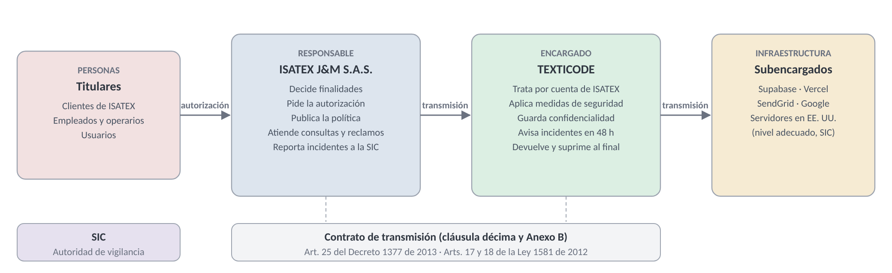

# CONTRATO DE SERVICIOS DE PLATAFORMA TECNOLÓGICA Y SOPORTE
## Contrato No. TXC-ISATEX-2026-001

> **Sobre este documento.** Contrato de licencia de uso, implementación, soporte y **encargo del tratamiento de datos personales** entre el equipo TEXTICODE e ISATEX J&M S.A.S. Desarrolla los términos de la propuesta comercial del 25/10/2026 y aplica la **Ley 1581 de 2012** y sus decretos reglamentarios. Los datos marcados con **[●]** (cédulas, direcciones y fechas) se completan antes de la firma. Es un modelo elaborado en el programa ADSO; antes de firmarlo con la empresa debe revisarlo un abogado.

---

## Comparecientes

| Parte | Identificación |
|-------|----------------|
| **EL PROVEEDOR** (también "TEXTICODE") | **Kevin Stevan Wagner Montenegro**, C.C. [●]; **Andrés Felipe Lancheros**, C.C. [●]; **Camilo Andrés Tibambre**, C.C. [●]; y **Kevin Andrés Castro**, C.C. [●]. Personas naturales mayores de edad, domiciliadas en Bogotá D.C., que actúan de forma **conjunta y solidaria** bajo el nombre comercial TEXTICODE. Para notificaciones y firma de actas las representa Kevin Stevan Wagner Montenegro. Correo: Texticode2026@gmail.com · Teléfono: 322 442 1303. |
| **EL CLIENTE** | **ISATEX J&M S.A.S.**, NIT 901.579.899-8, con domicilio en [●], Bogotá D.C., representada por **Diana María Gómez Vaca**, C.C. [●], en su calidad de [representante legal / apoderada] [●]. |

Ambas partes declaran tener capacidad legal para obligarse y acuerdan celebrar el presente contrato, que se rige por las cláusulas siguientes y, en lo no previsto, por el Código de Comercio y el Código Civil colombianos.

---

## Consideraciones

1. EL CLIENTE es una empresa de confección que hoy gestiona sus órdenes, inventario, reportes y comprobantes de forma manual, con una pérdida estimada de $3.400.000 al mes (documento 02.1 Análisis del problema, versión 2.0).
2. EL PROVEEDOR desarrolló **Texticode**, una plataforma web multiempresa de gestión de producción textil, y presentó a EL CLIENTE la propuesta comercial del 25 de octubre de 2026, que EL CLIENTE aceptó.
3. Para prestar el servicio, EL PROVEEDOR almacenará y procesará datos personales de clientes, empleados y usuarios de EL CLIENTE. Por eso las partes regulan en este contrato el **encargo del tratamiento** que exigen el artículo 25 del Decreto 1377 de 2013 y los artículos 17 y 18 de la Ley 1581 de 2012.
4. El software es una obra protegida por el derecho de autor (Ley 23 de 1982, Decisión Andina 351 de 1993 y Decreto 1360 de 1989). Este contrato concede una **licencia de uso**, no una cesión de derechos.

---

## Cláusula primera · Definiciones

Las palabras con mayúscula inicial tienen el significado siguiente. Los términos de protección de datos tienen el sentido del artículo 3 de la Ley 1581 de 2012.

| Término | Significado |
|---------|-------------|
| **Plataforma** | Texticode — Sistema de Gestión Textil: aplicación web, API REST y base de datos, con los 11 módulos de la cláusula tercera |
| **Licencia** | Derecho no exclusivo, intransferible y temporal de acceso y uso de la Plataforma |
| **Implementación** | Análisis, configuración, migración de datos, pruebas, capacitación y puesta en marcha, en 7 semanas |
| **Acta de entrega** | Documento firmado por ambas partes que declara la Plataforma en producción; su fecha es la **Fecha de activación** |
| **Datos del Cliente** | Toda la información que EL CLIENTE o sus usuarios registran en la Plataforma, incluidos los datos personales |
| **Dato personal** | Información vinculada o que pueda asociarse a una persona natural determinada o determinable (art. 3, lit. c, Ley 1581) |
| **Titular** | Persona natural cuyos datos son objeto de tratamiento: clientes, empleados y usuarios de EL CLIENTE |
| **Tratamiento** | Recolección, almacenamiento, uso, circulación o supresión de datos personales |
| **Responsable** | Quien decide sobre la base de datos y el tratamiento. En este contrato: **EL CLIENTE** |
| **Encargado** | Quien trata datos por cuenta del Responsable. En este contrato: **EL PROVEEDOR** |
| **Subencargado** | Proveedor de infraestructura que EL PROVEEDOR usa para prestar el servicio (Anexo E) |
| **Transmisión** | Comunicación de datos del Responsable al Encargado, dentro o fuera de Colombia, para que los trate por su cuenta (art. 3, Decreto 1377 de 2013) |
| **Incidente de seguridad** | Violación de los códigos de seguridad, o pérdida, robo o acceso no autorizado a los Datos del Cliente |
| **SLA** | Acuerdo de niveles de servicio del Anexo C |
| **SIC** | Superintendencia de Industria y Comercio, autoridad de protección de datos personales |

---

## Cláusula segunda · Objeto

EL PROVEEDOR se obliga a: (i) implementar la Plataforma para EL CLIENTE; (ii) otorgarle una **Licencia** de acceso y uso durante la vigencia del contrato; (iii) prestarle alojamiento, respaldo de datos, soporte técnico y mantenimiento; y (iv) **tratar los datos personales** que EL CLIENTE le transmita, en calidad de **Encargado**, únicamente para prestar el servicio y siguiendo las instrucciones de EL CLIENTE. EL CLIENTE se obliga a pagar el precio de la cláusula quinta y a cumplir sus deberes como Responsable del tratamiento.

---

## Cláusula tercera · Alcance del servicio

### 3.1 Módulos incluidos

EL PROVEEDOR da acceso a los once módulos de la propuesta comercial, especificados en los 75 requerimientos funcionales del documento 02.2:

| # | Módulo | Requerimientos (02.2) |
|---|--------|-----------------------|
| 1 | Gestión de usuarios | RF-008 a RF-014 |
| 2 | Inventario de materiales con alertas y kárdex | RF-019 a RF-023 |
| 3 | Producción por fases | RF-024 a RF-034 |
| 4 | Panel del operario | RF-052 a RF-062 |
| 5 | Eficiencia y carga de trabajo | RF-035 a RF-040 |
| 6 | Clientes y comprobantes de entrega | RF-015 a RF-018 |
| 7 | Panel del cliente | RF-063 a RF-075 |
| 8 | Reportes en PDF y Excel | RF-041 a RF-043 |
| 9 | Notificaciones por correo | RF-033, RF-071 |
| 10 | Google Calendar | RF-044 a RF-047 |
| 11 | Seguridad y acceso | RF-001 a RF-007 |

### 3.2 Servicios incluidos

- Alojamiento de la Plataforma y de la base de datos en la nube (Anexo E).
- Respaldos según la cláusula décima primera.
- Soporte técnico y mantenimiento correctivo según el Anexo C.
- Actualizaciones de seguridad y correcciones de errores de la versión contratada.
- Usuarios ilimitados para EL CLIENTE dentro de los límites técnicos del Anexo A.

### 3.3 Fuera del alcance

Facturación electrónica ante la DIAN, contabilidad, nómina, pasarela de pagos, integraciones bancarias y cualquier módulo o ajuste no pactado. Se cotizan por aparte (hora de desarrollo: $40.000; sesión adicional de capacitación de 2 horas: $100.000).

---

## Cláusula cuarta · Implementación y entrega

1. **Cronograma.** La Implementación dura **7 semanas** contadas desde el pago del anticipo: análisis y validación de requisitos (1 semana), configuración y migración de datos (1 semana), pruebas con usuarios y ajustes (2 semanas), capacitación por rol (1 semana) y puesta en marcha con acompañamiento (2 semanas).
2. **Migración.** Los datos iniciales se cargan según el Plan de migración de datos (versión 1.1). EL CLIENTE entrega la información en las plantillas acordadas y responde por su veracidad y por contar con autorización de los Titulares (cláusula décima).
3. **Aceptación.** Superadas las pruebas con usuarios, las partes firman el **Acta de entrega**. Si EL CLIENTE no presenta observaciones por escrito dentro de los 5 días hábiles siguientes a la puesta en producción, la entrega se entiende aceptada.
4. **Entregables.** Plataforma en funcionamiento, manual de usuario, guía de instalación, plan de respaldo y la copia del código fuente documentado en los términos del numeral 13.6.

---

## Cláusula quinta · Precio, licencia y forma de pago

### 5.1 Implementación (pago único)

| Concepto | Valor |
|----------|-------|
| Desarrollo e implementación | $4.500.000 |
| Configuración y carga inicial de datos | $700.000 |
| Capacitación por rol | $500.000 |
| Subtotal | $5.700.000 |
| IVA 19 % (si aplica, numeral 5.5) | $1.083.000 |
| **Total** | **$6.783.000** |

**Forma de pago:** 50 % (**$3.391.500**) como anticipo a la firma del contrato y 50 % (**$3.391.500**) a la firma del Acta de entrega.

### 5.2 Licencia de uso y operación (pago recurrente)

| Concepto | Valor mensual |
|----------|---------------|
| Alojamiento y base de datos (Vercel Pro y Supabase Pro) | $169.000 |
| Servicio de correo (SendGrid Essentials) | $76.000 |
| Soporte y mantenimiento | $130.000 |
| **Total mensual (IVA incluido)** | **$375.000** |

EL CLIENTE elige una modalidad al firmar:

- **Mensualidad:** $375.000 por mes, pagaderos dentro de los primeros **5 días hábiles** de cada mes.
- **Anualidad:** $4.050.000 por 12 meses (10 % de descuento), pagaderos dentro de los primeros **5 días hábiles** desde la Fecha de activación o desde la renovación.

La Licencia comienza en la Fecha de activación e incluye todo lo descrito en la cláusula tercera.

### 5.3 Mora

Si EL CLIENTE no paga a tiempo, EL PROVEEDOR le notificará por escrito. Si pasados **5 días calendario** desde la notificación el pago no se ha hecho, EL PROVEEDOR podrá **suspender el acceso** a la Plataforma hasta que se normalice. La suspensión **no borra** los Datos del Cliente: se conservan durante el plazo del numeral 16.5. Sobre las sumas en mora se causan intereses moratorios a la tasa máxima legal certificada por la Superintendencia Financiera.

### 5.4 Ajuste anual

En cada renovación anual, los valores recurrentes podrán ajustarse según la variación anual del **IPC certificada por el DANE**, o el indicador oficial que lo sustituya. EL PROVEEDOR informará el nuevo valor por escrito con al menos **30 días calendario** de anticipación.

### 5.5 Tributos

Cada parte asume los tributos a su cargo. EL PROVEEDOR facturará el IVA de la implementación solo si es responsable de ese impuesto según el Estatuto Tributario. Si no lo es, el valor de la implementación será el subtotal de $5.700.000 y cada pago del numeral 5.1 será de $2.850.000.

---

## Cláusula sexta · Vigencia y renovación

1. El contrato tiene una vigencia inicial de **un (1) año** desde la Fecha de activación. Las obligaciones de la Implementación rigen desde la firma.
2. Al vencer, se renueva de forma automática por periodos iguales: mensuales en la modalidad de mensualidad o anuales en la de anualidad, con la tarifa vigente y el ajuste del numeral 5.4.
3. Cualquiera de las partes puede impedir la renovación avisando por escrito con **30 días calendario** de anticipación al siguiente cobro.

---

## Cláusula séptima · Niveles de servicio y soporte

1. **Disponibilidad:** EL PROVEEDOR garantiza una disponibilidad mínima del **99 % mensual** (máximo 7,2 horas sin servicio en un mes de 720 horas). No cuentan las ventanas de mantenimiento programado ni las fallas causadas por EL CLIENTE, por terceros ajenos a EL PROVEEDOR o por fuerza mayor.
2. **Canales y horario:** correo Texticode2026@gmail.com y WhatsApp o teléfono 322 442 1303, de lunes a viernes de 8:00 a.m. a 6:00 p.m.
3. **Tiempos de respuesta y resolución:** según la gravedad del Anexo C.
4. **Mantenimiento programado:** domingos entre las 11:00 p.m. y las 2:00 a.m., con aviso previo de **48 horas**.
5. **Créditos de servicio:** si la disponibilidad mensual queda entre 97 % y 99 %, EL PROVEEDOR descuenta el **10 %** de la mensualidad siguiente; si queda por debajo del 97 %, el **25 %**. EL CLIENTE los solicita por escrito dentro de los 30 días siguientes al mes afectado.

---

## Cláusula octava · Garantía

EL PROVEEDOR garantiza la corrección **sin costo** de los errores de funcionamiento de la Plataforma durante **90 días calendario** desde la Fecha de activación. La garantía no cubre fallas originadas en el uso indebido de la Plataforma, en modificaciones no autorizadas o en datos incorrectos entregados por EL CLIENTE. Pasado ese plazo, las correcciones siguen incluidas en el soporte y mantenimiento de la cláusula séptima.

---

## Cláusula novena · Seguridad de la información

EL PROVEEDOR aplicará medidas técnicas y organizativas para proteger los Datos del Cliente, en cumplimiento del principio de **seguridad** (art. 4, lit. g, Ley 1581 de 2012):

| # | Medida | Cómo se aplica en la Plataforma |
|---|--------|---------------------------------|
| 1 | **Transmisión segura** | Todo el tráfico va cifrado por HTTPS (TLS) |
| 2 | **Acceso autenticado** | Usuario o correo y contraseña de mínimo 8 caracteres con mayúscula, número y carácter especial; contraseñas guardadas con **bcrypt**; sesiones con token firmado (JWT) que vencen a las 8 horas |
| 3 | **Control de acceso por rol** | Administrador, operario y cliente solo ven lo que les corresponde; los permisos se validan en el servidor |
| 4 | **Aislamiento entre empresas** | Cada registro lleva el identificador de la empresa; la base de datos impide relacionar datos de dos empresas distintas |
| 5 | **Protección contra ataques** | Máximo 10 intentos de ingreso por cuenta y 50 por IP cada 15 minutos; consultas parametrizadas contra inyección SQL |
| 6 | **Gestión de secretos** | Las claves de acceso a servicios solo existen en variables de entorno, nunca en el código ni en el repositorio |
| 7 | **Confidencialidad del personal** | Solo los integrantes de EL PROVEEDOR acceden a la infraestructura, con cuentas personales y bajo el deber de reserva de la cláusula décima cuarta |
| 8 | **Respaldos y recuperación** | Según la cláusula décima primera |

Las medidas se describen en detalle en el documento de Arquitectura técnica (versión 1.1) y se revisan al menos una vez al año o después de cualquier Incidente de seguridad.

---

## Cláusula décima · Protección de datos personales

Esta cláusula constituye el **contrato de transmisión de datos personales** del artículo 25 del Decreto 1377 de 2013 (compilado en el Decreto 1074 de 2015) y se desarrolla en el Anexo B.

### 10.1 Calidad de las partes

- **EL CLIENTE es el Responsable del tratamiento.** Decide qué datos se recogen, con qué finalidad y por cuánto tiempo, y responde ante los Titulares y ante la SIC.
- **EL PROVEEDOR es el Encargado del tratamiento.** Trata los datos por cuenta de EL CLIENTE, solo para prestar el servicio de este contrato, y no los usa para fines propios.

### 10.2 Datos tratados y finalidades

| Titulares | Datos | Finalidad autorizada |
|-----------|-------|----------------------|
| Clientes de ISATEX | Nombre o razón social, correo, teléfono, usuario, pedidos, comprobantes y materiales asociados | Gestionar sus órdenes, informar el avance, entregar comprobantes y enviar avisos por correo |
| Empleados (administradores y operarios) | Nombre, correo, teléfono, usuario, tareas asignadas, prendas reportadas, indicadores de eficiencia y observaciones | Asignar trabajo, registrar la producción y medir la productividad para la gestión de la planta |
| Todos los usuarios | Credenciales cifradas, registros de acceso y, si el usuario la vincula, su cuenta de Google (correo y tokens de calendario) | Autenticar, proteger la cuenta y sincronizar fechas de entrega con Google Calendar |

**Datos que no se tratan:** la Plataforma no recoge **datos sensibles** (art. 5, Ley 1581: salud, origen racial, orientación política o religiosa, datos biométricos, entre otros) ni datos de **niños, niñas y adolescentes** (art. 7). EL CLIENTE se obliga a no registrarlos en campos de texto libre como descripciones u observaciones.

### 10.3 Obligaciones de EL CLIENTE como Responsable (art. 17, Ley 1581)

1. Solicitar y conservar la **autorización previa, expresa e informada** de cada Titular (art. 9, Ley 1581, y art. 7, Decreto 1377), en especial la de sus empleados para el tratamiento de los indicadores de productividad. El Anexo B trae un modelo.
2. Informar a los Titulares la finalidad del tratamiento y sus derechos (art. 12, Ley 1581).
3. Adoptar y publicar su **Política de tratamiento de datos personales** con el contenido mínimo del artículo 13 del Decreto 1377 (Anexo B).
4. Transmitir a EL PROVEEDOR solo datos cuyo tratamiento esté autorizado, y mantenerlos veraces y actualizados (principio de veracidad o calidad).
5. Tramitar las consultas y los reclamos de los Titulares en los plazos legales (numeral 10.6).
6. Reportar a la SIC los Incidentes de seguridad (numeral 10.7) y, si sus activos totales superan **100.000 UVT**, registrar sus bases de datos en el **Registro Nacional de Bases de Datos (RNBD)** (Decreto 886 de 2014 y Decreto 090 de 2018).
7. Exigir a EL PROVEEDOR, en todo momento, el respeto de las condiciones de seguridad y privacidad de la información de los Titulares.

### 10.4 Obligaciones de EL PROVEEDOR como Encargado (art. 18, Ley 1581, y art. 25, Decreto 1377)

1. **Tratar los datos solo por cuenta de EL CLIENTE**, para las finalidades del numeral 10.2 y conforme a la Política de tratamiento de EL CLIENTE y a los principios del artículo 4 de la Ley 1581: legalidad, finalidad, libertad, veracidad o calidad, transparencia, acceso y circulación restringida, seguridad y confidencialidad.
2. **Salvaguardar la seguridad** de las bases de datos con las medidas de la cláusula novena e impedir su adulteración, pérdida, consulta, uso o acceso no autorizado.
3. **Guardar confidencialidad** sobre los datos, incluso después de terminado el contrato.
4. Permitir el acceso a los datos solo a las personas autorizadas por EL CLIENTE o por la ley.
5. Realizar oportunamente la actualización, rectificación o supresión de datos que EL CLIENTE le pida, y actualizar la información que este le reporte dentro de los **5 días hábiles** siguientes a su recibo.
6. Apoyar a EL CLIENTE en la atención de consultas y reclamos (numeral 10.6) y marcar en la Plataforma, cuando se le pida, los datos con "reclamo en trámite" o "información en discusión judicial".
7. Adoptar un **manual interno de políticas y procedimientos** para el tratamiento, el manejo de incidentes y la atención de solicitudes.
8. **No vender, ceder, divulgar ni transferir** los datos a terceros, salvo a los Subencargados del Anexo E o por orden de autoridad competente.
9. Informar a EL CLIENTE y a la SIC las violaciones a los códigos de seguridad y los riesgos en la administración de la información (art. 18, lit. k, Ley 1581), según el numeral 10.7.
10. Cumplir las instrucciones y requerimientos de la SIC.

### 10.5 Subencargados y transmisión internacional

1. EL CLIENTE autoriza a EL PROVEEDOR a usar los Subencargados del **Anexo E** (alojamiento, base de datos, correo y calendario). Sus servidores pueden estar en **Estados Unidos**, país que la SIC reconoce con un nivel adecuado de protección de datos (Circular Única de la SIC, Título V, numeral 3.2).
2. Esa comunicación es una **transmisión internacional** al Encargado y sus Subencargados. Conforme al artículo 24 del Decreto 1377 de 2013, no requiere informar al Titular ni contar con su consentimiento, siempre que exista este contrato de transmisión.
3. EL PROVEEDOR exigirá a cada Subencargado condiciones de seguridad y confidencialidad equivalentes a las de este contrato. Avisará a EL CLIENTE con **30 días** de anticipación cualquier cambio de Subencargado; si EL CLIENTE se opone por motivos razonables de protección de datos, podrá terminar el contrato sin penalidad.

### 10.6 Derechos de los Titulares

Los Titulares pueden conocer, actualizar y rectificar sus datos, pedir prueba de la autorización, ser informados del uso de sus datos, presentar quejas ante la SIC, revocar la autorización o pedir la supresión cuando proceda, y acceder gratis a sus datos (art. 8, Ley 1581). Para atenderlos:

| Solicitud | Plazo legal de EL CLIENTE | Apoyo de EL PROVEEDOR |
|-----------|---------------------------|-----------------------|
| **Consulta** (art. 14, Ley 1581) | 10 días hábiles, prorrogables 5 más | Extrae la información de la Plataforma dentro de los **3 días hábiles** siguientes a la petición |
| **Reclamo** (art. 15, Ley 1581) | 15 días hábiles, prorrogables 8 más | Corrige, actualiza o suprime el dato dentro de los **3 días hábiles** siguientes a la instrucción |

Si un Titular se dirige directamente a EL PROVEEDOR, este trasladará la solicitud a EL CLIENTE dentro de los **2 días hábiles** siguientes y no la responderá por su cuenta.

### 10.7 Incidentes de seguridad

1. EL PROVEEDOR notificará a EL CLIENTE cualquier Incidente de seguridad **sin dilación y a más tardar dentro de las 48 horas** siguientes a su detección. La notificación incluirá qué pasó, qué datos y cuántos Titulares se vieron afectados, las medidas tomadas y las recomendadas.
2. EL CLIENTE, como Responsable, reportará el incidente a la SIC a través del RNBD dentro de los **15 días hábiles** siguientes a su detección (Circular Única de la SIC, Título V). EL PROVEEDOR le entregará la información técnica necesaria.
3. EL PROVEEDOR contendrá el incidente, conservará las evidencias (registros del servidor) y presentará un informe de causa y corrección dentro de los **10 días hábiles** siguientes.

### 10.8 Responsabilidad demostrada

Las partes documentarán las medidas adoptadas para cumplir la Ley 1581 (autorizaciones, política, manual interno, registros de incidentes y de solicitudes de Titulares), de modo que puedan **demostrarlas ante la SIC** cuando esta lo pida (art. 26, Decreto 1377 de 2013). EL PROVEEDOR entregará a EL CLIENTE, a solicitud y una vez al año, la evidencia de sus medidas de seguridad.

### 10.9 Devolución y supresión al terminar

Al terminar el contrato por cualquier causa:

1. EL PROVEEDOR entregará a EL CLIENTE, dentro de los **30 días calendario** siguientes, una exportación completa de los Datos del Cliente en formatos abiertos (CSV o Excel y respaldo SQL).
2. Confirmada la recepción, EL PROVEEDOR **suprimirá** los Datos del Cliente de la Plataforma y de la copia mensual exportada dentro de los **30 días calendario** siguientes, y entregará una **certificación escrita** de la supresión. Las copias diarias de los Subencargados se eliminan solas al vencer su retención de 7 días.
3. Solo se conservará la información que una ley obligue a guardar, durante el plazo legal y con las mismas medidas de seguridad.

### 10.10 Sanciones legales

Las partes conocen que el incumplimiento de la Ley 1581 puede acarrear sanciones de la SIC (art. 23): **multas de hasta 2.000 SMMLV** (en 2026, hasta $3.501.810.000), suspensión de las actividades de tratamiento hasta por 6 meses, cierre temporal y cierre definitivo de las operaciones que involucren datos sensibles. Cada parte responde por las sanciones derivadas de sus propios incumplimientos.

---

## Cláusula décima primera · Respaldos (backup)

| Aspecto | Condición |
|---------|-----------|
| **Copia diaria** | Automática, de toda la base de datos, con retención de **7 días** (plan Supabase Pro) |
| **Copia mensual** | Exportación completa, almacenada fuera de la plataforma principal en un repositorio seguro con acceso restringido, con retención de **12 meses** |
| **Prueba de restauración** | Una vez cada **trimestre**, con acta del resultado |
| **Objetivo de recuperación** | Pérdida máxima de datos de 24 horas (RPO) y servicio restablecido en un máximo de 4 horas hábiles para incidentes críticos (RTO), según el Anexo C |

Las copias tienen las mismas medidas de seguridad y confidencialidad que los datos en producción. Los respaldos adicionales o con mayor retención que solicite EL CLIENTE se cotizan por aparte y se suman a la mensualidad.

---

## Cláusula décima segunda · Obligaciones generales de las partes

### 12.1 De EL PROVEEDOR

1. Ejecutar la Implementación en el cronograma de la cláusula cuarta.
2. Prestar el servicio con la disponibilidad y los tiempos de la cláusula séptima y el Anexo C.
3. Capacitar a los usuarios por rol (administrador, operario y cliente).
4. Cumplir las cláusulas novena y décima en materia de seguridad y datos personales.
5. Informar con anticipación cualquier cambio que afecte el servicio.

### 12.2 De EL CLIENTE

1. Pagar oportunamente el precio de la cláusula quinta.
2. Designar un **administrador de contacto** que valide requisitos, apruebe entregas y canalice las solicitudes de soporte.
3. Suministrar la información inicial (usuarios, materiales y clientes) y cumplir sus deberes de Responsable (numeral 10.3).
4. Usar la Plataforma conforme a la ley, a este contrato y a su finalidad.
5. Custodiar las credenciales de sus usuarios y desactivar oportunamente a quienes dejen de laborar con él.
6. Contar con conexión a internet y dispositivos para sus usuarios.

---

## Cláusula décima tercera · Propiedad intelectual y licencia de uso

### 13.1 Titularidad

EL CLIENTE reconoce que todos los derechos patrimoniales y morales de autor sobre la Plataforma pertenecen a EL PROVEEDOR, incluidos: el código fuente y el código objeto; la arquitectura, el diseño y la estructura del software; la base de datos como estructura, los algoritmos y la lógica de negocio; la documentación técnica; y la marca y los logos de Texticode (Ley 23 de 1982, Decisión Andina 351 de 1993 y Decreto 1360 de 1989).

### 13.2 Licencia

EL PROVEEDOR concede a EL CLIENTE una Licencia **no exclusiva, intransferible, no sublicenciable y temporal**, limitada a la vigencia del contrato, para que sus usuarios accedan y usen la Plataforma en la operación interna de ISATEX J&M S.A.S.

### 13.3 Restricciones

EL CLIENTE no podrá, directamente ni por medio de terceros: copiar, modificar, descompilar o hacer ingeniería inversa de la Plataforma; sublicenciarla, venderla o alquilarla; eludir sus medidas de seguridad; ni extraer datos de forma automatizada para replicar el sistema.

### 13.4 Propiedad de los datos

Los **Datos del Cliente pertenecen a EL CLIENTE**. EL PROVEEDOR no adquiere ningún derecho sobre ellos y solo los trata como Encargado (cláusula décima). EL PROVEEDOR puede usar estadísticas técnicas **anónimas y agregadas** (por ejemplo, tiempos de respuesta) para mejorar el servicio, sin que permitan identificar a EL CLIENTE ni a ningún Titular.

### 13.5 Desarrollos personalizados

Los ajustes y módulos adicionales que EL CLIENTE contrate serán propiedad de EL PROVEEDOR, salvo pacto escrito en contrario; quedarán incluidos en la Licencia y EL PROVEEDOR podrá reutilizarlos en otros proyectos sin incluir Datos del Cliente. Su costo se fija en una cotización específica.

### 13.6 Copia del código fuente (continuidad)

Para cumplir el entregable de la propuesta comercial, EL PROVEEDOR entrega a EL CLIENTE una **copia del código fuente documentado**, sellada y actualizada con cada versión mayor, con estas condiciones:

1. La entrega **no transfiere** la titularidad ni amplía la Licencia.
2. EL CLIENTE solo puede usar la copia si EL PROVEEDOR **deja de prestar el servicio** sin haber cedido el contrato, por disolución del equipo o incumplimiento total no subsanado en 30 días. En ese caso, EL CLIENTE podrá usarla, modificarla e instalarla por sí mismo o con terceros, **solo para su propia operación**.
3. Fuera de ese caso, la copia permanece sellada y le aplican las restricciones del numeral 13.3.

---

## Cláusula décima cuarta · Confidencialidad

Ambas partes guardarán reserva sobre la información técnica, comercial y estratégica que conozcan con ocasión del contrato, y solo la usarán para cumplirlo.

| Información confidencial de EL PROVEEDOR | Información confidencial de EL CLIENTE |
|------------------------------------------|----------------------------------------|
| Código fuente, algoritmos y arquitectura del software | Datos personales de sus clientes y empleados |
| Metodologías de desarrollo y buenas prácticas | Pedidos, volúmenes, precios y proveedores |
| Configuraciones de seguridad y credenciales de acceso | Estrategias de negocio y planes comerciales |
| Estrategias comerciales y de precios | Información financiera y contable |

No es confidencial la información que sea pública sin culpa de quien la recibe, la que ya conocía legítimamente o la que deba revelarse por orden de autoridad, caso en el que se avisará antes a la otra parte. La obligación se mantiene durante **5 años** después de terminado el contrato; para los **datos personales** se mantiene de forma indefinida (art. 4, lit. h, Ley 1581).

---

## Cláusula décima quinta · Auditorías

1. **De EL PROVEEDOR:** podrá verificar el cumplimiento de las restricciones de uso, la ausencia de modificaciones no autorizadas y el uso adecuado de la Licencia, con aviso previo de **48 horas** y sin interrumpir la operación de EL CLIENTE.
2. **De EL CLIENTE:** podrá verificar, una vez al año o después de un Incidente de seguridad, que EL PROVEEDOR cumple las cláusulas novena y décima. EL PROVEEDOR entregará las evidencias del numeral 10.8 y permitirá la revisión con aviso previo de **5 días hábiles**.
3. Cada parte asume sus propios costos de auditoría. Quien audite no podrá acceder a datos personales distintos de los estrictamente necesarios.

---

## Cláusula décima sexta · Terminación

### 16.1 Por mutuo acuerdo

Las partes pueden terminar el contrato en cualquier momento mediante acuerdo escrito.

### 16.2 Por incumplimiento de pago

EL PROVEEDOR puede terminar el contrato si EL CLIENTE incumple el pago de **2 mensualidades consecutivas**, previa notificación escrita con **15 días calendario** de plazo para pagar.

### 16.3 Por incumplimiento grave

Son causales de terminación inmediata, sin derecho a reembolso de lo pagado por el periodo en curso:

**Por parte de EL CLIENTE:**

1. Modificar, alterar, descompilar o hacer ingeniería inversa de la Plataforma.
2. Acceder sin autorización a servidores, bases de datos o infraestructura de EL PROVEEDOR (conducta que además puede constituir delito, arts. 269A y siguientes del Código Penal, Ley 1273 de 2009).
3. Compartir credenciales de administrador con terceros no autorizados.
4. Copiar, clonar, distribuir o sublicenciar la Plataforma.
5. Extraer datos de forma masiva o automatizada para replicar el sistema.
6. Permitir que terceros intervengan el código o la infraestructura sin autorización escrita.

**Por parte de EL PROVEEDOR:**

1. Incumplir el SLA de forma reiterada sin causa justificada (3 veces en 90 días).
2. Violar de forma comprobada la confidencialidad de los datos de EL CLIENTE.
3. Usar los datos personales para fines distintos de los autorizados o transferirlos sin autorización.
4. Suspender el servicio por más de 7 días sin causa de fuerza mayor.

### 16.4 Terminación voluntaria

Cualquiera de las partes puede terminar el contrato sin justa causa con aviso escrito de **30 días calendario**.

### 16.5 Consecuencias de la terminación

1. Cesa la Licencia y EL CLIENTE deja de usar la Plataforma, las marcas y los logos de EL PROVEEDOR.
2. Se aplica el numeral 10.9: exportación de los datos en 30 días y supresión certificada.
3. No hay devolución de pagos ya causados. Si la terminación es por causa de EL PROVEEDOR o por la oposición del numeral 10.5, este devolverá la parte proporcional no utilizada de la anualidad pagada por anticipado.
4. Subsisten las cláusulas de confidencialidad, propiedad intelectual, protección de datos y solución de controversias.

---

## Cláusula décima séptima · Cláusula penal y sanciones

| # | Incumplimiento | Penalidad |
|---|----------------|-----------|
| 17.1 | **Modificación no autorizada del código** o acceso no autorizado a la infraestructura por EL CLIENTE o terceros autorizados por él | $3.000.000 por cada incidente detectado y terminación inmediata del contrato sin reembolso |
| 17.2 | **Violación de la propiedad intelectual** (copiar, clonar, distribuir o sublicenciar la Plataforma) | $11.283.000 (valor del contrato del primer año), terminación inmediata, cese del uso y destrucción de todas las copias |
| 17.3 | **Violación de la confidencialidad** por cualquiera de las partes | $3.000.000 por cada divulgación |
| 17.4 | **Uso indebido de datos personales** por EL PROVEEDOR (fines no autorizados, transferencia sin autorización o falta de aviso de un incidente) | $5.000.000 por cada evento y terminación a elección de EL CLIENTE |

**Límite legal.** Conforme al artículo 867 del Código de Comercio, cuando la prestación principal está determinada en dinero la pena no puede superar su monto. Por eso la suma de las penalidades no excederá el **valor total del contrato** del periodo en curso ($11.283.000 en el primer año: $6.783.000 de implementación y $4.500.000 de operación).

**Perjuicios adicionales.** Las partes pactan expresamente que el pago de la pena no extingue la obligación principal y que puede exigirse junto con la indemnización de los perjuicios adicionales que se prueben (art. 1600 del Código Civil). Las penalidades no sustituyen las sanciones que imponga la SIC ni las acciones penales que procedan.

---

## Cláusula décima octava · Limitación de responsabilidad

1. La responsabilidad total de EL PROVEEDOR por daños derivados del contrato se limita a lo pagado por EL CLIENTE en los **12 meses** anteriores al hecho.
2. EL PROVEEDOR no responde por lucro cesante ni por daños indirectos, ni por fallas causadas por EL CLIENTE, sus usuarios, los datos que este suministre o servicios de terceros no contratados por EL PROVEEDOR.
3. Los límites anteriores **no aplican** en casos de dolo o culpa grave (art. 1522 del Código Civil), ni a los incumplimientos de la cláusula décima sobre datos personales imputables a EL PROVEEDOR.

---

## Cláusula décima novena · Fuerza mayor y caso fortuito

Ninguna parte responde por el incumplimiento causado por fuerza mayor o caso fortuito (art. 64 del Código Civil), como desastres naturales, actos de autoridad o fallas generales de los proveedores de nube o de internet ajenas a su control. Quien la invoque avisará a la otra parte dentro de las **48 horas** siguientes y tomará medidas para mitigar sus efectos. Si la situación dura más de **30 días**, cualquiera de las partes puede terminar el contrato sin penalidad.

---

## Cláusula vigésima · Cesión

Ninguna de las partes puede ceder, transferir o sublicenciar los derechos u obligaciones de este contrato sin consentimiento previo y escrito de la otra. Si EL PROVEEDOR se constituye como sociedad, podrá ceder el contrato a esa sociedad avisando a EL CLIENTE, siempre que la nueva sociedad asuma todas las obligaciones, incluida la cláusula décima.

---

## Cláusula vigésima primera · Notificaciones

Las notificaciones se hacen por escrito a las direcciones de la sección Comparecientes o a los correos que las partes informen. Los mensajes de datos tienen plena validez y se entienden recibidos cuando entran al sistema de información del destinatario (Ley 527 de 1999). Un cambio de dirección o de correo se informa por escrito.

---

## Cláusula vigésima segunda · Ley aplicable y solución de controversias

1. **Ley aplicable:** este contrato se rige por las leyes de la República de Colombia.
2. **Arreglo directo:** las diferencias se intentarán resolver directamente dentro de los **15 días hábiles** siguientes a la notificación escrita de la controversia.
3. **Conciliación:** si no hay acuerdo, las partes acudirán a conciliación extrajudicial en derecho ante un centro de conciliación de Bogotá D.C. (Ley 2220 de 2022).
4. **Jurisdicción:** si la conciliación fracasa, la controversia se someterá a los jueces competentes de **Bogotá D.C.**
5. Las quejas sobre el tratamiento de datos personales de los Titulares siguen siendo de competencia de la **SIC** (art. 22, Ley 1581 de 2012).

---

## Cláusula vigésima tercera · Disposiciones finales

1. **Independencia:** las partes son contratistas independientes; el contrato no crea relación laboral, sociedad ni representación entre ellas.
2. **Integralidad:** el contrato, sus anexos y la propuesta comercial del 25/10/2026 forman un solo acuerdo. Si hay contradicción, prevalece el contrato.
3. **Modificaciones:** solo valen por escrito y firmadas por ambas partes.
4. **Firma electrónica:** el contrato puede firmarse electrónicamente, con la misma validez de la firma manuscrita (Ley 527 de 1999 y Decreto 2364 de 2012).
5. **Anexos:** A · Especificaciones técnicas; B · Acuerdo de tratamiento de datos personales; C · SLA de soporte técnico; D · Marco normativo y matriz de cumplimiento; E · Subencargados; F · Fuentes de información.

---

## Firmas

En constancia se firma en Bogotá D.C., el [●] de [●] de 2026, en dos ejemplares del mismo tenor.

| EL PROVEEDOR (TEXTICODE) | EL CLIENTE (ISATEX J&M S.A.S.) |
|--------------------------|--------------------------------|
| Kevin Stevan Wagner Montenegro · C.C. [●] Firma: ____________________ | Diana María Gómez Vaca · C.C. [●] [Representante legal / apoderada] Firma: ____________________ |
| Andrés Felipe Lancheros · C.C. [●] Firma: ____________________ | |
| Camilo Andrés Tibambre · C.C. [●] Firma: ____________________ | |
| Kevin Andrés Castro · C.C. [●] Firma: ____________________ | |

---

## Anexo A · Especificaciones técnicas

| Componente | Especificación |
|------------|----------------|
| Aplicación web | Vue 3 y Vite; funciona en las dos últimas versiones de Chrome, Edge y Firefox, en computador y en celulares Android desde 360 px de ancho |
| API | Node.js y Express (API REST), publicada como Vercel Functions en el plan Pro |
| Base de datos | PostgreSQL 17 gestionado en Supabase Pro |
| Correo | SendGrid Essentials (hasta 50.000 correos al mes) |
| Integraciones | Google OAuth2 (inicio de sesión) y Google Calendar API |
| Rendimiento | Listados en menos de 2 segundos con hasta 1.000 órdenes |
| Capacidad incluida | Usuarios ilimitados de una sola empresa; consumo dentro de los límites de los planes contratados |

El detalle está en el documento de Arquitectura técnica (versión 1.1) y en el 02.2 Especificación de requerimientos.

---

## Anexo B · Acuerdo de tratamiento de datos personales

### B.1 Objeto

Este anexo desarrolla la cláusula décima y constituye el contrato de transmisión del artículo 25 del Decreto 1377 de 2013. En caso de duda, se interpreta a favor de la protección de los derechos de los Titulares.

### B.2 Contenido mínimo de la Política de tratamiento de EL CLIENTE (art. 13, Decreto 1377)

| # | Contenido obligatorio | Cómo lo cumple ISATEX |
|---|-----------------------|-----------------------|
| 1 | Nombre, domicilio, dirección, correo y teléfono del Responsable | ISATEX J&M S.A.S., NIT 901.579.899-8, [dirección ●] |
| 2 | Tratamiento y finalidades | Tabla del numeral 10.2 |
| 3 | Derechos de los Titulares | Artículo 8 de la Ley 1581 |
| 4 | Área responsable de atender consultas y reclamos | Jefe o administrador designado de ISATEX |
| 5 | Procedimiento para ejercer los derechos | Consultas: 10 días hábiles; reclamos: 15 días hábiles (numeral 10.6) |
| 6 | Fecha de vigencia y periodo de conservación de las bases de datos | Vigencia desde su publicación; conservación mientras dure la relación comercial o laboral y los plazos legales |

### B.3 Modelo de autorización para empleados

> Autorizo a **ISATEX J&M S.A.S.**, NIT 901.579.899-8, como Responsable, para tratar mis datos personales (nombre, correo, teléfono, tareas asignadas, prendas reportadas, indicadores de eficiencia y observaciones de desempeño) con el fin de asignar el trabajo de planta, registrar la producción y medir la productividad. Sé que mis datos se almacenan en la plataforma Texticode, que actúa como Encargado, con servidores que pueden estar en Estados Unidos. Conozco mis derechos a conocer, actualizar, rectificar y suprimir mis datos y a revocar esta autorización, que puedo ejercer ante [área ●] o en [correo ●], y la Política de tratamiento publicada en [enlace ●].
>
> Nombre: ________________ · C.C.: ________ · Firma: ________ · Fecha: __/__/____

Un texto equivalente, adaptado a la finalidad comercial, se usa para los **clientes** de ISATEX al crearles su usuario. La autorización puede obtenerse por escrito, de forma verbal o mediante conductas inequívocas que permitan concluir que se otorgó (art. 7, Decreto 1377), siempre que se conserve prueba de ella.

### B.4 Aviso de privacidad

Cuando no sea posible poner a disposición del Titular la Política, EL CLIENTE le comunicará un aviso de privacidad (art. 14, Decreto 1377) con su identificación, el tratamiento y sus finalidades, los derechos del Titular y los mecanismos para conocer la Política. EL PROVEEDOR habilitará en la pantalla de inicio de sesión de Texticode un enlace a la Política de EL CLIENTE.

---

## Anexo C · SLA de soporte técnico

| Gravedad | Descripción | Respuesta máxima | Resolución máxima |
|----------|-------------|------------------|-------------------|
| **Crítica** | El sistema no funciona o ningún usuario puede operar | 1 hora hábil | 4 horas hábiles |
| **Alta** | Un módulo principal (inventario o producción) falla y afecta la operación | 4 horas hábiles | 1 día hábil |
| **Media** | Falla parcial o error con una alternativa para seguir trabajando | 1 día hábil | 3 días hábiles |
| **Baja** | Consultas, dudas de uso o ajustes menores | 2 días hábiles | 7 días hábiles |

**Horario:** lunes a viernes de 8:00 a.m. a 6:00 p.m. · **Canales:** Texticode2026@gmail.com y WhatsApp o teléfono 322 442 1303 · **Disponibilidad:** 99 % mensual · **Mantenimiento programado:** domingos de 11:00 p.m. a 2:00 a.m., con aviso de 48 horas.

Un **Incidente de seguridad** con datos personales se trata siempre como gravedad **Crítica**, además del aviso de 48 horas del numeral 10.7.

---

## Anexo D · Marco normativo y matriz de cumplimiento

### D.1 Normas aplicables

| Norma | Tema | Dónde se aplica en el contrato |
|-------|------|--------------------------------|
| **Constitución Política, art. 15** | Derecho a la intimidad y al hábeas data | Cláusula décima |
| **Ley 1581 de 2012** | Régimen general de protección de datos personales | Cláusulas novena, décima y décima cuarta; Anexo B |
| **Decreto 1377 de 2013** (compilado en el Decreto 1074 de 2015) | Autorización, políticas, aviso de privacidad, transmisión y responsabilidad demostrada | Numerales 10.3 a 10.8; Anexo B |
| **Decreto 886 de 2014 y Decreto 090 de 2018** | Registro Nacional de Bases de Datos (obligatorio con activos superiores a 100.000 UVT) | Numeral 10.3.6 |
| **Circular Única de la SIC, Título V** | Países con nivel adecuado de protección; reporte de incidentes en 15 días hábiles | Numerales 10.5 y 10.7 |
| **Ley 1273 de 2009** | Delitos informáticos: acceso abusivo, violación de datos personales y otros (arts. 269A a 269J del Código Penal) | Numeral 16.3 y cláusula décima séptima |
| **Ley 23 de 1982, Decisión Andina 351 de 1993 y Decreto 1360 de 1989** | Derecho de autor y protección del software | Cláusula décima tercera |
| **Ley 527 de 1999 y Decreto 2364 de 2012** | Mensajes de datos y firma electrónica | Cláusulas vigésima primera y vigésima tercera |
| **Código de Comercio, art. 867** | Límite de la cláusula penal | Cláusula décima séptima |
| **Código Civil, arts. 64, 1522 y 1600** | Fuerza mayor, dolo y pena con indemnización | Cláusulas décima séptima, décima octava y décima novena |
| **Ley 2220 de 2022** | Conciliación extrajudicial | Cláusula vigésima segunda |

La Ley 1266 de 2008 (hábeas data financiero) **no aplica**: la Plataforma no trata información crediticia ni de comportamiento financiero.

### D.2 Principios de la Ley 1581 (art. 4) y su cumplimiento

| Principio | Qué exige | Cómo se cumple |
|-----------|-----------|----------------|
| Legalidad | El tratamiento es una actividad reglada | Contrato de transmisión, política y autorizaciones (cláusula décima, Anexo B) |
| Finalidad | Finalidad legítima, informada al Titular | Finalidades definidas en el numeral 10.2 |
| Libertad | Solo con autorización previa, expresa e informada | Modelo de autorización (Anexo B.3) |
| Veracidad o calidad | Información veraz, completa y actualizada | El Responsable actualiza y el Encargado aplica cambios en 5 días hábiles (10.4.5) |
| Transparencia | El Titular puede saber qué datos suyos existen | Consultas y reclamos (numeral 10.6) |
| Acceso y circulación restringida | Solo personas autorizadas | Roles, aislamiento entre empresas y lista cerrada de Subencargados (cláusula novena, Anexo E) |
| Seguridad | Medidas técnicas, humanas y administrativas | Cláusulas novena y décima primera |
| Confidencialidad | Reserva incluso después de terminar | Cláusula décima cuarta, indefinida para datos personales |

### D.3 Deberes del Encargado (art. 18, Ley 1581) y cláusula que los cumple

| Deber del Encargado | Cláusula |
|---------------------|----------|
| Garantizar el pleno y efectivo ejercicio del hábeas data | 10.6 |
| Conservar la información con seguridad | 9 y 10.4.2 |
| Actualizar, rectificar o suprimir datos oportunamente | 10.4.5 |
| Actualizar la información reportada por el Responsable en 5 días hábiles | 10.4.5 |
| Tramitar consultas y reclamos | 10.6 |
| Adoptar un manual interno de políticas y procedimientos | 10.4.7 |
| Registrar "reclamo en trámite" e "información en discusión judicial" | 10.4.6 |
| Permitir el acceso solo a personas autorizadas | 10.4.4 |
| Informar a la SIC las violaciones a los códigos de seguridad | 10.4.9 y 10.7 |
| Cumplir las instrucciones de la SIC | 10.4.10 |

---

## Anexo E · Subencargados

| Subencargado | Servicio | Datos que trata | Ubicación de los servidores |
|--------------|----------|-----------------|-----------------------------|
| **Supabase Inc.** | Base de datos PostgreSQL y copias diarias | Todos los Datos del Cliente | Región configurada en el proyecto [● confirmar en la implementación]; si es fuera de Colombia, Estados Unidos |
| **Vercel Inc.** | Alojamiento de la aplicación web y de la API | Datos en tránsito y registros técnicos | Red global; sede en Estados Unidos |
| **Twilio Inc. (SendGrid)** | Envío de correos | Nombre y correo del destinatario y contenido del aviso | Estados Unidos |
| **Google LLC** | Inicio de sesión y Google Calendar (solo para usuarios que lo vinculen) | Correo de Google, tokens y eventos con fechas de entrega | Estados Unidos |

Estados Unidos figura en la lista de países con nivel adecuado de protección de la Circular Única de la SIC (Título V, numeral 3.2). Cualquier cambio en esta lista se rige por el numeral 10.5.3.

---

## Anexo F · Fuentes de información

Fuentes usadas para redactar este contrato. Las normas se citan por su número oficial; los enlaces llevan a una copia pública del texto. Fecha de consulta de las fuentes en línea: 26 de octubre de 2026.

### F.1 Normas sobre protección de datos personales

1. Congreso de la República de Colombia. *Ley Estatutaria 1581 de 2012*, por la cual se dictan disposiciones generales para la protección de datos personales (arts. 3, 4, 5, 7, 8, 9, 12, 14, 15, 17, 18, 22, 23 y 26). https://relatoria.colombiacompra.gov.co/normativa/ley-1581-de-2012/
2. Presidencia de la República. *Decreto 1377 de 2013*, reglamentario de la Ley 1581 (arts. 3, 7, 13, 14, 24, 25 y 26), compilado en el Decreto 1074 de 2015. https://www.cancilleria.gov.co/sites/default/files/Normograma/docs/pdf/decreto_1377_2013.pdf
3. Presidencia de la República. *Decreto 886 de 2014*, que reglamenta el Registro Nacional de Bases de Datos, y *Decreto 090 de 2018*, que lo modifica. https://www.saludcapital.gov.co/Normo/tic/decreto_0090_de_2018.pdf
4. Superintendencia de Industria y Comercio. *Circular Única*, Título V (protección de datos personales): países con nivel adecuado de protección (numeral 3.2) y reporte de incidentes de seguridad. https://www.cancilleria.gov.co/sites/default/files/Normograma/docs/pdf/circular_superindustria_unica_pr004.pdf
5. Brigard Urrutia. *Actualización de información del RNBD* (obligados a registrarse y plazo de 15 días hábiles para reportar incidentes). https://www.bu.com.co/es/insights/noticias/actualizacion-informacion-del-rnbd
6. Asamblea Nacional Constituyente. *Constitución Política de Colombia de 1991*, artículo 15 (intimidad y hábeas data).

### F.2 Otras normas aplicadas

7. Congreso de la República. *Ley 1273 de 2009*, que crea el bien jurídico de la protección de la información y de los datos (arts. 269A a 269J del Código Penal). https://normograma.mintic.gov.co/mintic/compilacion/docs/ley_1273_2009.htm
8. Congreso de la República. *Ley 23 de 1982*, sobre derechos de autor. https://sidn.ramajudicial.gov.co/SIDN/NORMATIVA/TEXTOS_COMPLETOS/7_LEYES/LEYES%201982/Ley%2023%20de%201982.pdf
9. Comunidad Andina. *Decisión 351 de 1993*, régimen común sobre derecho de autor y derechos conexos; y *Decreto 1360 de 1989*, sobre la protección del soporte lógico (software).
10. Congreso de la República. *Ley 527 de 1999*, sobre mensajes de datos, comercio electrónico y firmas digitales. https://cancilleria.gov.co/sites/default/files/Normograma/docs/ley_0527_1999.htm
11. Presidencia de la República. *Decreto 2364 de 2012*, que reglamenta la firma electrónica.
12. *Código de Comercio*, artículo 867 (cláusula penal). https://leyonline.co/laws/codigo-de-comercio/articulo-867-clausula-penal
13. *Código Civil*, artículos 64 (fuerza mayor y caso fortuito), 1522 (condonación del dolo futuro) y 1600 (pena e indemnización de perjuicios).
14. Congreso de la República. *Ley 2220 de 2022*, Estatuto de Conciliación. https://www.cancilleria.gov.co/sites/default/files/Normograma/docs/pdf/ley_2220_2022.pdf
15. Presidencia de la República. *Decreto 1469 de 2025*, que fija el salario mínimo de 2026 ($1.750.905), usado para calcular el tope de las multas de la SIC.

### F.3 Servicios de nube (Subencargados)

16. Vercel. *Hobby Plan* y planes de pago. https://vercel.com/docs/plans/hobby
17. Vercel. *Express on Vercel* (API como Vercel Functions). https://vercel.com/docs/frameworks/backend/express
18. Supabase. *Pricing* (plan Pro y retención de copias). https://supabase.com/pricing

### F.4 Documentos del proyecto Texticode

19. Equipo Texticode. *Propuesta comercial — Sistema de Gestión Textil, preparada para ISATEX J&M S.A.S* (25/10/2026).
20. Equipo Texticode. *02.1 Análisis del problema — ISATEX J&M S.A.S*, versión 2.0 (25/10/2026).
21. Equipo Texticode. *02.2 Especificación de requerimientos — ISATEX J&M S.A.S*, versión 1.0 (26/10/2026).
22. Equipo Texticode. *Arquitectura técnica — Texticode*, versión 1.1 (25/10/2026).
23. Equipo Texticode. *Plan de migración de datos — Texticode*, versión 1.1 (25/10/2026).

### F.5 Material de clase

24. Ing. Edwin Marín. *Modelo de contrato de servicios de plataforma tecnológica y soporte* (03.1_Contrato_Servicios.md), presentado en clase, programa ADSO, ficha 3278639 (octubre de 2026). Base de la estructura de las cláusulas.

