# MANUAL DE USUARIO
## Texticode — Sistema de Gestión Textil · ISATEX J&M S.A.S

> **Cómo leer este manual.** Explica, paso a paso, cómo usar Texticode según tu rol: **administrador**, **operario** o **cliente** (y el **superadmin** del equipo Texticode). Sigue la estructura de la norma **ISO/IEC/IEEE 26514** para documentación de usuario. Las capturas se tomaron del sistema real (rama *kvnwagner_rama*, 04/11/2026) con **datos de demostración ficticios**: los nombres de personas, clientes y pedidos son de ejemplo.

---

## 1. Introducción

### 1.1 Propósito

Este manual enseña a usar Texticode, la plataforma web que ISATEX J&M S.A.S usa para controlar su **producción por fases**, su **inventario** de materiales, sus **clientes** y **comprobantes de entrega**, el **rendimiento** de sus operarios y sus **reportes**. Con él, cada usuario puede hacer su trabajo diario sin ayuda, resolver los errores más comunes y saber a quién acudir cuando necesite soporte.

### 1.2 A quién va dirigido

| Rol | Quién es en ISATEX | Qué hace en Texticode | Capítulo |
|-----|--------------------|-----------------------|----------|
| **Administrador** | La jefe y quien ella designe | Gestiona usuarios, clientes, inventario, órdenes, eficiencia, reportes y calendario | 4 |
| **Operario** | Personal de planta (corte, confección, terminación) | Ve sus tareas, reporta las prendas que termina y consulta su historial | 5 |
| **Cliente** | Empresas y personas que encargan pedidos | Sigue el avance de sus pedidos, descarga comprobantes y ve sus materiales | 6 |
| **Superadmin** | Equipo Texticode (proveedor) | Crea empresas y sus administradores, gestiona roles y revisa el envío de correos | 7 |

Todos los usuarios deben leer los capítulos 2 y 3, que explican cómo entrar al sistema y cómo funciona la pantalla.

### 1.3 Convenciones

| Convención | Significado | Ejemplo |
|------------|-------------|---------|
| **Negrita** | Botón, pestaña o campo de la pantalla | Haz clic en **Nueva orden** |
| Menú › Opción | Ruta en el menú lateral | **Gestión de Producción › Nueva orden** |
| *Cursiva* | Texto que aparece en pantalla o que debes escribir | *Credenciales incorrectas.* |
| ⚠️ | Advertencia: una acción que no se puede deshacer o que afecta a otros | Eliminar una orden |
| ✅ | Resultado esperado del procedimiento | La orden aparece en el tablero |
| RF-000 | Requerimiento funcional del documento 02.2 que describe la función | RF-024 |

### 1.4 Documentos relacionados

- **02.2 Especificación de requerimientos** (75 RF): el detalle técnico de cada función.
- **Contrato de servicios 03.1**: soporte, niveles de servicio y protección de datos.
- **Plan de migración de datos**: cómo se cargan los datos iniciales de ISATEX.
- **Plan de respaldo y recuperación de datos**: cómo se protegen y recuperan los datos.

---

## 2. Antes de empezar

### 2.1 Requisitos

| Requisito | Detalle |
|-----------|---------|
| Dispositivo | Computador, tableta o celular con pantalla desde 360 px de ancho |
| Navegador | Las dos últimas versiones de Google Chrome, Microsoft Edge o Mozilla Firefox |
| Conexión | Internet estable; la plataforma no funciona sin conexión |
| Cuenta | Usuario y contraseña creados por el administrador de ISATEX (o por el superadmin, en el caso del administrador) |
| Correo | Un correo propio, para recibir avisos y recuperar la contraseña |
| Opcional | Cuenta de Google, si quieres entrar con Google o sincronizar fechas con Google Calendar |

### 2.2 Dirección de acceso

Abre el navegador y entra a la dirección de Texticode que el equipo entregue en la puesta en marcha: **[● dirección de producción]**. Guárdala en tus favoritos. En la página de inicio, haz clic en **Ingresar al Sistema**.

### 2.3 Qué ve cada rol en el menú lateral

| Administrador | Operario | Cliente | Superadmin |
|---------------|----------|---------|------------|
| Gestión de Usuarios | Cuenta Personal | Cuenta Personal | Gestión de Empresas |
| Gestión de Clientes | Tareas Asignadas | Pedidos y Entregas | Gestión de Roles |
| Gestión de Inventario | Reportar Avances | Centro de Soporte | |
| Reportes | Google Calendar | Alertas de Materiales | |
| Gestión de Producción | | Google Calendar | |
| Gestión de Operarios | | | |
| Google Calendar | | | |

Si intentas abrir una pantalla que no corresponde a tu rol, el sistema te devuelve al inicio de sesión (RF-005).

### 2.4 Tu cuenta y tus datos personales

- Tu cuenta es **personal e intransferible**. No compartas tu contraseña; el contrato de servicios considera falta grave compartir credenciales de administrador.
- La contraseña debe tener **mínimo 8 caracteres**, con al menos **una mayúscula**, **un número** y **un carácter especial** (@, #, $…).
- Por seguridad, la sesión **se cierra sola a las 8 horas** y, después de **10 intentos fallidos en 15 minutos**, el sistema bloquea temporalmente el ingreso a esa cuenta.
- ISATEX es la **responsable** de tus datos personales y Texticode los trata **por cuenta de ella** (Ley 1581 de 2012). Para conocer, actualizar o suprimir tus datos, dirígete a ISATEX (sección 11.3).

---

## 3. Primeros pasos

### 3.1 Iniciar sesión (RF-001 a RF-004)

1. En la página de inicio, haz clic en **Ingresar al Sistema**.
2. En **Nombre de usuario**, escribe tu usuario **o** tu correo electrónico: el sistema acepta los dos.
3. En **Contraseña**, escribe tu contraseña. Con el ícono del ojo puedes verla u ocultarla.
4. Haz clic en **Iniciar Sesión**.

✅ El sistema abre el panel de tu rol: el administrador entra a **Gestión de Usuarios**, el operario y el cliente a **Cuenta Personal** y el superadmin a **Gestión de Empresas**.

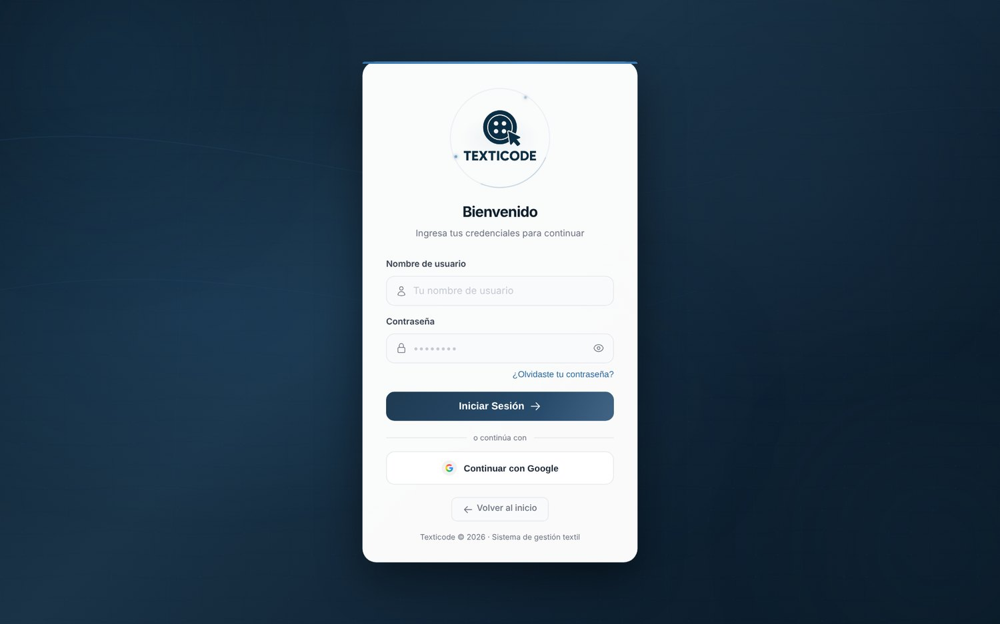

Si los datos no coinciden, aparece el mensaje *Credenciales incorrectas.* Por seguridad, el sistema no dice cuál dato está mal. Revisa que no tengas activadas las mayúsculas y vuelve a intentarlo.

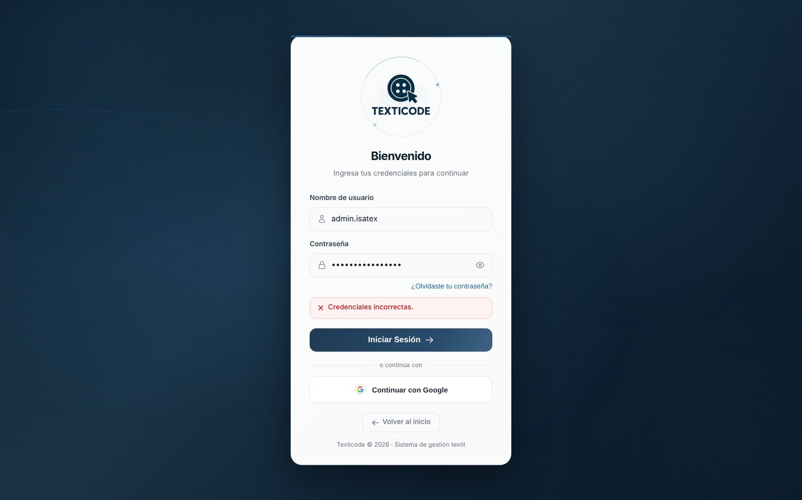

### 3.2 Iniciar sesión con Google (RF-002)

1. En la pantalla de inicio de sesión, haz clic en **Continuar con Google**.
2. Elige tu cuenta de Google y acepta los permisos.

✅ Entras al panel de tu rol. Solo funciona si tu correo de Google es **el mismo** que está registrado en Texticode; si no, aparece *No existe un usuario de Texticode con este correo de Google.*

### 3.3 Recuperar la contraseña (RF-006)

1. En la pantalla de inicio de sesión, haz clic en **¿Olvidaste tu contraseña?**
2. Escribe tu **correo electrónico registrado** y haz clic en **Enviar enlace**.
3. Abre el correo de Texticode y haz clic en el enlace. **El enlace vence en 1 hora y sirve una sola vez.**
4. Escribe la nueva contraseña dos veces, cumpliendo las reglas de la sección 2.4, y guárdala.

✅ El sistema confirma *Contraseña actualizada exitosamente* y puedes iniciar sesión con la nueva.

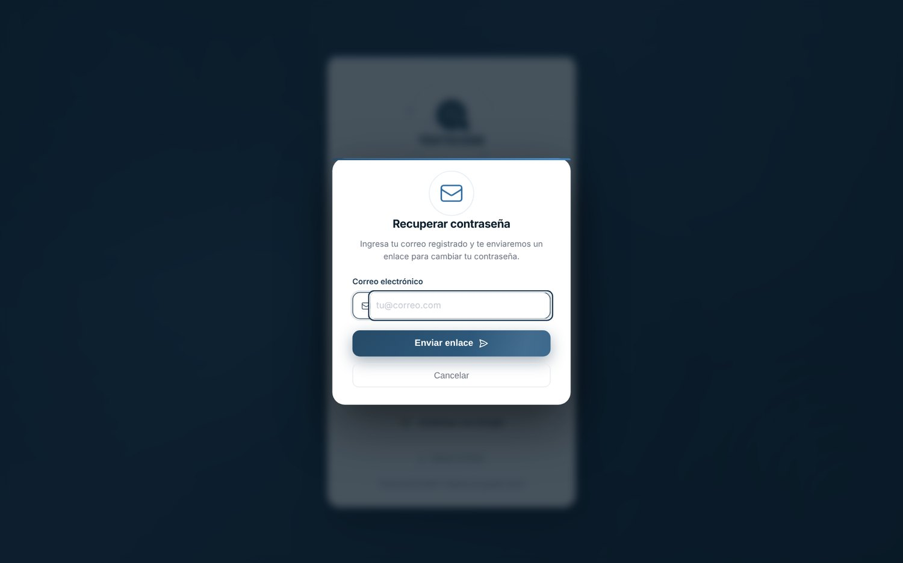

> **Notas.** Por seguridad, el mensaje es el mismo aunque el correo no exista. Si no ves el correo, revisa la carpeta de spam. Si pides demasiados enlaces seguidos, aparece *Demasiadas solicitudes de recuperación. Intenta de nuevo en una hora.* Si el enlace ya venció, aparece *El enlace es inválido o ya expiró. Solicita uno nuevo.*

### 3.4 Conoce la pantalla

Todas las pantallas internas comparten la misma organización:

| Zona | Para qué sirve |
|------|----------------|
| **Menú lateral** (izquierda) | Cambiar de módulo. La flecha **‹** lo contrae para ganar espacio; en celular se abre con el botón de menú |
| **Encabezado** | Título del módulo, buscador, filtros y el botón de acción principal (por ejemplo, **Nueva orden**) |
| **Tarjetas de indicadores** | Totales del módulo. En varias pantallas, al hacer clic en una tarjeta se filtra la lista por ese estado |
| **Lista o tablero** | Los registros, con íconos de acción: 👁 ver, ✏️ editar y 🗑 eliminar o desactivar |
| **Paginación** | Al final de las listas largas: elige cuántos registros ver por página y avanza con las flechas |
| **Tu perfil** (abajo a la izquierda) | Tu nombre y rol; al hacer clic se abre **Mi perfil** |
| **Cerrar sesión** | Debajo de tu perfil |
| **Avisos** | Mensajes que aparecen unos segundos en una esquina para confirmar una acción o informar un error |

### 3.5 Ver y editar tu perfil (RF-014, RF-053, RF-064)

1. Haz clic en tu nombre, abajo a la izquierda del menú.
2. Se abre el panel **Mi perfil** con tu correo, teléfono y usuario.
3. Haz clic en **Editar perfil**, cambia los datos que necesites y guarda.

✅ Tus datos quedan actualizados. Si cambias la contraseña, aplica la política de la sección 2.4. El operario y el cliente no pueden cambiar su propio rol.

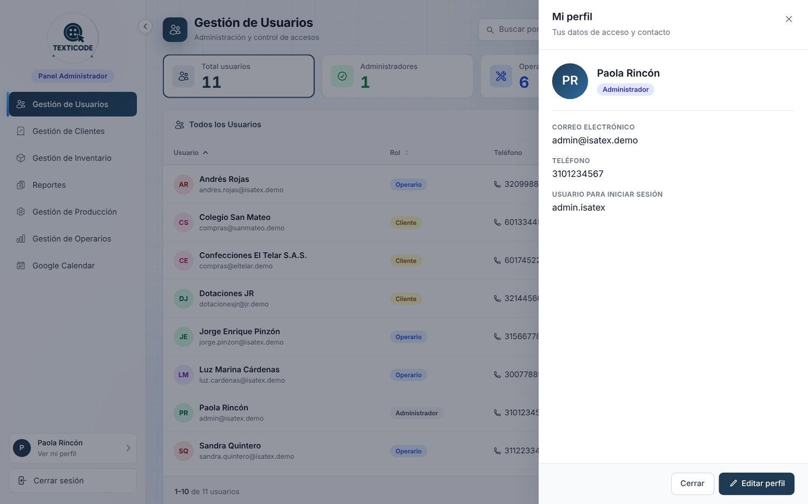

### 3.6 Cerrar sesión (RF-007)

1. Haz clic en **Cerrar sesión**, debajo de tu perfil.
2. Confirma en el mensaje que aparece.

✅ Vuelves a la pantalla de inicio de sesión. Si usas un computador compartido, **cierra siempre la sesión** al terminar.

### 3.7 Uso en el celular

Texticode se adapta a la pantalla del celular: el menú lateral se oculta y se abre con el botón de menú, y las listas se muestran como tarjetas. Es la forma recomendada para que los operarios reporten su avance desde la planta.

<table><tr><td align="center">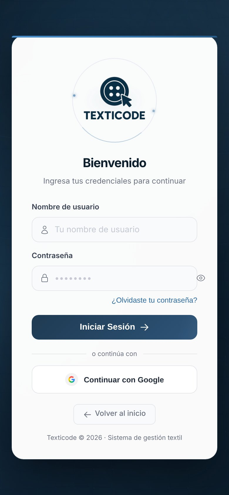 <em>Inicio de sesión en el celular</em></td><td align="center">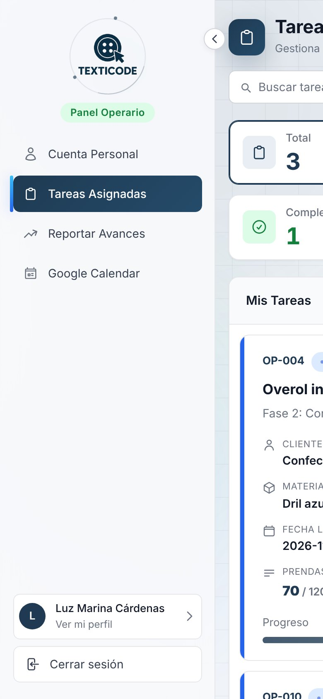 <em>Tareas del operario en el celular</em></td></tr></table>

---

## 4. Manual del administrador

El administrador de ISATEX controla toda la operación de su empresa. Solo ve y modifica los datos de ISATEX; nunca los de otras empresas de la plataforma.

### 4.1 Gestión de usuarios (RF-008 a RF-013)

Aquí se registra a todo el personal y a los clientes que usarán Texticode. Las tarjetas superiores muestran el total de usuarios, administradores, operarios y clientes.

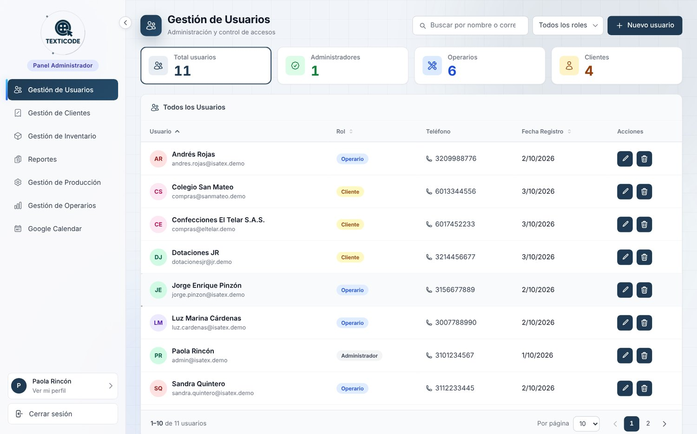

**Crear un usuario**

1. Haz clic en **Nuevo usuario**.
2. Completa **Nombre completo**, **Usuario para iniciar sesión**, **Teléfono** (10 dígitos), **Correo electrónico**, **Rol** (administrador, operario o cliente) y **Contraseña**.
3. Haz clic en **Crear usuario**.

✅ El usuario aparece en la lista y ya puede iniciar sesión. Entrégale su usuario y contraseña de forma privada y pídele que la cambie en su primer ingreso.

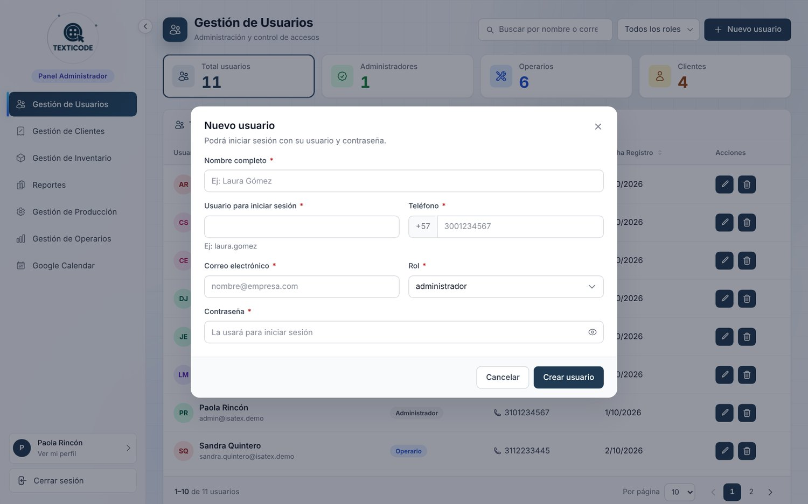

> **Importante (Ley 1581).** Antes de registrar a un empleado o a un cliente, ISATEX debe tener su **autorización** para tratar sus datos personales. El contrato de servicios (Anexo B) trae un modelo de autorización.

**Editar un usuario:** haz clic en ✏️ en la fila del usuario, cambia los datos y guarda. Las mismas reglas aplican: el correo y el usuario no se pueden repetir.

**Desactivar un usuario:** haz clic en 🗑 y confirma. ⚠️ El usuario deja de poder ingresar de inmediato, pero su historial (órdenes, fases y comprobantes) se conserva. Hazlo apenas una persona deje de trabajar con ISATEX.

**Buscar y filtrar:** usa el buscador (nombre o correo) y el filtro de rol. Haz clic en el título de una columna para ordenar por ella.

### 4.2 Gestión de clientes y comprobantes (RF-015 a RF-018)

Muestra los clientes activos con su correo, teléfono y número de comprobantes. Las tarjetas indican clientes activos, comprobantes emitidos y órdenes pendientes.

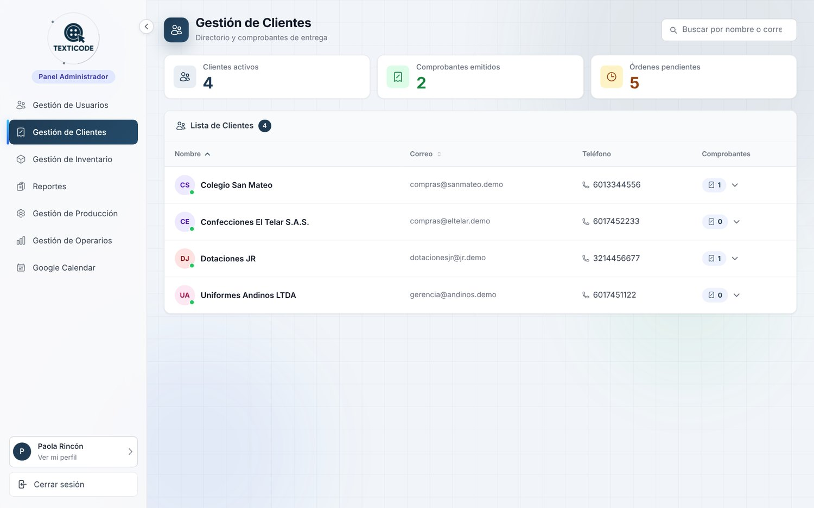

**Ver los comprobantes de un cliente**

1. Haz clic en la flecha de la columna **Comprobantes** del cliente.
2. Se despliegan los comprobantes de sus órdenes completadas, con número, fecha y estado.

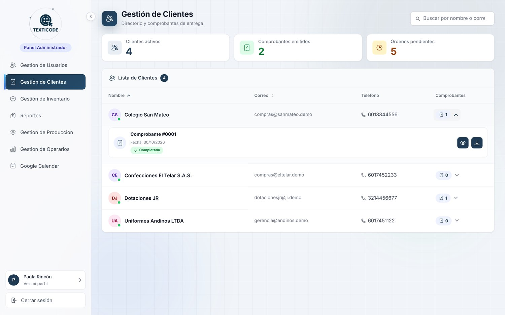

**Ver o descargar un comprobante**

1. Haz clic en 👁 para abrir el comprobante en el formato oficial: cliente, fechas, producto, cantidad, estado, observaciones y firmas.
2. Haz clic en **Descargar PDF** para guardarlo o enviarlo al cliente.

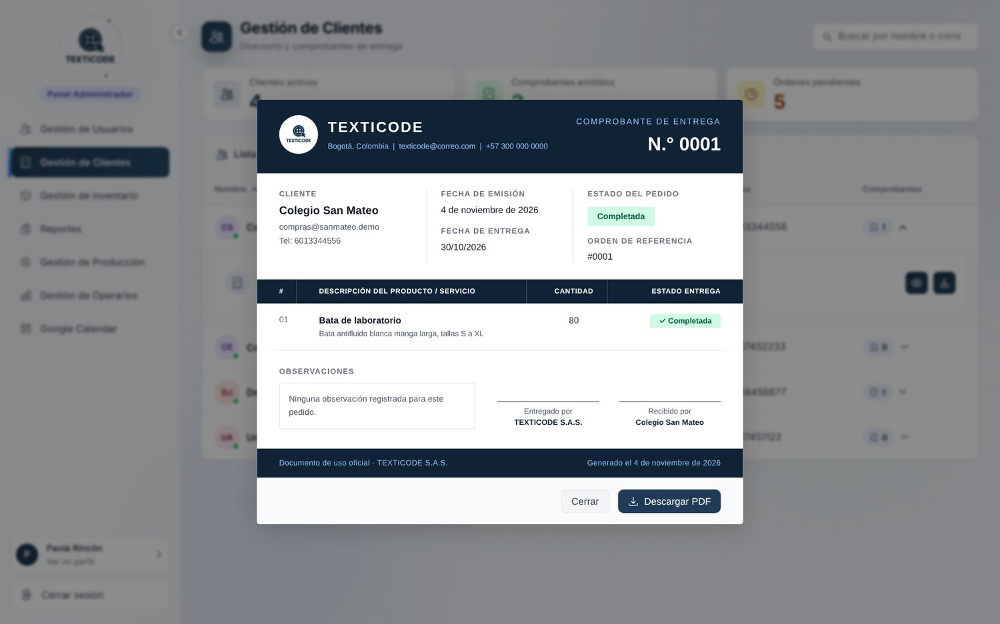

> **Nota.** Cada orden genera su comprobante automáticamente al crearla, en estado *Pendiente* (RF-032).

### 4.3 Gestión de inventario (RF-019 a RF-023)

Controla los materiales (telas, hilos y accesorios), su stock y sus alertas. El aviso naranja de la parte superior resume los materiales que necesitan reposición.

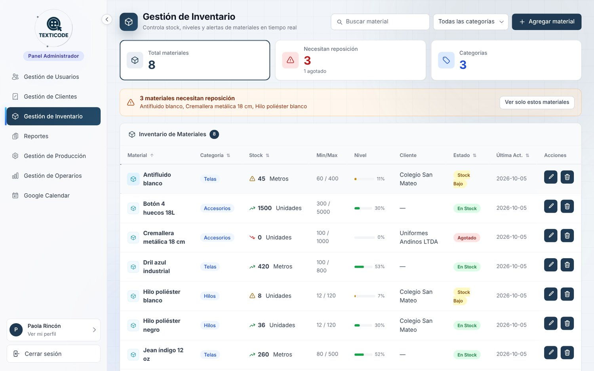

**Cómo se calcula el estado de cada material**

| Estado | Condición | Qué hacer |
|--------|-----------|-----------|
| **En Stock** | El stock es igual o mayor que el mínimo | Nada |
| **Stock Bajo** | El stock es menor que el mínimo | Programar la compra |
| **Agotado** | El stock es 0 | Comprar de inmediato: no se puede asignar a órdenes |

La barra de **Nivel** muestra el stock frente al máximo definido.

**Agregar un material**

1. Haz clic en **Agregar material**.
2. Completa **Nombre del material**, **Categoría** (Telas, Hilos o Accesorios) y **Unidad de medida** (Metros, Centímetros, Unidades, Rollos, Kilos o Gramos).
3. En **Stock**, escribe el **Stock actual**, el **Mínimo** (por debajo de este número se marca *Stock Bajo*) y el **Máximo**.
4. Si el material pertenece a un cliente específico, elígelo en **Cliente**; si no, deja *Sin cliente*.
5. Haz clic en **Agregar material**.

✅ El material aparece en la lista con su estado calculado, y el movimiento inicial queda en el historial (kárdex).

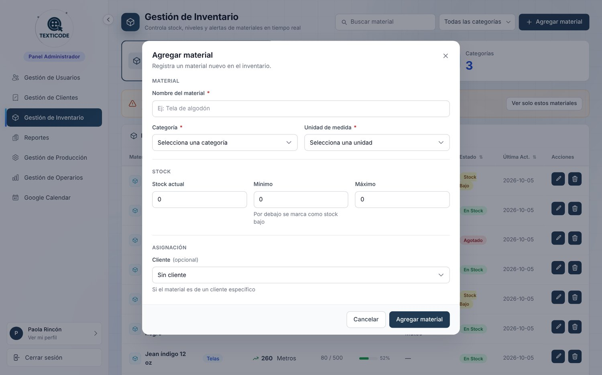

> **Nota.** El stock se registra en números enteros. Si necesitas decimales (por ejemplo, 12,5 metros), usa una unidad menor: 1.250 centímetros.

**Editar o eliminar:** usa ✏️ o 🗑. ⚠️ Al eliminar, el material deja de aparecer en el inventario y en las órdenes nuevas; las órdenes que ya lo usaron lo conservan.

**Buscar y filtrar:** busca por nombre, filtra por categoría o haz clic en **Ver solo estos materiales** en el aviso de reposición.

### 4.4 Gestión de producción (RF-024 a RF-034)

Es el corazón del sistema. Cada orden se muestra como una tarjeta con su número, prioridad, estado, cliente, número de fases, fecha límite y una barra con las prendas hechas frente a las pedidas.

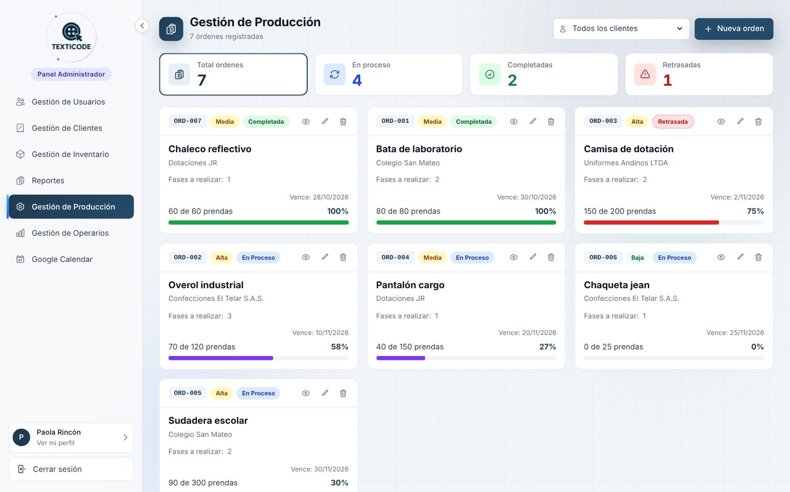

**Estados de una orden**

| Estado | Significado |
|--------|-------------|
| **En Proceso** | Estado inicial de toda orden nueva |
| **Retrasada** | El sistema la marca solo cuando pasa la fecha límite sin terminarse |
| **Completada** | Todas sus fases se completaron (o el administrador la marcó así) |

**Crear una orden de producción**

1. Haz clic en **Nueva orden**.
2. En **Datos de la orden**, elige el **Cliente** y escribe **Producto** (opcional), **Descripción**, **Cantidad de prendas**, **Fecha límite**, **Prioridad** (Alta, Media o Baja) y **Dificultad**.
3. En **Materiales**, elige un material, escribe la cantidad y haz clic en **Agregar**. Repite para cada material. Primero debes elegir el cliente: la lista muestra los materiales disponibles para él.
4. En **Operarios y fases**, elige el **Operario**, el **N.° de fase** y escribe **Qué hace en esta fase** (por ejemplo, *Corte*). Haz clic en **Agregar fase**. Repite para cada fase.
5. Haz clic en **Crear orden**.

✅ La orden aparece en el tablero en estado *En Proceso*; el stock de los materiales se descuenta, se genera su comprobante y cada operario recibe un correo con su tarea.

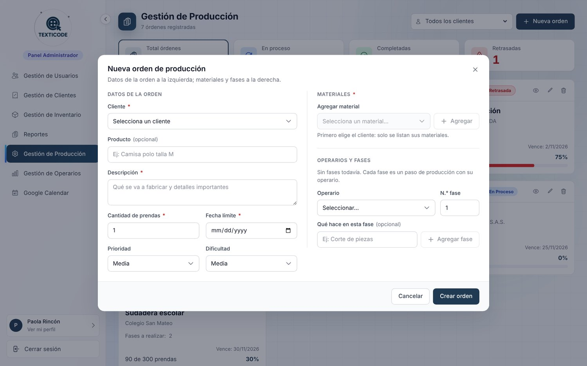

> **Si el stock no alcanza.** El sistema no deja asignar más material del disponible y muestra la cantidad máxima posible (RF-031). Registra primero la compra en el inventario.

**Ver el detalle de una orden:** haz clic en 👁 en la tarjeta. Verás el progreso de fabricación, el cliente, el material principal, la dificultad, las fechas, la descripción, las fases con su operario y la cantidad que cada uno ha realizado.

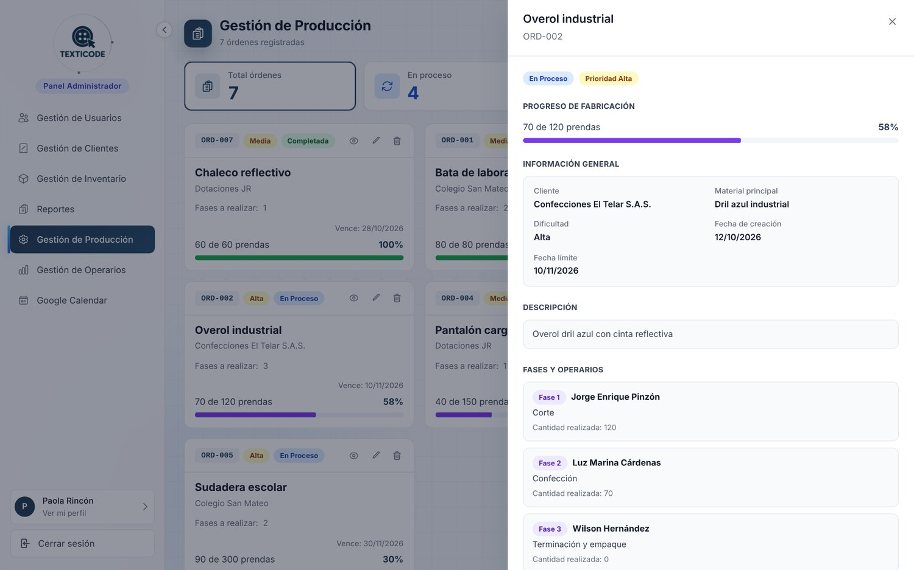

**Editar una orden:** haz clic en ✏️. Puedes cambiar datos, materiales, fases y el estado. Una fase ya **completada** no se puede quitar.

**Eliminar una orden:** haz clic en 🗑 y confirma. ⚠️ Se eliminan también sus fases, materiales asignados y comprobante. Úsalo solo para órdenes creadas por error.

**Filtrar:** usa el selector de cliente, o haz clic en las tarjetas *En proceso*, *Completadas* o *Retrasadas*. Las órdenes se ordenan por fecha límite.

### 4.5 Gestión de operarios: eficiencia y carga de trabajo (RF-035 a RF-040)

Tiene dos pestañas.

**Pestaña Eficiencia y Rendimiento.** Muestra el ranking de operarios con prendas por día, total producido, órdenes en retraso, completadas y su rendimiento.

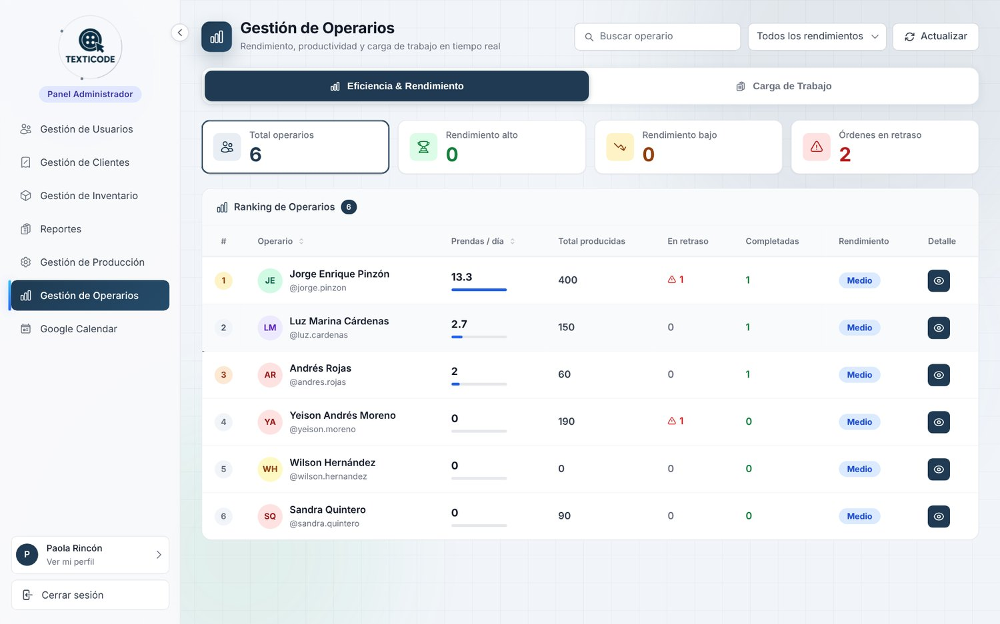

| Rendimiento | Cómo se calcula |
|-------------|-----------------|
| **Alto** | El operario produce el 105 % o más de su propio promedio de los 3 periodos anteriores |
| **Bajo** | Produce menos del 85 % de su promedio **y** bajó frente al periodo anterior |
| **Medio** | Los demás casos, incluidos los operarios nuevos sin historial suficiente |

El rendimiento compara a cada operario **consigo mismo**, no con sus compañeros. En el detalle (👁) verás el avance de cada orden, la tendencia frente al periodo anterior y las **observaciones**: haz clic en **Ver / agregar observaciones** para registrar una nota sobre una orden.

**Pestaña Carga de Trabajo.** Clasifica a cada operario según sus órdenes y fases activas:

| Clasificación | Órdenes o fases activas |
|---------------|-------------------------|
| **Disponible** | 4 o menos |
| **Normal** | Entre 5 y 7 |
| **Sobrecargado** | 8 o más |

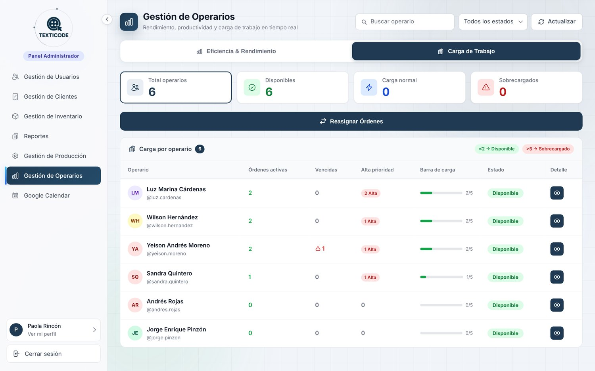

**Reasignar órdenes de un operario sobrecargado**

1. En la pestaña **Carga de Trabajo**, haz clic en **Reasignar Órdenes** o en el detalle del operario sobrecargado.
2. El sistema sugiere operarios disponibles o normales.
3. Elige el operario de destino y confirma.

✅ La carga de los dos operarios se recalcula.

### 4.6 Reportes (RF-041 a RF-043)

Las tarjetas muestran pedidos totales, completados, tasa de completación y pedidos en proceso, con un gráfico de los últimos 6 meses.

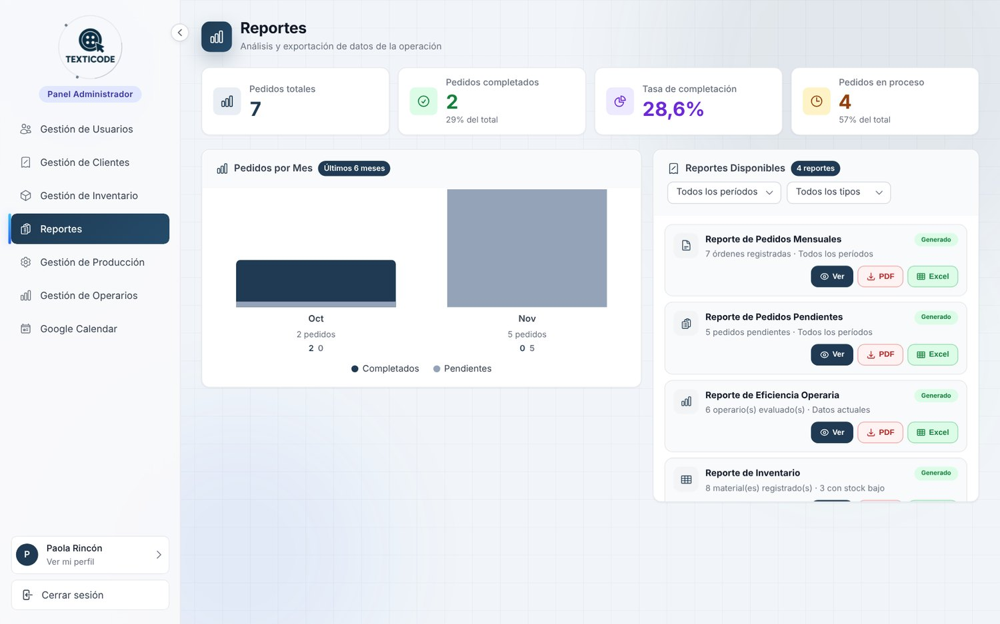

| Reporte | Contenido |
|---------|-----------|
| Pedidos mensuales | Órdenes registradas en el periodo |
| Pedidos pendientes | Órdenes sin completar |
| Eficiencia operaria | Producción y rendimiento por operario |
| Inventario | Stock de los materiales; para un mes pasado, se reconstruye con el historial de movimientos |

**Generar un reporte**

1. Elige el **periodo** y, si quieres, el **tipo** en los filtros de *Reportes Disponibles*.
2. En el reporte, haz clic en **Ver** (vista previa), **PDF** (descarga) o **Excel** (exportación).

✅ El archivo se descarga en tu computador, listo para imprimir o enviar.

### 4.7 Google Calendar (RF-044 a RF-047)

Lleva las fechas de entrega de las órdenes al calendario de Google de cada usuario, con recordatorios.

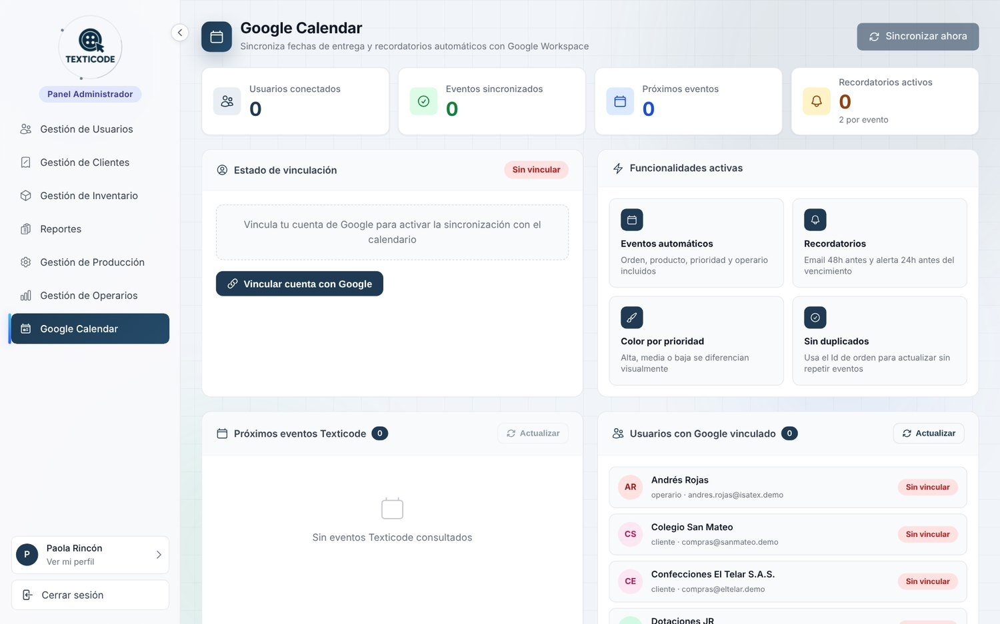

**Vincular tu cuenta**

1. Entra a **Google Calendar** en el menú.
2. Haz clic en **Vincular cuenta con Google**, elige tu cuenta y acepta los permisos.
3. Haz clic en **Sincronizar ahora**.

✅ Las fechas límite aparecen como eventos en tu calendario, sin duplicarse; si una fecha cambia, el evento se actualiza.

Como administrador, en **Usuarios con Google vinculado** ves quién tiene Google conectado y puedes **desvincular** a un usuario (por ejemplo, cuando deja la empresa).

---

## 5. Manual del operario

### 5.1 Cuenta personal (RF-052 a RF-054)

Muestra tus datos, tus órdenes completadas, en proceso y totales, y una **línea de tiempo** con tu actividad reciente.

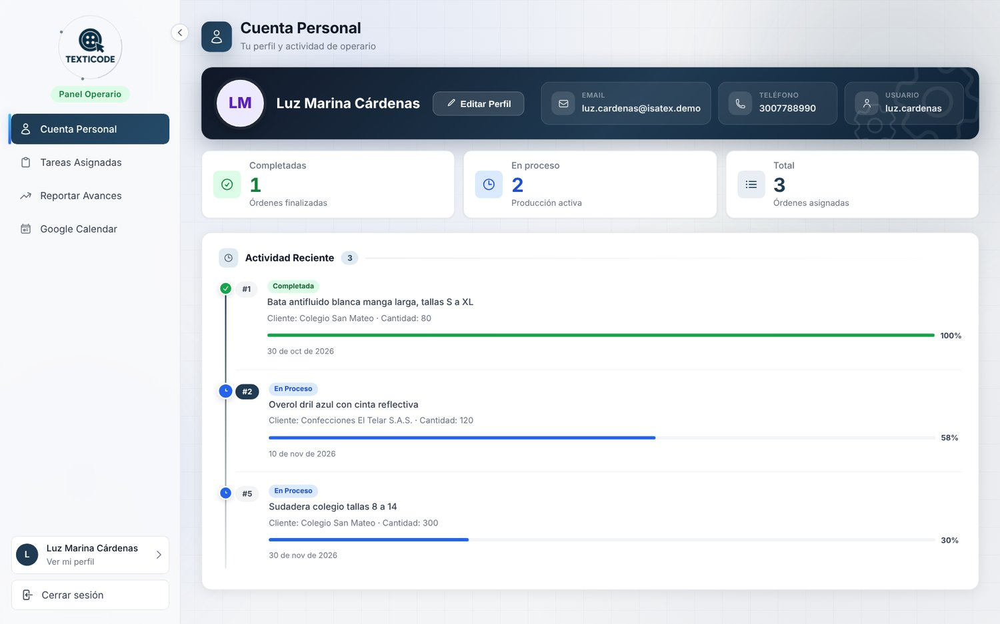

### 5.2 Tareas asignadas (RF-055 a RF-059)

Cada tarjeta es una fase que te asignaron, con el producto, la descripción de la fase, el material, el cliente, la **fecha límite** (en rojo si ya venció), la **prioridad** y una barra de progreso. Usa el buscador y el filtro de prioridad, o haz clic en las tarjetas de arriba para ver solo las tareas en proceso, completadas o retrasadas.

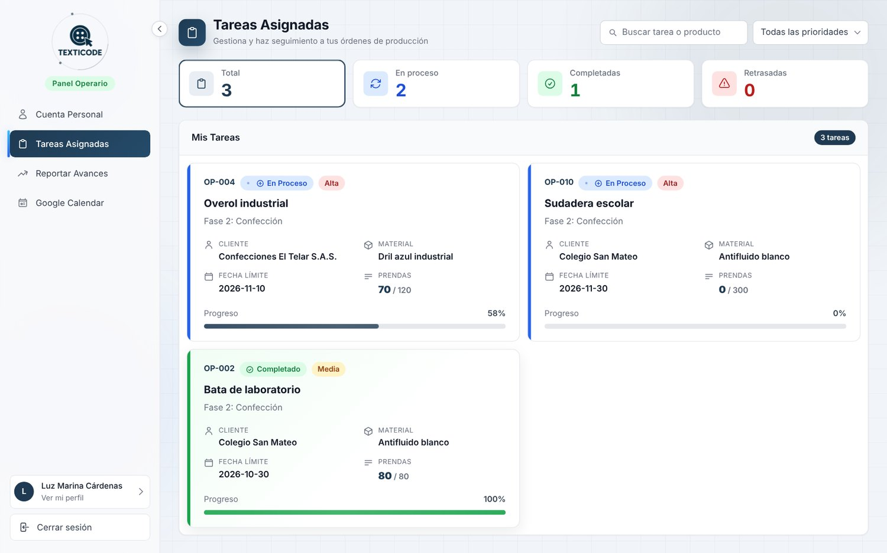

> **Prioridad.** Atiende primero las tareas de prioridad **Alta** y las que están más cerca de su fecha límite.

### 5.3 Reportar avance (RF-060 y RF-061)

1. Entra a **Reportar Avances**. En la pestaña **Órdenes Activas** verás cada fase con las prendas realizadas y tu cuota.
2. Haz clic en **Reportar avance** en la fase que trabajaste.
3. En **Prendas terminadas hasta ahora**, escribe el **total acumulado** de prendas que llevas (no solo las de hoy). Si terminaste todas, haz clic en **Todas**.
4. Si quieres, escribe una **Nota** (por ejemplo, *Faltan botones para terminar 5 prendas*).
5. Haz clic en **Guardar avance**.

✅ El porcentaje se actualiza. Al llegar a la cuota, la fase pasa a **Completada**; cuando se completan todas las fases de la orden, la orden se completa y el cliente recibe un correo.

<table><tr><td>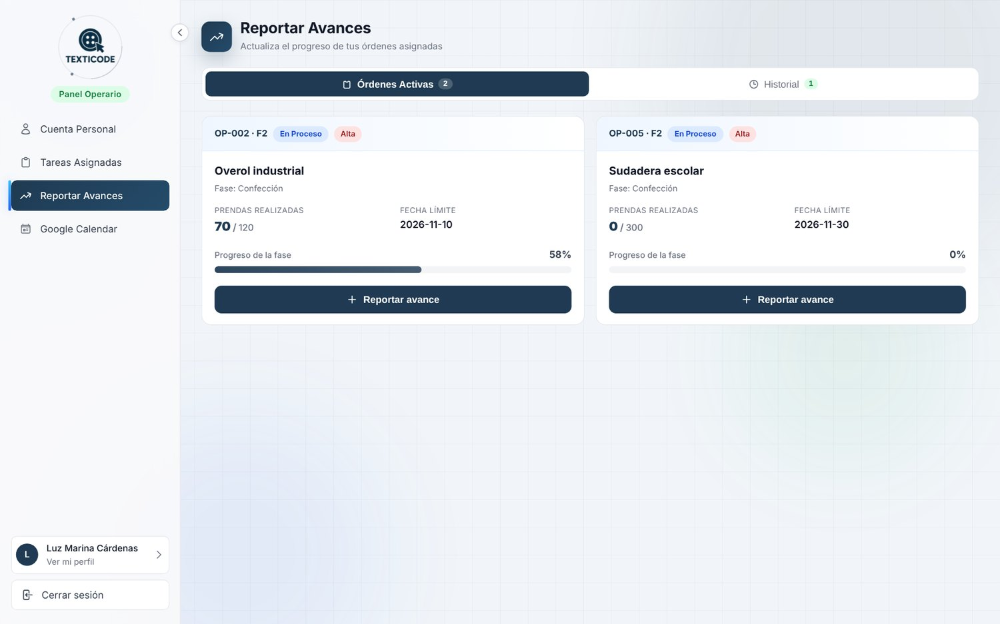</td><td>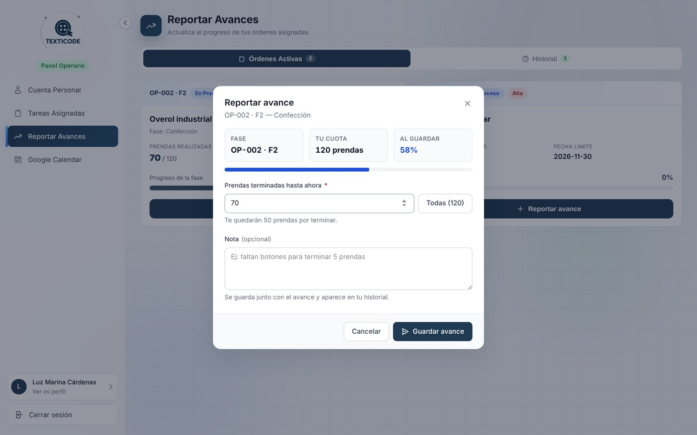</td></tr><tr><td align="center"><em>Fases activas</em></td><td align="center"><em>Ventana Reportar avance</em></td></tr></table>

> **Ejemplo.** Tu cuota es de 120 prendas. El lunes terminas 40 y reportas *40*. El martes terminas 30 más y reportas *70*, no *30*.

### 5.4 Historial (RF-062)

En **Reportar Avances › Historial** ves las fases que completaste, con su fecha y la nota que dejaste.

### 5.5 Google Calendar

Igual que en la sección 4.7: vincula tu cuenta para ver en tu calendario las fechas de entrega de tus tareas.

---

## 6. Manual del cliente

### 6.1 Cuenta personal y comprobantes (RF-063 a RF-065, RF-070)

Muestra tus datos, tus órdenes totales, entregadas y pendientes, y la lista **Mis Comprobantes de Entrega**.

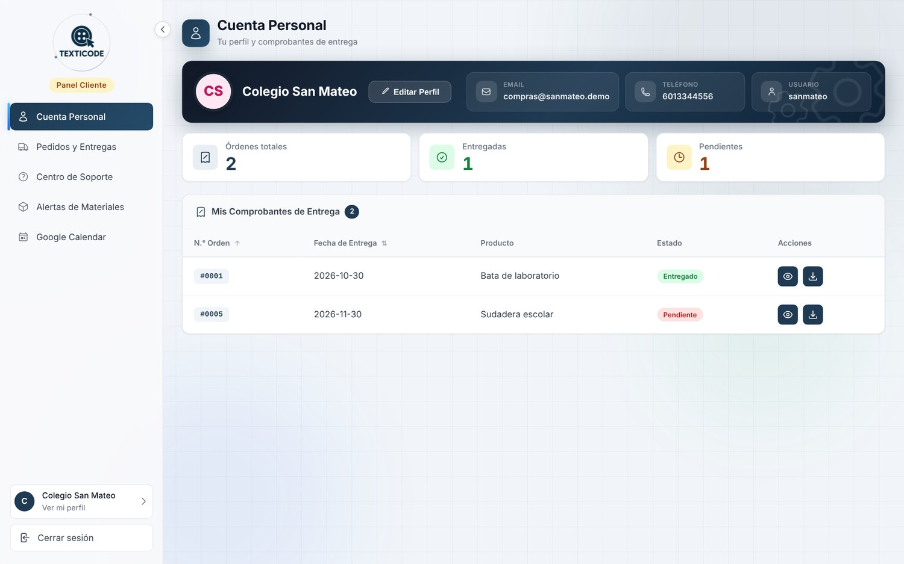

**Ver o descargar un comprobante:** haz clic en 👁 para verlo y en **Descargar PDF** para guardarlo.

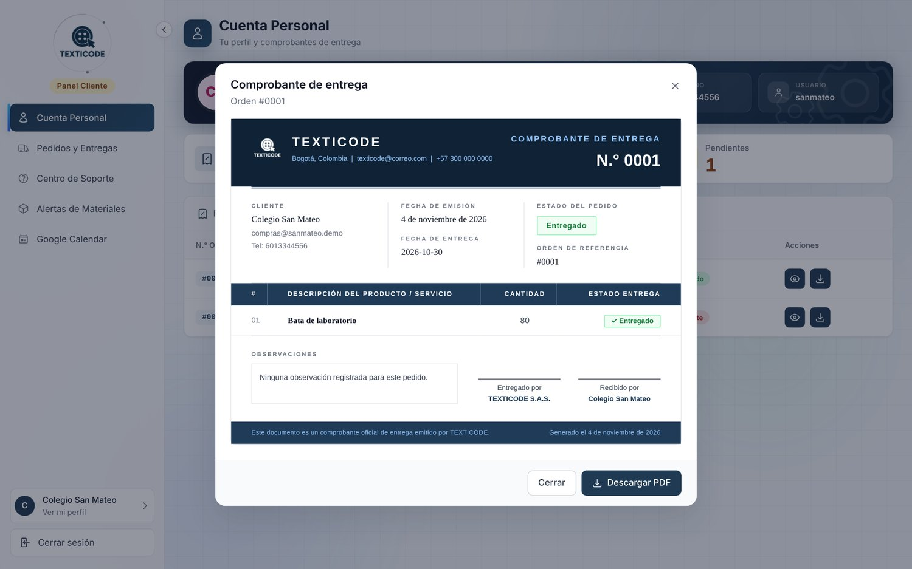

### 6.2 Pedidos y entregas (RF-066 a RF-070)

Cada pedido muestra el material, la cantidad pedida, la fecha límite, las prendas realizadas, una **barra de progreso** y un aviso con su estado:

| Aviso | Significado |
|-------|-------------|
| *En producción — faltan N prendas por fabricar* | Tu pedido avanza; la barra muestra cuánto falta |
| *Orden completada — todas las prendas han sido fabricadas* | Ya puedes descargar el comprobante en PDF |
| *Retrasada* | Pasó la fecha límite; ISATEX le da seguimiento prioritario |

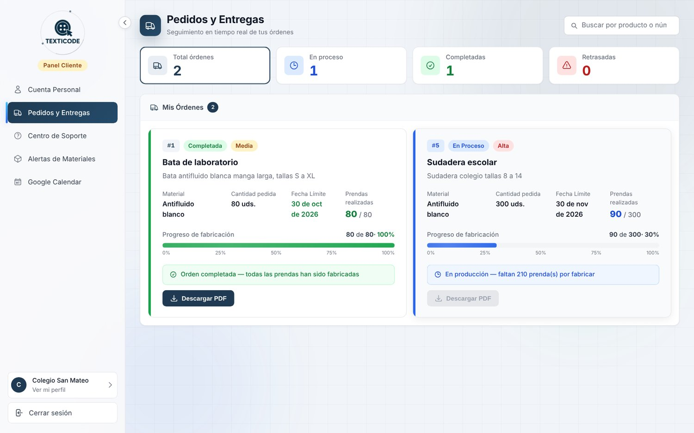

Busca por producto o número, o haz clic en las tarjetas para ver solo los pedidos en proceso, completados o retrasados. Cuando tu pedido se completa, recibes un **correo de aviso** (RF-071).

### 6.3 Alertas de materiales (RF-072)

Si ISATEX guarda materiales a tu nombre, aquí ves su estado (disponible, stock bajo o agotado) y su nivel frente al máximo.

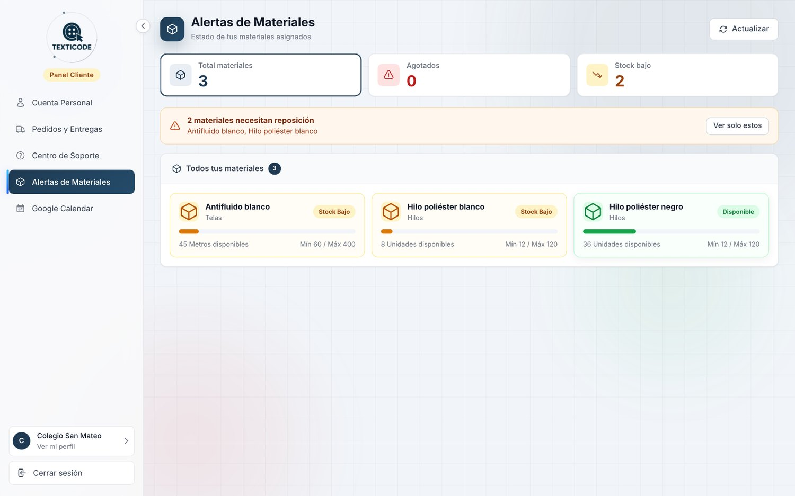

### 6.4 Centro de soporte (RF-073 a RF-075)

Reúne los canales de contacto (teléfono, WhatsApp, correo y horario) y las **preguntas frecuentes** sobre pedidos, comprobantes y progreso. Desde aquí puedes llamar, escribir por WhatsApp o enviar un correo con un clic.

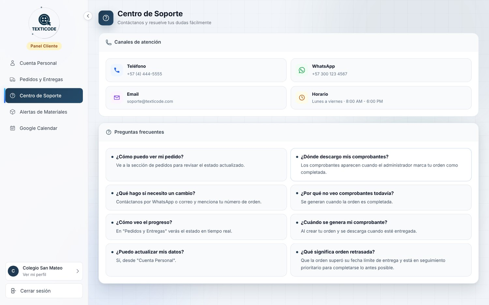

---

## 7. Manual del superadmin (equipo Texticode)

El superadmin administra la plataforma para todas las empresas. **No opera dentro de ninguna empresa** ni ve sus órdenes o inventarios.

### 7.1 Gestión de empresas y sus administradores (RF-048, RF-049, RF-051)

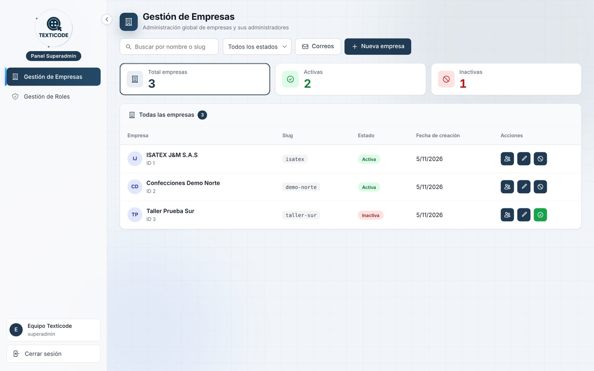

| Acción | Cómo |
|--------|------|
| **Crear empresa** | **Nueva empresa**: nombre, slug (identificador único), nombre comercial, correo de respuestas y datos de su primer administrador |
| **Editar empresa** | Ícono **Editar** de la fila |
| **Ver y editar administradores** | Ícono **Administradores**: editar, activar o desactivar a cada uno |
| **Desactivar empresa** | Ícono **Desactivar** y escribir el nombre de la empresa para confirmar. ⚠️ Ningún usuario de esa empresa podrá ingresar hasta que se reactive |
| **Estadísticas de correo** | Botón **Correos**: correos enviados por día y por empresa, para vigilar el límite del plan de SendGrid |

### 7.2 Gestión de roles (RF-050)

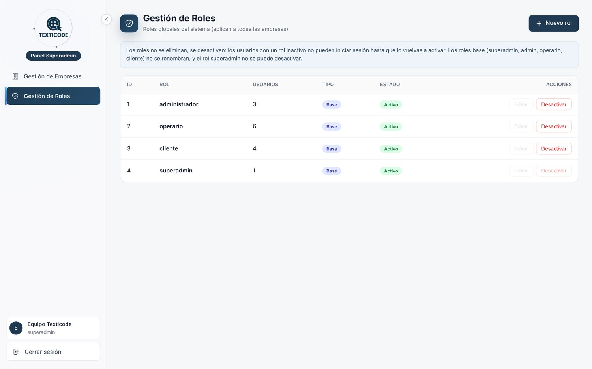

Los roles **no se eliminan, se desactivan**: los usuarios con un rol inactivo no pueden iniciar sesión hasta que se reactive. Los roles base (administrador, operario, cliente y superadmin) no se pueden renombrar, y el rol superadmin no se puede desactivar.

---

## 8. Flujo completo de un pedido

Así trabajan los tres roles sobre un mismo pedido, desde que el cliente lo encarga hasta que descarga su comprobante:

| # | Rol | Acción en Texticode | Sección |
|---|-----|---------------------|---------|
| 1 | Administrador | Verifica que el cliente exista en **Gestión de Usuarios** (si no, lo crea con rol cliente) | 4.1 |
| 2 | Administrador | Revisa en **Inventario** que haya material suficiente; si está en *Stock Bajo*, registra la compra | 4.3 |
| 3 | Administrador | Crea la orden en **Gestión de Producción** con materiales y fases | 4.4 |
| 4 | Sistema | Descuenta el stock, genera el comprobante *Pendiente* y envía un correo a cada operario | — |
| 5 | Operario | Ve la tarea en **Tareas Asignadas** y reporta su avance en **Reportar Avances** | 5.2 y 5.3 |
| 6 | Cliente | Sigue el progreso en **Pedidos y Entregas** | 6.2 |
| 7 | Administrador | Vigila retrasos en **Producción** y la carga del equipo en **Gestión de Operarios**; reasigna si hace falta | 4.4 y 4.5 |
| 8 | Sistema | Al completarse todas las fases, la orden pasa a *Completada* y el cliente recibe un correo | — |
| 9 | Cliente / Administrador | Descargan el **comprobante de entrega** en PDF | 6.1 y 4.2 |
| 10 | Administrador | Revisa los indicadores y genera el reporte del mes en **Reportes** | 4.6 |

---

## 9. Mensajes del sistema y solución de problemas

| Mensaje o situación | Causa | Qué hacer |
|---------------------|-------|-----------|
| *Credenciales incorrectas.* | Usuario o contraseña mal escritos | Revisa mayúsculas y vuelve a intentar; si no la recuerdas, usa **¿Olvidaste tu contraseña?** |
| *Por favor completa todos los campos.* | Falta el usuario o la contraseña | Completa ambos campos |
| *Demasiados intentos. Intenta de nuevo más tarde.* | Más de 10 intentos fallidos en 15 minutos | Espera 15 minutos o recupera la contraseña |
| *Sesión expirada.* | Pasaron 8 horas desde el ingreso | Vuelve a iniciar sesión |
| *La empresa está inactiva.* | La empresa fue desactivada en la plataforma | Comunícate con soporte de Texticode |
| *Membresía empresarial inactiva o no autorizada.* | Tu usuario fue desactivado | Comunícate con el administrador de ISATEX |
| *No tienes permisos para esta operación.* | La función no corresponde a tu rol | Pide al administrador que la haga o revise tu rol |
| *No existe un usuario de Texticode con este correo de Google.* | Tu correo de Google no es el registrado | Inicia sesión con usuario y contraseña, o pide que actualicen tu correo |
| *El enlace es inválido o ya expiró. Solicita uno nuevo.* | El enlace de recuperación venció (1 hora) o ya se usó | Pide un enlace nuevo |
| *La contraseña debe tener al menos…* | La contraseña no cumple la política | Usa 8 caracteres o más, con mayúscula, número y carácter especial |
| No llega el correo de recuperación o de aviso | Filtro de spam o correo mal registrado | Revisa spam; pide al administrador verificar tu correo |
| No puedo asignar un material a la orden | No hay stock suficiente | Registra la compra en Inventario o reduce la cantidad |
| No puedo quitar una fase de una orden | La fase ya está completada | Es el comportamiento esperado: las fases completadas no se borran |
| La vista previa de un reporte no carga | El navegador no pudo descargar el componente de PDF | Revisa la conexión, recarga la página o usa **Excel** |
| La página sale en blanco o no carga | Conexión o caché del navegador | Recarga con Ctrl + F5; si sigue, reporta a soporte (sección 11) |

---

## 10. Preguntas frecuentes

**¿Puedo entrar desde el celular?** Sí. Texticode funciona en el navegador del celular; no necesitas instalar nada.

**¿Puedo tener la misma cuenta en dos empresas?** No. Cada usuario pertenece a una sola empresa.

**¿Qué pasa si se me cierra la sesión mientras trabajo?** Lo que ya guardaste no se pierde. Vuelve a iniciar sesión y continúa.

**¿Por qué una orden pasó sola a "Retrasada"?** Porque venció su fecha límite sin completarse. Al terminarla, pasa a *Completada*.

**¿Por qué el rendimiento de un operario sale "Medio" si es nuevo?** Porque todavía no tiene 3 periodos de historial para comparar.

**¿Cuándo recibe el cliente un correo?** Cuando su orden pasa a *Completada*. El operario recibe uno cada vez que le asignan una fase.

**¿Puedo recuperar un usuario desactivado?** Hoy la lista solo muestra usuarios activos; pide a soporte de Texticode que lo reactive (ver Anexo B).

**¿Se pierde la información si se cae el sistema?** No. La base de datos tiene copia diaria y mensual, y la restauración se prueba cada trimestre (Plan de respaldo y recuperación).

**¿Quién puede ver mis datos?** Solo el personal autorizado de ISATEX según su rol, y el equipo Texticode para prestar el servicio, con deber de confidencialidad.

---

## 11. Soporte técnico

### 11.1 Canales y horario

| Canal | Dato |
|-------|------|
| Correo | Texticode2026@gmail.com |
| WhatsApp y teléfono | 322 442 1303 |
| Horario | Lunes a viernes, 8:00 a.m. a 6:00 p.m. |
| Mantenimiento programado | Domingos de 11:00 p.m. a 2:00 a.m., con aviso de 48 horas |

### 11.2 Tiempos de atención

| Gravedad | Ejemplo | Respuesta | Solución |
|----------|---------|-----------|----------|
| **Crítica** | Nadie puede entrar al sistema | 1 hora hábil | 4 horas hábiles |
| **Alta** | Producción o inventario no funcionan | 4 horas hábiles | 1 día hábil |
| **Media** | Falla parcial con alternativa | 1 día hábil | 3 días hábiles |
| **Baja** | Dudas de uso o ajustes menores | 2 días hábiles | 7 días hábiles |

**Al reportar un problema, incluye:** tu nombre y rol, la pantalla donde ocurrió, qué estabas haciendo, el mensaje exacto (o una captura de pantalla), la fecha y hora, y el número de la orden o el nombre del material si aplica. **Nunca envíes tu contraseña.**

### 11.3 Tus datos personales

Si quieres conocer, actualizar, rectificar o suprimir tus datos, o revocar tu autorización, dirígete a **ISATEX J&M S.A.S**, responsable del tratamiento, por los canales de su política de tratamiento de datos. ISATEX responde las consultas en un máximo de **10 días hábiles** y los reclamos en **15 días hábiles** (Ley 1581 de 2012, arts. 14 y 15). Si recibes un correo sospechoso a nombre de Texticode que te pide tu contraseña, no respondas y repórtalo a soporte.

---

## 12. Glosario

| Término | Significado |
|---------|-------------|
| **Orden de producción** | Pedido de un cliente: producto, cantidad, materiales, prioridad, dificultad y fecha límite |
| **Fase** | Etapa de una orden (corte, confección, terminación…) asignada a un operario con una cuota de prendas |
| **Cuota** | Número de prendas que el operario debe terminar en su fase |
| **Comprobante de entrega** | Documento PDF que certifica la entrega de una orden; estado *Pendiente* o *Entregado* |
| **Stock mínimo / máximo** | Límites que definen las alertas de *Stock Bajo* y la barra de nivel |
| **Kárdex** | Historial de entradas y salidas de cada material |
| **Rendimiento** | Comparación de la producción de un operario con su propio promedio (Alto, Medio, Bajo) |
| **Carga de trabajo** | Número de órdenes y fases activas de un operario |
| **Slug** | Identificador corto y único de una empresa en la plataforma |
| **Sincronizar** | Copiar las fechas de entrega de Texticode al calendario de Google |
| **Responsable / Encargado** | Quien decide sobre los datos personales (ISATEX) y quien los trata por su cuenta (Texticode) |

---

## Anexo A · Funciones por rol y requerimiento (02.2)

| Función | Admin | Operario | Cliente | Superadmin | RF |
|---------|:-----:|:--------:|:-------:|:----------:|----|
| Iniciar sesión, con Google, recuperar contraseña y cerrar sesión | ✅ | ✅ | ✅ | ✅ | RF-001 a RF-007 |
| Ver y editar mi perfil | ✅ | ✅ | ✅ | — | RF-014, RF-052, RF-053, RF-063, RF-064 |
| Crear, editar y desactivar usuarios | ✅ | — | — | — | RF-008 a RF-013 |
| Consultar clientes y comprobantes | ✅ | — | Los suyos | — | RF-015 a RF-018, RF-070 |
| Gestionar inventario | ✅ | — | — | — | RF-019 a RF-023 |
| Ver alertas de sus materiales | — | — | ✅ | — | RF-072 |
| Crear, editar y eliminar órdenes | ✅ | — | — | — | RF-024 a RF-034 |
| Ver tareas y reportar avance | — | ✅ | — | — | RF-055 a RF-062 |
| Seguir pedidos y su progreso | — | — | ✅ | — | RF-065 a RF-069 |
| Eficiencia, carga y reasignación | ✅ | — | — | — | RF-035 a RF-040 |
| Reportes PDF y Excel | ✅ | — | — | — | RF-041 a RF-043 |
| Google Calendar | ✅ | ✅ | ✅ | — | RF-044 a RF-047 |
| Centro de soporte | — | — | ✅ | — | RF-073 a RF-075 |
| Empresas, administradores, roles y correos | — | — | — | ✅ | RF-048 a RF-051 |

---

## Anexo B · Observaciones para el equipo de desarrollo

Al documentar el sistema se encontraron diferencias entre las pantallas y los demás informes. Se registran para corregirlas antes de la entrega a ISATEX:

| # | Pantalla | Observación | Acción sugerida |
|---|----------|-------------|-----------------|
| 1 | Centro de soporte (cliente) | Muestra datos de contacto de ejemplo (+57 (4) 444-5555, +57 300 123 4567, soporte@texticode.com) que no coinciden con los del contrato (322 442 1303 y Texticode2026@gmail.com) | Usar los canales oficiales de la sección 11.1 |
| 2 | Inicio de sesión | El campo dice *Nombre de usuario*, pero también acepta el correo | Cambiar la etiqueta a *Usuario o correo* |
| 3 | Página de inicio | Dice *49 requisitos funcionales* y *7 módulos* | Actualizar a 75 requerimientos y 11 módulos |
| 4 | Reportes | La vista previa necesita descargar un componente de PDF desde internet; sin acceso, muestra un error | Incluir el componente en la aplicación o mostrar un mensaje más claro |
| 5 | Gestión de usuarios | La lista solo muestra usuarios activos; no se puede reactivar a uno desactivado desde la pantalla | Agregar un filtro de inactivos con opción de reactivar (posible RF-076) |

---

## Anexo C · Fuentes

1. ISO/IEC/IEEE. *ISO/IEC/IEEE 26514:2022, Systems and software engineering — Design and development of information for users.* https://www.iso.org/standard/77451.html
2. Equipo Texticode. *02.2 Especificación de requerimientos — ISATEX J&M S.A.S*, versión 1.0 (26/10/2026).
3. Equipo Texticode. *Contrato de servicios 03.1 — ISATEX J&M S.A.S*, versión 1.0 (26/10/2026): canales de soporte, SLA y protección de datos.
4. Equipo Texticode. *Arquitectura técnica*, versión 1.1, y *Plan de respaldo y recuperación de datos*, versión 1.0.
5. Código fuente de Texticode, rama *kvnwagner_rama* (commit `ca3bce6`, 28/10/2026): textos, mensajes y reglas del sistema citados en este manual.
6. Congreso de la República de Colombia. *Ley 1581 de 2012*, protección de datos personales. https://relatoria.colombiacompra.gov.co/normativa/ley-1581-de-2012/
